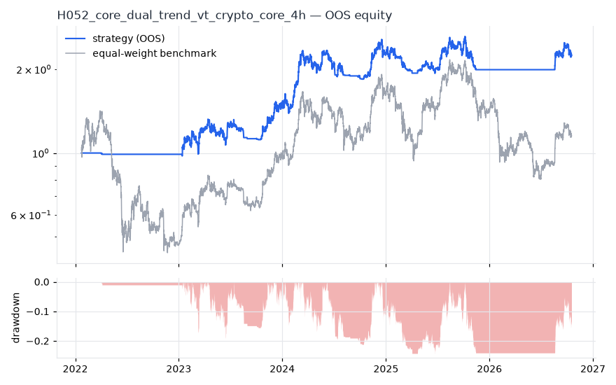
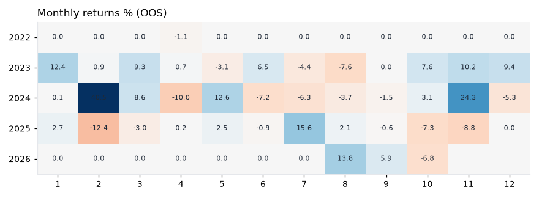

# H052 — core_dual_trend_vt on crypto_core [4h]  ✅ ACCEPT

- Kind: strategy · Source: Faber (2007) SMA200 + Moskowitz, Ooi & Pedersen (2012) TSMOM + Moreira & Muir (2017) vol target
- For system: `karma_perp_bot`
- Data: 2018-01-11 08:00:00 → 2026-10-17 12:00:00 · 2 assets · 2191.6 bars/year · survivorship mask: False
- Costs: {'commission': 0.0006, 'slippage': 0.0005, 'funding_annual': 0.08, 'borrow_annual': 0.0}
- Variants tried (DSR trials): 1 (failed: 0)
- Final variant: `core_dual_trend_vt|`

## Verdict reasons
- all gate checks passed

## Walk-forward out-of-sample


| Metric | Strategy | Equal-weight benchmark |
|---|---|---|
| years | 4.73 | 4.73 |
| cagr | 0.1855 | 0.0304 |
| vol | 0.259 | 0.5502 |
| sharpe | 0.787 | 0.33 |
| sharpe_excess_rf | 0.635 | None |
| sortino | 0.909 | 0.464 |
| max_dd | -0.2437 | -0.6906 |
| max_dd_bars | 2255 | 4210 |
| calmar | 0.761 | 0.044 |
| ulcer | 0.1404 | 0.4063 |
| var95 | -0.0076 | -0.0181 |
| cvar95 | -0.014 | -0.029 |
| omega | 1.073 | 1.022 |
| tail_ratio | 1.059 | 0.99 |
| skew | -0.077 | -0.085 |
| kurtosis | 20.117 | 7.43 |
| hit_rate | 0.279 | 0.512 |
| turnover_ann | 12.83 | None |

- **Gate Sharpe (excess of T-bill): 0.635**
- Deflated Sharpe: **0.956** · PBO: **None** · Reality Check p: **None**
- PSR 0.956 · Info ratio 0.051 · Beta 0.296 · Up/Down capture 0.35/0.333
- Sharpe with 2× costs: 0.732 · Walk-forward efficiency: 0.706
- Bootstrap: {'p_sharpe_pos': 0.955, 'cagr_p05': -0.0234, 'maxdd_p05': -0.516}
- Yearly OOS Sharpe: {'2022': -1.25, '2023': 1.33, '2024': 1.46, '2025': -0.35, '2026': 0.99}



## Regimes (where does it work?)
`{"bull": {"sharpe": 0.99, "ann_ret": 0.3191, "bars": 6385}, "bear": {"sharpe": 0.2, "ann_ret": 0.0189, "bars": 3988}, "calm": {"sharpe": 0.56, "ann_ret": 0.1402, "bars": 5727}, "stressed": {"sharpe": 1.04, "ann_ret": 0.2819, "bars": 4646}, "vix_lt_20": {"sharpe": 0.59, "ann_ret": 0.1739, "bars": 6904}, "vix_20_30": {"sharpe": 1.62, "ann_ret": 0.2938, "bars": 2953}, "vix_ge_30": {"sharpe": 3.12, "ann_ret": 0.0874, "bars": 516}}`

## Calendar profile (weekday / month / hour)
`{"weekday": {"0": 0.00022, "1": -0.00013, "2": 0.00024, "3": -0.00013, "4": 0.00011, "5": 0.0, "6": 0.00034}, "month": {"1": 0.0002, "2": 0.00027, "3": 0.00017, "4": -0.0001, "5": 0.00013, "6": -1e-05, "7": 5e-05, "8": 5e-05, "9": 5e-05, "10": -3e-05, "11": 0.00033, "12": 7e-05}, "hour": {"0": 3e-05, "4": -3e-05, "8": 0.00024, "12": -9e-05, "16": 0.00012, "20": 0.00028}}`

## Robustness
- **delay**: `{"sharpe": 1.131, "sharpe_delayed_1bar": 1.081, "retained": 0.956}`
- **neighbourhood**: `{"neighbours": 0}`
- **noise**: `{"noise_bp": 0.002, "sharpe_min": 1.076, "sharpe_median": 1.089}`

## Timing, take-profit, stop-loss and profit studies (in-sample diagnostics)
- Portfolio overlays (vol target, drawdown brake, equity-curve filter): `{"none": {"sharpe": 0.787, "cagr": 0.1855, "max_dd": -0.2437}, "vol_target_0.1": {"sharpe": 1.373, "cagr": 0.1721, "max_dd": -0.0844}, "vol_target_0.15": {"sharpe": 1.384, "cagr": 0.2401, "max_dd": -0.1255}, "vol_target_0.2": {"sharpe": 1.346, "cagr": 0.297, "max_dd": -0.1659}, "dd_brake_0.1": {"sharpe": 0.622, "cagr": 0.1208, "max_dd": -0.2504}, "dd_brake_0.2": {"sharpe": 0.738, "cagr": 0.1691, "max_dd": -0.254}, "equity_ma_365": {"sharpe": 0.903, "cagr": 0.1892, "max_dd": -0.2822}, "equity_ma_1095": {"sharpe": 0.777, "cagr": 0.1742, "max_dd": -0.2157}, "best_by_calmar": "vol_target_0.1"}`
> Studies are in-sample diagnostics. To use a better exit, register it (exits: [...]) and let the gate judge it.

## Kasa koruma (kriz testi, teşhis)

Piyasa: **crypto**. Kapsanan krizler: covid_2020, may_2021, luna_2022, ftx_2022, aug_2024, oct_2025. Eşikler ve kabul kuralları `config/protection.yaml` içinde, sonuçlardan önce yazıldı. Bu bölüm stratejiyi DEĞİŞTİRMEZ. Bir kuralı kullanmak için hipoteze `overlays:` olarak ekleyin.

Korumasız (tüm geçmiş): CAGR +33.2%, Sharpe 1.131, maks. düşüş -37.1%, MC P(≤−%50) 0.4%

| Kriz | Getiri | Maks. düşüş |
|---|---|---|
| covid_2020 | -7.1% | -10.7% |
| may_2021 | -16.6% | -19.9% |
| luna_2022 | +0.0% | 0.0% |
| ftx_2022 | +0.0% | 0.0% |
| aug_2024 | -5.9% | -7.8% |
| oct_2025 | -12.5% | -16.5% |

| Kural | Sonuç (tüm eşikler) | Eşik: krizlerde daha iyi · Sharpe · maks. düşüş |
|---|---|---|
| Kasa düşüş sigortası | ❌ geçmedi | (0.08, 0.16): 4/6 · 0.728 · -36% / (0.1, 0.2): 4/6 · 0.84 · -35% / (0.12, 0.25): 4/6 · 0.886 · -35% |
| Volatilite hedefi | ❌ geçmedi | 0.25: 4/6 · 1.163 · -28% / 0.35: 3/6 · 1.135 · -34% / 0.5: 0/6 · 1.13 · -37% |
| Kasa eğrisi filtresi | ❌ geçmedi | 30: 4/6 · 1.208 · -27% / 60: 4/6 · 1.076 · -32% / 90: 4/6 · 1.075 · -35% |
| Günlük kayıp limiti | ❌ geçmedi | 0.04: 3/6 · 1.049 · -33% / 0.05: 2/6 · 1.044 · -38% / 0.07: 0/6 · 1.072 · -38% |
| Piyasa çöküş bekçisi | ❌ geçmedi | 0.08: 0/6 · 0.93 · -38% / 0.1: 0/6 · 0.968 · -43% / 0.15: 0/6 · 1.081 · -40% |

## Walk-forward windows
- 2022-01-22 20:00:00 → 2022-07-24 04:00:00: IS 1.546 / OOS -1.71 — `core_dual_trend_vt|`
- 2022-07-24 08:00:00 → 2023-01-22 16:00:00: IS 1.172 / OOS 1.874 — `core_dual_trend_vt|`
- 2023-01-22 20:00:00 → 2023-07-24 04:00:00: IS 1.561 / OOS 0.728 — `core_dual_trend_vt|`
- 2023-07-24 08:00:00 → 2024-01-22 16:00:00: IS 1.469 / OOS 1.156 — `core_dual_trend_vt|`
- 2024-01-22 20:00:00 → 2024-07-23 04:00:00: IS 0.675 / OOS 2.094 — `core_dual_trend_vt|`
- 2024-07-23 08:00:00 → 2025-01-21 16:00:00: IS 0.93 / OOS 1.117 — `core_dual_trend_vt|`
- 2025-01-21 20:00:00 → 2025-07-23 04:00:00: IS 1.164 / OOS 0.006 — `core_dual_trend_vt|`
- 2025-07-23 08:00:00 → 2026-01-21 16:00:00: IS 1.125 / OOS -1.06 — `core_dual_trend_vt|`
- 2026-01-21 20:00:00 → 2026-07-23 04:00:00: IS 0.778 / OOS 0.0 — `core_dual_trend_vt|`
- 2026-07-23 08:00:00 → 2026-10-17 12:00:00: IS 0.723 / OOS 1.818 — `core_dual_trend_vt|`

## Best variants (full sample, reference only)
- core_dual_trend_vt|: Sharpe 1.049

## Current targets / signals
```json
{
 "BTC/USDT": 0.5,
 "ETH/USDT": 0.4376
}
```

> Survivorship bias: unless a membership mask is used, universes are today's members (upper-bound results).