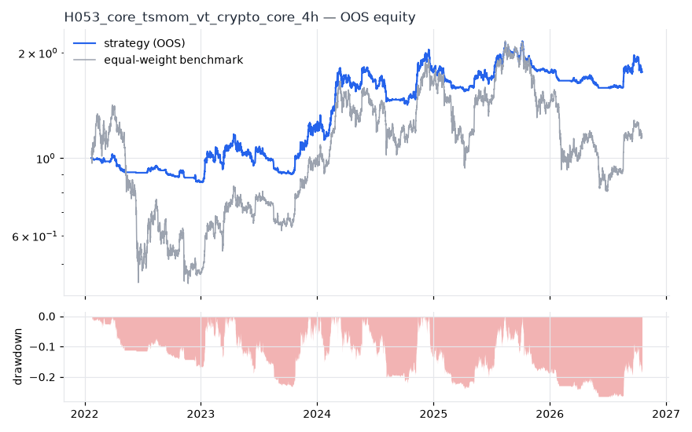
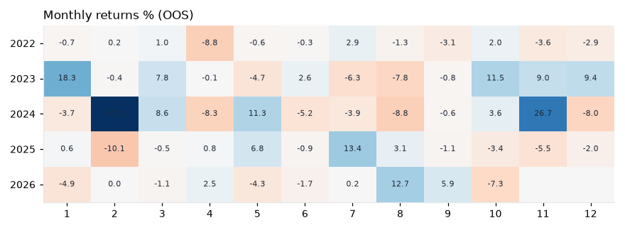

# H053 — core_tsmom_vt on crypto_core [4h]  🟡 WATCH

- Kind: strategy · Source: Moskowitz, Ooi & Pedersen (2012); Liu & Tsyvinski (2021); Moreira & Muir (2017)
- For system: `karma_perp_bot`
- Data: 2018-01-11 08:00:00 → 2026-10-17 12:00:00 · 2 assets · 2191.6 bars/year · survivorship mask: False
- Costs: {'commission': 0.0006, 'slippage': 0.0005, 'funding_annual': 0.08, 'borrow_annual': 0.0}
- Variants tried (DSR trials): 1 (failed: 0)
- Final variant: `core_tsmom_vt|`

## Verdict reasons
- OOS Sharpe (excess of T-bill) 0.458 < 0.5

## Walk-forward out-of-sample


| Metric | Strategy | Equal-weight benchmark |
|---|---|---|
| years | 4.73 | 4.73 |
| cagr | 0.127 | 0.0304 |
| vol | 0.2372 | 0.5502 |
| sharpe | 0.623 | 0.33 |
| sharpe_excess_rf | 0.458 | None |
| sortino | 0.651 | 0.464 |
| max_dd | -0.2663 | -0.6906 |
| max_dd_bars | 2255 | 4210 |
| calmar | 0.477 | 0.044 |
| ulcer | 0.1489 | 0.4063 |
| var95 | -0.007 | -0.0181 |
| cvar95 | -0.0124 | -0.029 |
| omega | 1.05 | 1.022 |
| tail_ratio | 1.064 | 0.99 |
| skew | -0.192 | -0.085 |
| kurtosis | 21.883 | 7.43 |
| hit_rate | 0.439 | 0.512 |
| turnover_ann | 35.7 | None |

- **Gate Sharpe (excess of T-bill): 0.458**
- Deflated Sharpe: **0.912** · PBO: **None** · Reality Check p: **None**
- PSR 0.912 · Info ratio -0.082 · Beta 0.315 · Up/Down capture 0.364/0.355
- Sharpe with 2× costs: 0.457 · Walk-forward efficiency: 0.575
- Bootstrap: {'p_sharpe_pos': 0.909, 'cagr_p05': -0.0656, 'maxdd_p05': -0.5558}
- Yearly OOS Sharpe: {'2022': -1.66, '2023': 1.31, '2024': 1.38, '2025': 0.08, '2026': 0.13}



## Regimes (where does it work?)
`{"bull": {"sharpe": 1.08, "ann_ret": 0.3101, "bars": 6385}, "bear": {"sharpe": -0.92, "ann_ret": -0.1122, "bars": 3988}, "calm": {"sharpe": 0.29, "ann_ret": 0.0666, "bars": 5727}, "stressed": {"sharpe": 1.0, "ann_ret": 0.2477, "bars": 4646}, "vix_lt_20": {"sharpe": 0.4, "ann_ret": 0.1046, "bars": 6904}, "vix_20_30": {"sharpe": 1.55, "ann_ret": 0.2847, "bars": 2953}, "vix_ge_30": {"sharpe": -0.78, "ann_ret": -0.0591, "bars": 516}}`

## Calendar profile (weekday / month / hour)
`{"weekday": {"0": 0.00022, "1": -0.00014, "2": 0.0003, "3": -0.00017, "4": 4e-05, "5": -0.0, "6": 0.00022}, "month": {"1": 0.00012, "2": 0.00026, "3": 0.00018, "4": -0.00015, "5": 9e-05, "6": -5e-05, "7": 6e-05, "8": -3e-05, "9": 1e-05, "10": 8e-05, "11": 0.00034, "12": -4e-05}, "hour": {"0": 4e-05, "4": 0.0, "8": 0.00024, "12": -0.00014, "16": 4e-05, "20": 0.00023}}`

## Robustness
- **delay**: `{"sharpe": 0.994, "sharpe_delayed_1bar": 1.02, "retained": 1.026}`
- **neighbourhood**: `{"neighbours": 0}`
- **noise**: `{"noise_bp": 0.002, "sharpe_min": 0.935, "sharpe_median": 0.949}`

## Timing, take-profit, stop-loss and profit studies (in-sample diagnostics)
- Portfolio overlays (vol target, drawdown brake, equity-curve filter): `{"none": {"sharpe": 0.623, "cagr": 0.127, "max_dd": -0.2663}, "vol_target_0.1": {"sharpe": 0.907, "cagr": 0.1039, "max_dd": -0.1537}, "vol_target_0.15": {"sharpe": 0.916, "cagr": 0.1544, "max_dd": -0.2297}, "vol_target_0.2": {"sharpe": 0.917, "cagr": 0.1967, "max_dd": -0.289}, "dd_brake_0.1": {"sharpe": 0.44, "cagr": 0.0706, "max_dd": -0.2507}, "dd_brake_0.2": {"sharpe": 0.587, "cagr": 0.116, "max_dd": -0.238}, "equity_ma_365": {"sharpe": 0.954, "cagr": 0.1933, "max_dd": -0.1763}, "equity_ma_1095": {"sharpe": 0.667, "cagr": 0.1299, "max_dd": -0.2766}, "best_by_calmar": "equity_ma_365"}`
> Studies are in-sample diagnostics. To use a better exit, register it (exits: [...]) and let the gate judge it.

## Kasa koruma (kriz testi, teşhis)

Piyasa: **crypto**. Kapsanan krizler: covid_2020, may_2021, luna_2022, ftx_2022, aug_2024, oct_2025. Eşikler ve kabul kuralları `config/protection.yaml` içinde, sonuçlardan önce yazıldı. Bu bölüm stratejiyi DEĞİŞTİRMEZ. Bir kuralı kullanmak için hipoteze `overlays:` olarak ekleyin.

Korumasız (tüm geçmiş): CAGR +24.4%, Sharpe 0.994, maks. düşüş -35.2%, MC P(≤−%50) 0.1%

| Kriz | Getiri | Maks. düşüş |
|---|---|---|
| covid_2020 | -9.3% | -11.9% |
| may_2021 | -11.1% | -14.9% |
| luna_2022 | -0.7% | -2.1% |
| ftx_2022 | -7.3% | -7.6% |
| aug_2024 | -11.7% | -13.6% |
| oct_2025 | -9.5% | -13.3% |

| Kural | Sonuç (tüm eşikler) | Eşik: krizlerde daha iyi · Sharpe · maks. düşüş |
|---|---|---|
| Kasa düşüş sigortası | ❌ geçmedi | (0.08, 0.16): 6/6 · 0.831 · -22% / (0.1, 0.2): 6/6 · 0.776 · -31% / (0.12, 0.25): 6/6 · 0.762 · -30% |
| Volatilite hedefi | ❌ geçmedi | 0.25: 4/6 · 0.975 · -32% / 0.35: 2/6 · 0.965 · -35% / 0.5: 0/6 · 0.993 · -35% |
| Kasa eğrisi filtresi | ❌ geçmedi | 30: 6/6 · 1.044 · -24% / 60: 6/6 · 0.993 · -36% / 90: 5/6 · 0.954 · -31% |
| Günlük kayıp limiti | ❌ geçmedi | 0.04: 2/6 · 0.988 · -36% / 0.05: 1/6 · 0.929 · -35% / 0.07: 0/6 · 0.954 · -35% |
| Piyasa çöküş bekçisi | ❌ geçmedi | 0.08: 1/6 · 0.787 · -36% / 0.1: 2/6 · 0.823 · -38% / 0.15: 0/6 · 0.942 · -36% |

## Walk-forward windows
- 2022-01-22 20:00:00 → 2022-07-24 04:00:00: IS 1.778 / OOS -1.33 — `core_tsmom_vt|`
- 2022-07-24 08:00:00 → 2023-01-22 16:00:00: IS 1.282 / OOS 1.34 — `core_tsmom_vt|`
- 2023-01-22 20:00:00 → 2023-07-24 04:00:00: IS 1.538 / OOS 0.079 — `core_tsmom_vt|`
- 2023-07-24 08:00:00 → 2024-01-22 16:00:00: IS 1.408 / OOS 1.121 — `core_tsmom_vt|`
- 2024-01-22 20:00:00 → 2024-07-23 04:00:00: IS 0.546 / OOS 2.421 — `core_tsmom_vt|`
- 2024-07-23 08:00:00 → 2025-01-21 16:00:00: IS 0.794 / OOS 0.745 — `core_tsmom_vt|`
- 2025-01-21 20:00:00 → 2025-07-23 04:00:00: IS 0.897 / OOS 0.692 — `core_tsmom_vt|`
- 2025-07-23 08:00:00 → 2026-01-21 16:00:00: IS 1.059 / OOS -0.933 — `core_tsmom_vt|`
- 2026-01-21 20:00:00 → 2026-07-23 04:00:00: IS 0.768 / OOS -1.359 — `core_tsmom_vt|`
- 2026-07-23 08:00:00 → 2026-10-17 12:00:00: IS 0.755 / OOS 1.479 — `core_tsmom_vt|`

## Best variants (full sample, reference only)
- core_tsmom_vt|: Sharpe 0.988

## Current targets / signals
```json
{
 "BTC/USDT": 0.5,
 "ETH/USDT": 0.2917
}
```

> Survivorship bias: unless a membership mask is used, universes are today's members (upper-bound results).