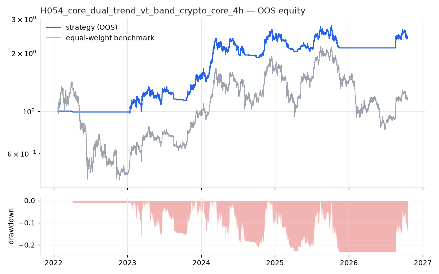
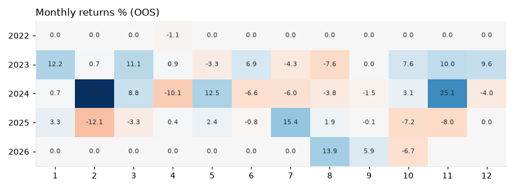

# H054 — core_dual_trend_vt_band on crypto_core [4h]  ✅ ACCEPT

- Kind: strategy · Source: H052 + 10% no-trade band (pre-registered variant V_band, config/core.yaml)
- For system: `karma_perp_bot`
- Data: 2018-01-11 08:00:00 → 2026-10-17 12:00:00 · 2 assets · 2191.6 bars/year · survivorship mask: False
- Costs: {'commission': 0.0006, 'slippage': 0.0005, 'funding_annual': 0.08, 'borrow_annual': 0.0}
- Variants tried (DSR trials): 1 (failed: 0)
- Final variant: `core_dual_trend_vt_band|`

## Verdict reasons
- all gate checks passed

## Walk-forward out-of-sample


| Metric | Strategy | Equal-weight benchmark |
|---|---|---|
| years | 4.73 | 4.73 |
| cagr | 0.2022 | 0.0303 |
| vol | 0.2623 | 0.5499 |
| sharpe | 0.833 | 0.33 |
| sharpe_excess_rf | 0.684 | None |
| sortino | 0.98 | 0.464 |
| max_dd | -0.232 | -0.6907 |
| max_dd_bars | 2255 | 4210 |
| calmar | 0.871 | 0.044 |
| ulcer | 0.1346 | 0.4063 |
| var95 | -0.0077 | -0.0181 |
| cvar95 | -0.0141 | -0.029 |
| omega | 1.078 | 1.022 |
| tail_ratio | 1.065 | 0.989 |
| skew | -0.063 | -0.083 |
| kurtosis | 19.643 | 7.427 |
| hit_rate | 0.278 | 0.512 |
| turnover_ann | 10.87 | None |

- **Gate Sharpe (excess of T-bill): 0.684**
- Deflated Sharpe: **0.965** · PBO: **None** · Reality Check p: **None**
- PSR 0.965 · Info ratio 0.086 · Beta 0.301 · Up/Down capture 0.356/0.337
- Sharpe with 2× costs: 0.788 · Walk-forward efficiency: 0.723
- Bootstrap: {'p_sharpe_pos': 0.965, 'cagr_p05': -0.0054, 'maxdd_p05': -0.4952}
- Yearly OOS Sharpe: {'2022': -1.26, '2023': 1.37, '2024': 1.53, '2025': -0.28, '2026': 1.0}



## Regimes (where does it work?)
`{"bull": {"sharpe": 1.05, "ann_ret": 0.3432, "bars": 6385}, "bear": {"sharpe": 0.2, "ann_ret": 0.0191, "bars": 3988}, "calm": {"sharpe": 0.61, "ann_ret": 0.1507, "bars": 5727}, "stressed": {"sharpe": 1.08, "ann_ret": 0.3022, "bars": 4646}, "vix_lt_20": {"sharpe": 0.64, "ann_ret": 0.1905, "bars": 6904}, "vix_20_30": {"sharpe": 1.68, "ann_ret": 0.3071, "bars": 2953}, "vix_ge_30": {"sharpe": 3.12, "ann_ret": 0.0881, "bars": 516}}`

## Calendar profile (weekday / month / hour)
`{"weekday": {"0": 0.00022, "1": -0.00013, "2": 0.00027, "3": -0.00012, "4": 0.00012, "5": -0.0, "6": 0.00035}, "month": {"1": 0.00022, "2": 0.00027, "3": 0.00019, "4": -0.0001, "5": 0.00013, "6": 0.0, "7": 5e-05, "8": 4e-05, "9": 5e-05, "10": -3e-05, "11": 0.00035, "12": 9e-05}, "hour": {"0": 4e-05, "4": -2e-05, "8": 0.00026, "12": -9e-05, "16": 0.00013, "20": 0.00029}}`

## Robustness
- **delay**: `{"sharpe": 1.151, "sharpe_delayed_1bar": 1.079, "retained": 0.937}`
- **neighbourhood**: `{"neighbours": 0}`
- **noise**: `{"noise_bp": 0.002, "sharpe_min": 1.075, "sharpe_median": 1.084}`

## Timing, take-profit, stop-loss and profit studies (in-sample diagnostics)
- Portfolio overlays (vol target, drawdown brake, equity-curve filter): `{"none": {"sharpe": 0.833, "cagr": 0.2022, "max_dd": -0.232}, "vol_target_0.1": {"sharpe": 1.401, "cagr": 0.1765, "max_dd": -0.0763}, "vol_target_0.15": {"sharpe": 1.415, "cagr": 0.2472, "max_dd": -0.1139}, "vol_target_0.2": {"sharpe": 1.379, "cagr": 0.307, "max_dd": -0.1511}, "dd_brake_0.1": {"sharpe": 0.681, "cagr": 0.1387, "max_dd": -0.2391}, "dd_brake_0.2": {"sharpe": 0.798, "cagr": 0.1903, "max_dd": -0.2226}, "equity_ma_365": {"sharpe": 0.966, "cagr": 0.2104, "max_dd": -0.2221}, "equity_ma_1095": {"sharpe": 0.742, "cagr": 0.1671, "max_dd": -0.2167}, "best_by_calmar": "vol_target_0.1"}`
> Studies are in-sample diagnostics. To use a better exit, register it (exits: [...]) and let the gate judge it.

## Kasa koruma (kriz testi, teşhis)

Piyasa: **crypto**. Kapsanan krizler: covid_2020, may_2021, luna_2022, ftx_2022, aug_2024, oct_2025. Eşikler ve kabul kuralları `config/protection.yaml` içinde, sonuçlardan önce yazıldı. Bu bölüm stratejiyi DEĞİŞTİRMEZ. Bir kuralı kullanmak için hipoteze `overlays:` olarak ekleyin.

Korumasız (tüm geçmiş): CAGR +34.7%, Sharpe 1.151, maks. düşüş -37.8%, MC P(≤−%50) 0.5%

| Kriz | Getiri | Maks. düşüş |
|---|---|---|
| covid_2020 | -8.2% | -12.0% |
| may_2021 | -17.0% | -21.5% |
| luna_2022 | +0.0% | 0.0% |
| ftx_2022 | +0.0% | 0.0% |
| aug_2024 | -6.0% | -7.8% |
| oct_2025 | -12.5% | -16.5% |

| Kural | Sonuç (tüm eşikler) | Eşik: krizlerde daha iyi · Sharpe · maks. düşüş |
|---|---|---|
| Kasa düşüş sigortası | ❌ geçmedi | (0.08, 0.16): 4/6 · 0.707 · -38% / (0.1, 0.2): 4/6 · 0.699 · -41% / (0.12, 0.25): 4/6 · 0.862 · -32% |
| Volatilite hedefi | ❌ geçmedi | 0.25: 4/6 · 1.173 · -29% / 0.35: 3/6 · 1.148 · -35% / 0.5: 1/6 · 1.152 · -38% |
| Kasa eğrisi filtresi | ❌ geçmedi | 30: 4/6 · 1.16 · -30% / 60: 4/6 · 1.197 · -26% / 90: 4/6 · 1.04 · -33% |
| Günlük kayıp limiti | ❌ geçmedi | 0.04: 3/6 · 1.07 · -34% / 0.05: 3/6 · 1.081 · -38% / 0.07: 0/6 · 1.098 · -39% |
| Piyasa çöküş bekçisi | ❌ geçmedi | 0.08: 0/6 · 0.944 · -39% / 0.1: 0/6 · 0.976 · -44% / 0.15: 0/6 · 1.101 · -41% |

## Walk-forward windows
- 2022-01-22 20:00:00 → 2022-07-24 04:00:00: IS 1.531 / OOS -1.723 — `core_dual_trend_vt_band|`
- 2022-07-24 08:00:00 → 2023-01-22 16:00:00: IS 1.193 / OOS 1.877 — `core_dual_trend_vt_band|`
- 2023-01-22 20:00:00 → 2023-07-24 04:00:00: IS 1.582 / OOS 0.814 — `core_dual_trend_vt_band|`
- 2023-07-24 08:00:00 → 2024-01-22 16:00:00: IS 1.524 / OOS 1.17 — `core_dual_trend_vt_band|`
- 2024-01-22 20:00:00 → 2024-07-23 04:00:00: IS 0.733 / OOS 2.12 — `core_dual_trend_vt_band|`
- 2024-07-23 08:00:00 → 2025-01-21 16:00:00: IS 0.966 / OOS 1.259 — `core_dual_trend_vt_band|`
- 2025-01-21 20:00:00 → 2025-07-23 04:00:00: IS 1.213 / OOS -0.002 — `core_dual_trend_vt_band|`
- 2025-07-23 08:00:00 → 2026-01-21 16:00:00: IS 1.172 / OOS -0.954 — `core_dual_trend_vt_band|`
- 2026-01-21 20:00:00 → 2026-07-23 04:00:00: IS 0.842 / OOS 0.0 — `core_dual_trend_vt_band|`
- 2026-07-23 08:00:00 → 2026-10-17 12:00:00: IS 0.776 / OOS 1.829 — `core_dual_trend_vt_band|`

## Best variants (full sample, reference only)
- core_dual_trend_vt_band|: Sharpe 1.068

## Current targets / signals
```json
{
 "BTC/USDT": 0.5,
 "ETH/USDT": 0.4831
}
```

> Survivorship bias: unless a membership mask is used, universes are today's members (upper-bound results).