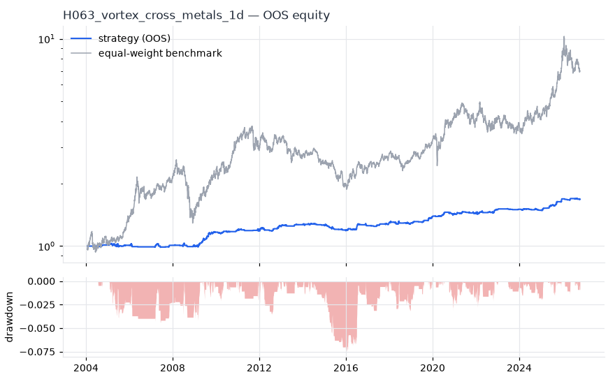
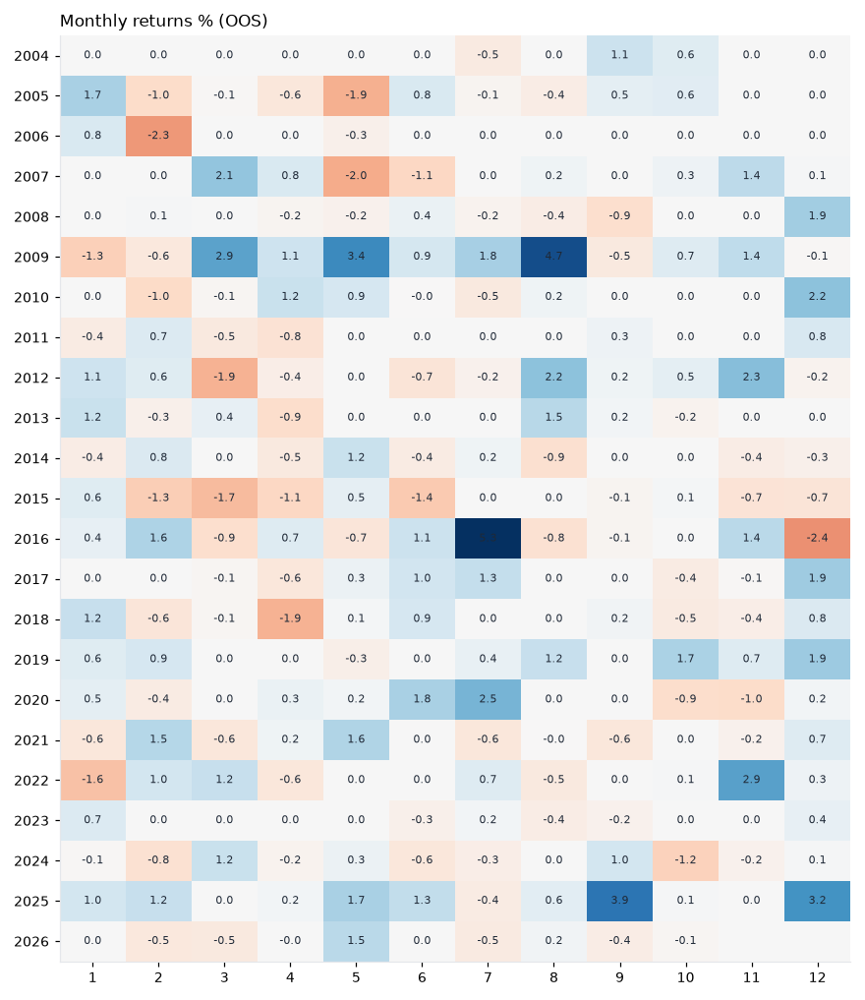
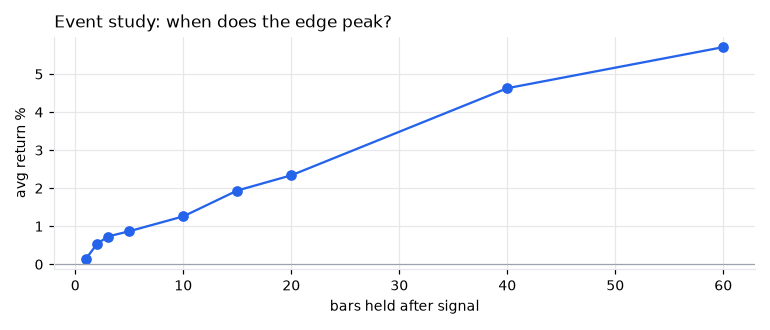
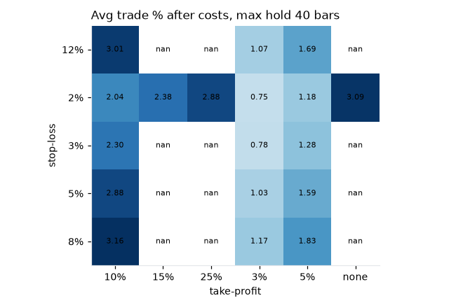

# H063 — vortex_cross on metals [1d]  🟡 WATCH

- Kind: rule · Source: Botes & Siepman Vortex
- For system: `paper_watch`
- Data: 2000-01-04 00:00:00 → 2026-10-21 00:00:00 · 5 assets · 251.3 bars/year · survivorship mask: False
- Costs: {'commission': 0.0002, 'slippage': 0.0005, 'funding_annual': 0.0, 'borrow_annual': 0.0}
- Variants tried (DSR trials): 13 (failed: 0)
- Final variant: `vortex_cross+smc_order_block|n=28|f=none|x=stop_atr=2.0,tp_r=3.0|confirm=k=5,max_age=50,within=3|size=atr_risk0.005`

## Verdict reasons
- OOS Sharpe (excess of T-bill) 0.184 < 0.5
- PBO 0.515 > 0.5 (variant selection is overfit)
- Reality Check p 0.95 > 0.1 (best variant may be data-mined)

## Walk-forward out-of-sample


| Metric | Strategy | Equal-weight benchmark |
|---|---|---|
| years | 22.77 | 22.77 |
| cagr | 0.0231 | 0.0892 |
| vol | 0.0333 | 0.2252 |
| sharpe | 0.702 | 0.493 |
| sharpe_excess_rf | 0.184 | None |
| sortino | 0.279 | 0.679 |
| max_dd | -0.0764 | -0.5054 |
| max_dd_bars | 872 | 2233 |
| calmar | 0.302 | 0.176 |
| ulcer | 0.0227 | 0.2267 |
| var95 | -0.0027 | -0.0218 |
| cvar95 | -0.0051 | -0.034 |
| omega | 1.231 | 1.091 |
| tail_ratio | 1.257 | 0.991 |
| skew | 0.995 | -0.625 |
| kurtosis | 26.094 | 6.559 |
| hit_rate | 0.206 | 0.537 |
| turnover_ann | 4.95 | None |

- **Gate Sharpe (excess of T-bill): 0.184**
- Deflated Sharpe: **0.994** · PBO: **0.515** · Reality Check p: **0.95**
- PSR 1.0 · Info ratio -0.406 · Beta 0.053 · Up/Down capture 0.075/0.063
- Sharpe with 2× costs: 0.597 · Walk-forward efficiency: 0.62
- Bootstrap: {'p_sharpe_pos': 1.0, 'cagr_p05': 0.0113, 'maxdd_p05': -0.1152}
- Yearly OOS Sharpe: {'2004': 1.18, '2005': -0.05, '2006': -0.61, '2007': 0.62, '2008': 0.14, '2009': 2.13, '2010': 1.16, '2011': 0.04, '2012': 0.93, '2013': 0.95, '2014': -0.3, '2015': -1.79, '2016': 1.63, '2017': 1.56, '2018': -0.05, '2019': 2.17, '2020': 1.03, '2021': 0.47, '2022': 0.82, '2023': 0.37, '2024': -0.54, '2025': 3.28, '2026': -0.29}



## Regimes (where does it work?)
`{"bull": {"sharpe": 1.38, "ann_ret": 0.0471, "bars": 3972}, "bear": {"sharpe": -0.98, "ann_ret": -0.0305, "bars": 1750}, "calm": {"sharpe": 1.18, "ann_ret": 0.0413, "bars": 2898}, "stressed": {"sharpe": 0.16, "ann_ret": 0.005, "bars": 2824}, "vix_lt_20": {"sharpe": 0.56, "ann_ret": 0.0171, "bars": 3945}, "vix_20_30": {"sharpe": 0.96, "ann_ret": 0.0373, "bars": 1328}, "vix_ge_30": {"sharpe": 0.94, "ann_ret": 0.0373, "bars": 449}, "curve_inverted": {"sharpe": 0.24, "ann_ret": 0.0049, "bars": 813}, "curve_normal": {"sharpe": 0.76, "ann_ret": 0.0265, "bars": 4909}}`

## Calendar profile (weekday / month / hour)
`{"weekday": {"0": 4e-05, "1": 0.00011, "2": 0.00013, "3": 6e-05, "4": 0.00012}, "month": {"1": 0.00013, "2": -1e-05, "3": 3e-05, "4": -7e-05, "5": 0.00013, "6": 8e-05, "7": 0.00018, "8": 0.00014, "9": 9e-05, "10": 3e-05, "11": 0.00016, "12": 0.00023}}`

## Trades (OOS)
`{"n_trades": 252, "trades_per_year": 11.1, "win_rate": 0.496, "avg_trade": 0.0163, "median_trade": -0.0002, "avg_win": 0.0555, "avg_loss": -0.0222, "profit_factor": 2.457, "payoff": 2.497, "expectancy_r": 0.461, "sqn": 3.03, "kelly_fraction": 0.294, "max_consec_losses": 11, "avg_bars": 9.7, "avg_bars_win": 13.1, "avg_bars_loss": 6.3, "avg_mfe": 0.0349, "avg_mae": -0.0127, "edge_ratio": 2.758, "exit_reasons": {"signal": 155, "target": 50, "stop": 47}, "long_short": {"1": {"count": 252, "mean": 0.0163}}}`

## Robustness
- **delay**: `{"sharpe": 0.959, "sharpe_delayed_1bar": 0.914, "retained": 0.953}`
- **neighbourhood**: `{"neighbours": 1, "best_sharpe": 0.956, "neighbour_median": 0.844, "share_positive": 1.0, "stability": 0.882}`
- **noise**: `{"noise_bp": 0.002, "sharpe_min": 0.657, "sharpe_median": 0.814}`
- **random_entry**: `{"actual_ret_per_exposure_ann": 0.358, "random_median_ann": 0.1071, "random_p95_ann": 0.1799, "trades_actual": 287, "p_value": 0.0}`
- **mc_trade_shuffle**: `{"maxdd_median": -0.0337, "maxdd_p95": -0.0507, "final_p05": 1.0756, "final_median": 1.0756}`

## Timing, take-profit, stop-loss and profit studies (in-sample diagnostics)
- Event study (forward return by bars held): `{"1": {"n": 289, "mean": 0.0015, "hit": 0.46, "t": 2.03, "per_bar": 0.00154}, "2": {"n": 288, "mean": 0.0053, "hit": 0.635, "t": 4.66, "per_bar": 0.00267}, "3": {"n": 288, "mean": 0.0073, "hit": 0.646, "t": 5.18, "per_bar": 0.00243}, "5": {"n": 288, "mean": 0.0087, "hit": 0.656, "t": 4.1, "per_bar": 0.00174}, "10": {"n": 288, "mean": 0.0126, "hit": 0.622, "t": 4.28, "per_bar": 0.00126}, "15": {"n": 286, "mean": 0.0194, "hit": 0.629, "t": 5.26, "per_bar": 0.0013}, "20": {"n": 286, "mean": 0.0234, "hit": 0.619, "t": 5.38, "per_bar": 0.00117}, "40": {"n": 284, "mean": 0.0463, "hit": 0.662, "t": 7.18, "per_bar": 0.00116}, "60": {"n": 280, "mean": 0.0571, "hit": 0.657, "t": 7.09, "per_bar": 0.00095}, "best_holding_bars": 40}`

- Best stop / target / max-hold combinations: `[{"stop": 0.08, "target": 0.1, "max_hold": 40, "n": 289, "mean": 0.0316, "hit": 0.6609, "per_bar": 0.0011, "t": 7.794}, {"stop": 0.05, "target": 0.1, "max_hold": 40, "n": 289, "mean": 0.0288, "hit": 0.5986, "per_bar": 0.0012, "t": 7.5679}, {"stop": 0.12, "target": 0.1, "max_hold": 40, "n": 289, "mean": 0.0301, "hit": 0.6713, "per_bar": 0.001, "t": 6.9648}, {"stop": 0.03, "target": 0.1, "max_hold": 40, "n": 289, "mean": 0.023, "hit": 0.4879, "per_bar": 0.0012, "t": 6.5977}, {"stop": 0.08, "target": 0.05, "max_hold": 40, "n": 289, "mean": 0.0183, "hit": 0.7301, "per_bar": 0.0009, "t": 6.5175}]`

- Portfolio overlays (vol target, drawdown brake, equity-curve filter): `{"none": {"sharpe": 0.702, "cagr": 0.0231, "max_dd": -0.0764}, "vol_target_0.1": {"sharpe": 0.689, "cagr": 0.0423, "max_dd": -0.148}, "vol_target_0.15": {"sharpe": 0.701, "cagr": 0.0454, "max_dd": -0.148}, "vol_target_0.2": {"sharpe": 0.702, "cagr": 0.0456, "max_dd": -0.148}, "dd_brake_0.1": {"sharpe": 0.702, "cagr": 0.0231, "max_dd": -0.0764}, "dd_brake_0.2": {"sharpe": 0.702, "cagr": 0.0231, "max_dd": -0.0764}, "equity_ma_41": {"sharpe": 0.459, "cagr": 0.0125, "max_dd": -0.0762}, "equity_ma_125": {"sharpe": 0.447, "cagr": 0.0126, "max_dd": -0.0947}, "best_by_calmar": "vol_target_0.2"}`
> Studies are in-sample diagnostics. To use a better exit, register it (exits: [...]) and let the gate judge it.

## Kasa koruma (kriz testi, teşhis)

Piyasa: **multi**. Kapsanan krizler: gfc_2008, euro_2011, gold_crash_2013, covid_2020, rates_2022, tariff_apr_2025. Eşikler ve kabul kuralları `config/protection.yaml` içinde, sonuçlardan önce yazıldı. Bu bölüm stratejiyi DEĞİŞTİRMEZ. Bir kuralı kullanmak için hipoteze `overlays:` olarak ekleyin.

Korumasız (tüm geçmiş): CAGR +2.5%, Sharpe 0.959, maks. düşüş -5.6%, MC P(≤−%50) 0.0%

| Kriz | Getiri | Maks. düşüş |
|---|---|---|
| gfc_2008 | +3.6% | -0.9% |
| euro_2011 | +0.1% | 0.0% |
| gold_crash_2013 | +0.0% | 0.0% |
| covid_2020 | +0.0% | 0.0% |
| rates_2022 | +1.1% | -0.9% |
| tariff_apr_2025 | +0.0% | 0.0% |

| Kural | Sonuç (tüm eşikler) | Eşik: krizlerde daha iyi · Sharpe · maks. düşüş |
|---|---|---|
| Kasa düşüş sigortası | ❌ geçmedi | (0.08, 0.16): 0/6 · 0.959 · -6% / (0.1, 0.2): 0/6 · 0.959 · -6% / (0.12, 0.25): 0/6 · 0.959 · -6% |
| Volatilite hedefi | ❌ geçmedi | 0.1: 0/6 · 0.959 · -6% / 0.15: 0/6 · 0.959 · -6% / 0.25: 0/6 · 0.959 · -6% |
| Kasa eğrisi filtresi | ❌ geçmedi | 30: 0/6 · 0.156 · -10% / 60: 1/6 · 0.312 · -9% / 90: 1/6 · 0.429 · -7% |
| Günlük kayıp limiti | ❌ geçmedi | 0.03: 0/6 · 0.959 · -6% / 0.05: 0/6 · 0.959 · -6% / 0.07: 0/6 · 0.959 · -6% |
| Piyasa çöküş bekçisi | ❌ geçmedi | 0.04: 0/6 · 0.898 · -6% / 0.06: 0/6 · 0.951 · -6% / 0.08: 0/6 · 0.955 · -6% |

## Walk-forward windows
- 2020-12-15 00:00:00 → 2021-06-15 00:00:00: IS 1.313 / OOS 1.806 — `vortex_cross+smc_order_block|n=14|f=none|x=stop_atr=2.0,tp_r=3.0|confirm=k=5,max_age=50,within=3|size=atr_risk0.005`
- 2021-06-16 00:00:00 → 2021-12-10 00:00:00: IS 1.408 / OOS -1.45 — `vortex_cross+smc_order_block|n=14|f=none|x=stop_atr=2.0,tp_r=3.0|confirm=k=5,max_age=50,within=3|size=vol0.2`
- 2021-12-13 00:00:00 → 2022-06-10 00:00:00: IS 1.365 / OOS 0.388 — `vortex_cross+smc_order_block|n=14|f=none|x=stop_atr=2.0,tp_r=3.0|confirm=k=5,max_age=50,within=3|size=vol0.2`
- 2022-06-13 00:00:00 → 2022-12-08 00:00:00: IS 1.044 / OOS 2.15 — `vortex_cross+smc_order_block|n=28|f=none|x=stop_atr=2.0,tp_r=3.0|confirm=k=5,max_age=50,within=3|size=atr_risk0.005`
- 2022-12-09 00:00:00 → 2023-06-09 00:00:00: IS 1.191 / OOS 0.854 — `vortex_cross+smc_order_block|n=28|f=none|x=stop_atr=2.0,tp_r=3.0|confirm=k=5,max_age=50,within=3|size=atr_risk0.005`
- 2023-06-12 00:00:00 → 2023-12-06 00:00:00: IS 1.092 / OOS -1.709 — `vortex_cross+smc_order_block|n=14|f=none|x=stop_atr=2.0,tp_r=3.0|confirm=k=5,max_age=50,within=3|size=vol0.1`
- 2023-12-07 00:00:00 → 2024-06-06 00:00:00: IS 0.929 / OOS 1.057 — `vortex_cross+smc_order_block|n=14|f=none|x=stop_atr=2.0,tp_r=3.0|confirm=k=5,max_age=50,within=3|size=vol0.1`
- 2024-06-07 00:00:00 → 2024-12-04 00:00:00: IS 1.062 / OOS -1.354 — `vortex_cross+smc_order_block|n=28|f=none|x=stop_atr=2.0,tp_r=3.0|confirm=k=5,max_age=50,within=3|size=atr_risk0.005`
- 2024-12-05 00:00:00 → 2025-06-05 00:00:00: IS 1.243 / OOS 3.323 — `vortex_cross+smc_order_block|n=28|f=none|x=stop_atr=2.0,tp_r=3.0|confirm=k=5,max_age=50,within=3|size=atr_risk0.005`
- 2025-06-06 00:00:00 → 2025-12-02 00:00:00: IS 1.525 / OOS 2.627 — `vortex_cross+smc_order_block|n=28|f=none|x=stop_atr=2.0,tp_r=3.0|confirm=k=5,max_age=50,within=3|size=atr_risk0.005`
- 2025-12-03 00:00:00 → 2026-06-03 00:00:00: IS 1.654 / OOS 2.294 — `vortex_cross+smc_order_block|n=28|f=none|x=stop_atr=2.0,tp_r=3.0|confirm=k=5,max_age=50,within=3|size=atr_risk0.005`
- 2026-06-04 00:00:00 → 2026-10-21 00:00:00: IS 1.857 / OOS -0.976 — `vortex_cross+smc_order_block|n=28|f=none|x=stop_atr=2.0,tp_r=3.0|confirm=k=5,max_age=50,within=3|size=atr_risk0.005`

## Best variants (full sample, reference only)
- vortex_cross+smc_order_block|n=28|f=none|x=stop_atr=2.0,tp_r=3.0|confirm=k=5,max_age=50,within=3|size=atr_risk0.005: Sharpe 0.956
- vortex_cross+smc_order_block|n=28|f=none|x=stop_atr=2.0,tp_r=3.0|confirm=k=5,max_age=50,within=3|size=atr_risk0.01: Sharpe 0.944
- vortex_cross+smc_order_block|n=28|f=none|x=stop_atr=2.0,tp_r=3.0|confirm=k=5,max_age=50,within=3: Sharpe 0.942
- vortex_cross+smc_order_block|n=28|f=none|x=stop_atr=2.0,tp_r=3.0|confirm=k=5,max_age=50,within=3|size=atr_risk0.02: Sharpe 0.942
- vortex_cross+smc_order_block|n=28|f=none|x=stop_atr=2.0,tp_r=3.0|confirm=k=5,max_age=50,within=3|size=vol0.2: Sharpe 0.869
- vortex_cross+smc_order_block|n=14|f=none|x=stop_atr=2.0,tp_r=3.0|confirm=k=5,max_age=50,within=3|size=atr_risk0.005: Sharpe 0.844
- vortex_cross+smc_order_block|n=28|f=none|x=stop_atr=2.0,tp_r=3.0|confirm=k=5,max_age=50,within=3|size=vol0.1: Sharpe 0.843
- vortex_cross+smc_order_block|n=14|f=none|x=stop_atr=2.0,tp_r=3.0|confirm=k=5,max_age=50,within=3|size=vol0.2: Sharpe 0.815
- vortex_cross+smc_order_block|n=14|f=none|x=stop_atr=2.0,tp_r=3.0|confirm=k=5,max_age=50,within=3|size=vol0.1: Sharpe 0.81
- vortex_cross+smc_order_block|n=14|f=none|x=stop_atr=2.0,tp_r=3.0|confirm=k=5,max_age=50,within=3|size=atr_risk0.01: Sharpe 0.771

## Current targets / signals
```json
{
 "positions": {
  "HG=F": 0.1977
 },
 "entry_long_next_open": [],
 "exit_long_next_open": [],
 "entry_short_next_open": []
}
```

> Survivorship bias: unless a membership mask is used, universes are today's members (upper-bound results).