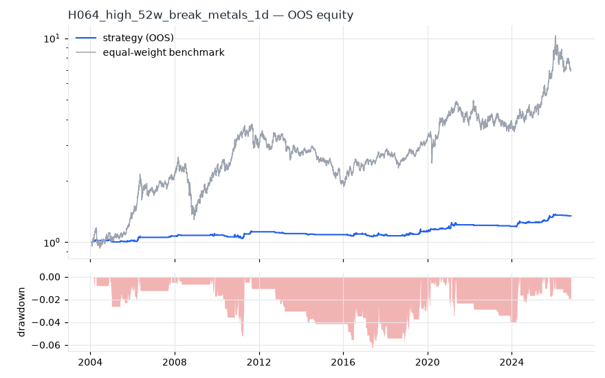
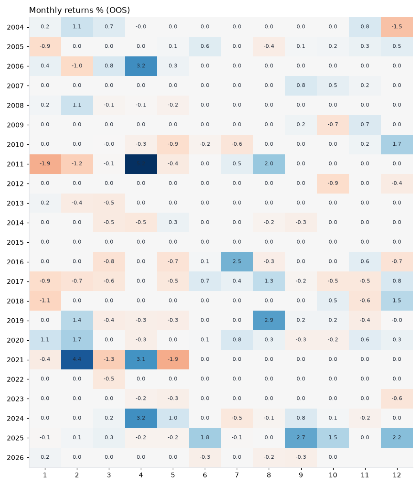
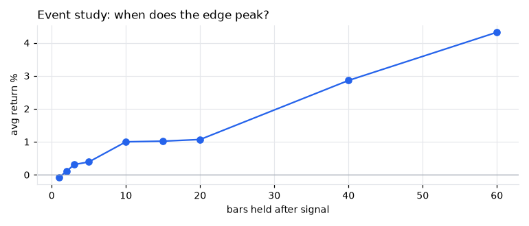
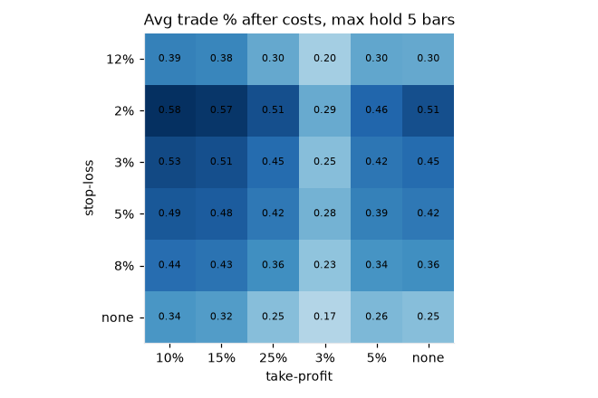

# H064 — high_52w_break on metals [1d]  ❌ REJECT

- Kind: rule · Source: George & Hwang 52-week high
- For system: `paper_watch`
- Data: 2000-01-04 00:00:00 → 2026-10-21 00:00:00 · 5 assets · 251.3 bars/year · survivorship mask: False
- Costs: {'commission': 0.0002, 'slippage': 0.0005, 'funding_annual': 0.0, 'borrow_annual': 0.0}
- Variants tried (DSR trials): 14 (failed: 0)
- Final variant: `high_52w_break+smc_bos|n=252,exit_ma=50|f=none|x=stop_atr=2.0,trail_atr=3.0|confirm=k=5,within=3|size=vol0.1`

## Verdict reasons
- OOS Sharpe (excess of T-bill) -0.147 < 0.5
- with 2x costs it does not beat the equal-weight benchmark
- Reality Check p 0.964 > 0.1 (best variant may be data-mined)

## Walk-forward out-of-sample


| Metric | Strategy | Equal-weight benchmark |
|---|---|---|
| years | 22.77 | 22.77 |
| cagr | 0.0131 | 0.0892 |
| vol | 0.0261 | 0.2252 |
| sharpe | 0.513 | 0.493 |
| sharpe_excess_rf | -0.147 | None |
| sortino | -0.206 | 0.679 |
| max_dd | -0.0622 | -0.5054 |
| max_dd_bars | 2016 | 2233 |
| calmar | 0.211 | 0.176 |
| ulcer | 0.028 | 0.2267 |
| var95 | -0.0017 | -0.0218 |
| cvar95 | -0.0041 | -0.034 |
| omega | 1.21 | 1.091 |
| tail_ratio | 1.273 | 0.991 |
| skew | -0.432 | -0.625 |
| kurtosis | 32.511 | 6.56 |
| hit_rate | 0.148 | 0.537 |
| turnover_ann | 2.01 | None |

- **Gate Sharpe (excess of T-bill): -0.147**
- Deflated Sharpe: **0.964** · PBO: **0.036** · Reality Check p: **0.964**
- PSR 0.992 · Info ratio -0.447 · Beta 0.038 · Up/Down capture 0.047/0.04
- Sharpe with 2× costs: 0.457 · Walk-forward efficiency: 0.779
- Bootstrap: {'p_sharpe_pos': 0.993, 'cagr_p05': 0.0047, 'maxdd_p05': -0.1036}
- Yearly OOS Sharpe: {'2004': 0.74, '2005': 0.26, '2006': 1.35, '2007': 1.61, '2008': 0.83, '2009': 0.11, '2010': -0.01, '2011': 1.0, '2012': -1.85, '2013': -0.94, '2014': -1.15, '2015': 0.0, '2016': 0.21, '2017': -0.23, '2018': 0.1, '2019': 0.69, '2020': 1.57, '2021': 0.77, '2022': -0.89, '2023': -1.31, '2024': 1.42, '2025': 2.06, '2026': -0.55}



## Regimes (where does it work?)
`{"bull": {"sharpe": 0.71, "ann_ret": 0.0201, "bars": 3972}, "bear": {"sharpe": -0.09, "ann_ret": -0.0017, "bars": 1750}, "calm": {"sharpe": 0.91, "ann_ret": 0.0233, "bars": 2898}, "stressed": {"sharpe": 0.12, "ann_ret": 0.0032, "bars": 2824}, "vix_lt_20": {"sharpe": 0.66, "ann_ret": 0.0171, "bars": 3945}, "vix_20_30": {"sharpe": 0.31, "ann_ret": 0.009, "bars": 1328}, "vix_ge_30": {"sharpe": -0.33, "ann_ret": -0.0058, "bars": 449}, "curve_inverted": {"sharpe": 0.77, "ann_ret": 0.0208, "bars": 813}, "curve_normal": {"sharpe": 0.47, "ann_ret": 0.0122, "bars": 4909}}`

## Calendar profile (weekday / month / hour)
`{"weekday": {"0": 0.00014, "1": 6e-05, "2": 5e-05, "3": -0.0, "4": 2e-05}, "month": {"1": -7e-05, "2": 0.00015, "3": -5e-05, "4": 0.00026, "5": -8e-05, "6": 6e-05, "7": 6e-05, "8": 0.0001, "9": 8e-05, "10": 1e-05, "11": 4e-05, "12": 8e-05}}`

## Trades (OOS)
`{"n_trades": 146, "trades_per_year": 6.4, "win_rate": 0.466, "avg_trade": 0.0227, "median_trade": -0.0079, "avg_win": 0.0834, "avg_loss": -0.0302, "profit_factor": 2.409, "payoff": 2.764, "expectancy_r": 0.711, "sqn": 3.01, "kelly_fraction": 0.272, "max_consec_losses": 6, "avg_bars": 12.8, "avg_bars_win": 20.0, "avg_bars_loss": 6.6, "avg_mfe": 0.0787, "avg_mae": -0.0126, "edge_ratio": 6.268, "exit_reasons": {"stop": 146}, "long_short": {"1": {"count": 146, "mean": 0.0227}}}`

## Robustness
- **delay**: `{"sharpe": 0.778, "sharpe_delayed_1bar": 0.732, "retained": 0.941}`
- **neighbourhood**: `{"neighbours": 1, "best_sharpe": 0.753, "neighbour_median": 0.753, "share_positive": 1.0, "stability": 1.0}`
- **noise**: `{"noise_bp": 0.002, "sharpe_min": 0.638, "sharpe_median": 0.687}`
- **random_entry**: `{"actual_ret_per_exposure_ann": 0.3878, "random_median_ann": 0.1336, "random_p95_ann": 0.2994, "trades_actual": 162, "p_value": 0.0}`
- **mc_trade_shuffle**: `{"maxdd_median": -0.0222, "maxdd_p95": -0.0341, "final_p05": 0.4326, "final_median": 0.4326}`

## Timing, take-profit, stop-loss and profit studies (in-sample diagnostics)
- Event study (forward return by bars held): `{"1": {"n": 385, "mean": -0.0007, "hit": 0.335, "t": -1.14, "per_bar": -0.00068}, "2": {"n": 385, "mean": 0.001, "hit": 0.538, "t": 0.86, "per_bar": 0.00052}, "3": {"n": 385, "mean": 0.0031, "hit": 0.553, "t": 2.23, "per_bar": 0.00104}, "5": {"n": 385, "mean": 0.0039, "hit": 0.561, "t": 1.86, "per_bar": 0.00077}, "10": {"n": 383, "mean": 0.01, "hit": 0.611, "t": 3.4, "per_bar": 0.001}, "15": {"n": 382, "mean": 0.0102, "hit": 0.55, "t": 2.62, "per_bar": 0.00068}, "20": {"n": 381, "mean": 0.0107, "hit": 0.551, "t": 2.21, "per_bar": 0.00054}, "40": {"n": 382, "mean": 0.0286, "hit": 0.623, "t": 4.24, "per_bar": 0.00071}, "60": {"n": 381, "mean": 0.0432, "hit": 0.627, "t": 5.89, "per_bar": 0.00072}, "best_holding_bars": 60}`

- Best stop / target / max-hold combinations: `[{"stop": 0.02, "target": 0.1, "max_hold": 5, "n": 385, "mean": 0.0058, "hit": 0.5039, "per_bar": 0.0014, "t": 3.7292}, {"stop": 0.02, "target": 0.05, "max_hold": 5, "n": 385, "mean": 0.0046, "hit": 0.5143, "per_bar": 0.0012, "t": 3.5928}, {"stop": 0.02, "target": 0.15, "max_hold": 5, "n": 385, "mean": 0.0057, "hit": 0.5013, "per_bar": 0.0014, "t": 3.4707}, {"stop": 0.02, "target": 0.25, "max_hold": 5, "n": 385, "mean": 0.0051, "hit": 0.4987, "per_bar": 0.0012, "t": 3.2353}, {"stop": 0.02, "target": NaN, "max_hold": 5, "n": 385, "mean": 0.0051, "hit": 0.4987, "per_bar": 0.0012, "t": 3.2353}]`

- Portfolio overlays (vol target, drawdown brake, equity-curve filter): `{"none": {"sharpe": 0.513, "cagr": 0.0131, "max_dd": -0.0622}, "vol_target_0.1": {"sharpe": 0.519, "cagr": 0.0247, "max_dd": -0.1218}, "vol_target_0.15": {"sharpe": 0.511, "cagr": 0.0255, "max_dd": -0.1218}, "vol_target_0.2": {"sharpe": 0.505, "cagr": 0.0253, "max_dd": -0.1218}, "dd_brake_0.1": {"sharpe": 0.513, "cagr": 0.0131, "max_dd": -0.0622}, "dd_brake_0.2": {"sharpe": 0.513, "cagr": 0.0131, "max_dd": -0.0622}, "equity_ma_41": {"sharpe": 0.429, "cagr": 0.0098, "max_dd": -0.0556}, "equity_ma_125": {"sharpe": 0.471, "cagr": 0.011, "max_dd": -0.0477}, "best_by_calmar": "equity_ma_125"}`
> Studies are in-sample diagnostics. To use a better exit, register it (exits: [...]) and let the gate judge it.

## Kasa koruma (kriz testi, teşhis)

Piyasa: **multi**. Kapsanan krizler: gfc_2008, euro_2011, gold_crash_2013, covid_2020, rates_2022, tariff_apr_2025. Eşikler ve kabul kuralları `config/protection.yaml` içinde, sonuçlardan önce yazıldı. Bu bölüm stratejiyi DEĞİŞTİRMEZ. Bir kuralı kullanmak için hipoteze `overlays:` olarak ekleyin.

Korumasız (tüm geçmiş): CAGR +1.3%, Sharpe 0.778, maks. düşüş -3.6%, MC P(≤−%50) 0.0%

| Kriz | Getiri | Maks. düşüş |
|---|---|---|
| gfc_2008 | +0.0% | 0.0% |
| euro_2011 | +1.5% | -0.8% |
| gold_crash_2013 | +0.0% | 0.0% |
| covid_2020 | +0.8% | -0.3% |
| rates_2022 | -0.3% | -0.6% |
| tariff_apr_2025 | -0.3% | -0.5% |

| Kural | Sonuç (tüm eşikler) | Eşik: krizlerde daha iyi · Sharpe · maks. düşüş |
|---|---|---|
| Kasa düşüş sigortası | ❌ geçmedi | (0.08, 0.16): 0/6 · 0.778 · -4% / (0.1, 0.2): 0/6 · 0.778 · -4% / (0.12, 0.25): 0/6 · 0.778 · -4% |
| Volatilite hedefi | ❌ geçmedi | 0.1: 0/6 · 0.778 · -4% / 0.15: 0/6 · 0.778 · -4% / 0.25: 0/6 · 0.778 · -4% |
| Kasa eğrisi filtresi | ❌ geçmedi | 30: 1/6 · 0.379 · -5% / 60: 1/6 · 0.446 · -4% / 90: 1/6 · 0.537 · -4% |
| Günlük kayıp limiti | ❌ geçmedi | 0.03: 0/6 · 0.778 · -4% / 0.05: 0/6 · 0.778 · -4% / 0.07: 0/6 · 0.778 · -4% |
| Piyasa çöküş bekçisi | ❌ geçmedi | 0.04: 0/6 · 0.705 · -4% / 0.06: 0/6 · 0.765 · -4% / 0.08: 0/6 · 0.771 · -4% |

## Walk-forward windows
- 2020-12-15 00:00:00 → 2021-06-15 00:00:00: IS 1.007 / OOS 1.101 — `high_52w_break+smc_bos|n=252,exit_ma=50|f=none|x=stop_atr=2.0,trail_atr=3.0|confirm=k=5,within=3|size=atr_risk0.01`
- 2021-06-16 00:00:00 → 2021-12-10 00:00:00: IS 1.217 / OOS 0.0 — `high_52w_break+smc_bos|n=252,exit_ma=50|f=none|x=stop_atr=2.0,trail_atr=3.0|confirm=k=5,within=3|size=vol0.1`
- 2021-12-13 00:00:00 → 2022-06-10 00:00:00: IS 1.271 / OOS -1.255 — `high_52w_break+smc_bos|n=252,exit_ma=50|f=none|x=stop_atr=2.0,trail_atr=3.0|confirm=k=5,within=3|size=vol0.1`
- 2022-06-13 00:00:00 → 2022-12-08 00:00:00: IS 1.02 / OOS 0.0 — `high_52w_break+smc_bos|n=252,exit_ma=50|f=none|x=stop_atr=2.0,trail_atr=3.0|confirm=k=5,within=3|size=vol0.1`
- 2022-12-09 00:00:00 → 2023-06-09 00:00:00: IS 0.868 / OOS -1.206 — `high_52w_break+smc_bos|n=252,exit_ma=50|f=none|x=stop_atr=2.0,trail_atr=3.0|confirm=k=5,within=3|size=vol0.1`
- 2023-06-12 00:00:00 → 2023-12-06 00:00:00: IS 0.565 / OOS -1.418 — `high_52w_break+smc_bos|n=252,exit_ma=50|f=none|x=stop_atr=2.0,trail_atr=3.0|confirm=k=5,within=3|size=vol0.2`
- 2023-12-07 00:00:00 → 2024-06-06 00:00:00: IS 0.401 / OOS 2.28 — `high_52w_break+smc_bos|n=126,exit_ma=50|f=none|x=stop_atr=2.0,trail_atr=3.0|confirm=k=5,within=3`
- 2024-06-07 00:00:00 → 2024-12-04 00:00:00: IS 0.559 / OOS -0.024 — `high_52w_break+smc_bos|n=252,exit_ma=50|f=none|x=stop_atr=2.0,trail_atr=3.0|confirm=k=5,within=3|size=atr_risk0.005`
- 2024-12-05 00:00:00 → 2025-06-05 00:00:00: IS 0.522 / OOS 0.746 — `high_52w_break+smc_bos|n=252,exit_ma=50|f=none|x=stop_atr=2.0,trail_atr=3.0|confirm=k=5,within=3|size=vol0.1`
- 2025-06-06 00:00:00 → 2025-12-02 00:00:00: IS 0.768 / OOS 2.365 — `high_52w_break+smc_bos|n=252,exit_ma=50|f=none|x=stop_atr=2.0,trail_atr=3.0|confirm=k=5,within=3|size=vol0.1`
- 2025-12-03 00:00:00 → 2026-06-03 00:00:00: IS 1.224 / OOS 1.35 — `high_52w_break+smc_bos|n=252,exit_ma=50|f=none|x=stop_atr=2.0,trail_atr=3.0|confirm=k=5,within=3|size=vol0.1`
- 2026-06-04 00:00:00 → 2026-10-21 00:00:00: IS 1.421 / OOS -2.908 — `high_52w_break+smc_bos|n=252,exit_ma=50|f=none|x=stop_atr=2.0,trail_atr=3.0|confirm=k=5,within=3|size=vol0.1`

## Best variants (full sample, reference only)
- high_52w_break+smc_bos|n=252,exit_ma=100|f=none|x=stop_atr=2.0,trail_atr=3.0|confirm=k=5,within=3|size=vol0.1: Sharpe 0.753
- high_52w_break+smc_bos|n=252,exit_ma=50|f=none|x=stop_atr=2.0,trail_atr=3.0|confirm=k=5,within=3|size=vol0.1: Sharpe 0.753
- high_52w_break+smc_bos|n=252,exit_ma=50|f=none|x=stop_atr=2.0,trail_atr=3.0|confirm=k=5,within=3|size=vol0.2: Sharpe 0.734
- high_52w_break+smc_bos|n=252,exit_ma=100|f=none|x=stop_atr=2.0,trail_atr=3.0|confirm=k=5,within=3|size=vol0.2: Sharpe 0.734
- high_52w_break+smc_bos|n=252,exit_ma=50|f=none|x=stop_atr=2.0,trail_atr=3.0|confirm=k=5,within=3|size=atr_risk0.005: Sharpe 0.708
- high_52w_break+smc_bos|n=252,exit_ma=100|f=none|x=stop_atr=2.0,trail_atr=3.0|confirm=k=5,within=3|size=atr_risk0.005: Sharpe 0.708
- high_52w_break+smc_bos|n=252,exit_ma=50|f=none|x=stop_atr=2.0,trail_atr=3.0|confirm=k=5,within=3|size=atr_risk0.01: Sharpe 0.662
- high_52w_break+smc_bos|n=252,exit_ma=100|f=none|x=stop_atr=2.0,trail_atr=3.0|confirm=k=5,within=3|size=atr_risk0.01: Sharpe 0.662
- high_52w_break+smc_bos|n=252,exit_ma=50|f=none|x=stop_atr=2.0,trail_atr=3.0|confirm=k=5,within=3: Sharpe 0.637
- high_52w_break+smc_bos|n=252,exit_ma=100|f=none|x=stop_atr=2.0,trail_atr=3.0|confirm=k=5,within=3: Sharpe 0.637

## Current targets / signals
```json
{
 "positions": {},
 "entry_long_next_open": [],
 "exit_long_next_open": [
  "GC=F",
  "SI=F",
  "HG=F",
  "PL=F",
  "PA=F"
 ],
 "entry_short_next_open": []
}
```

> Survivorship bias: unless a membership mask is used, universes are today's members (upper-bound results).