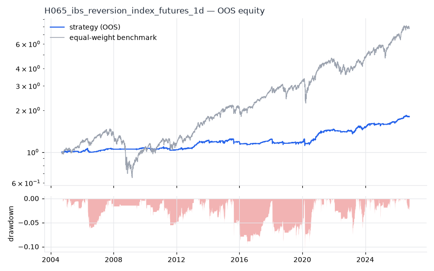
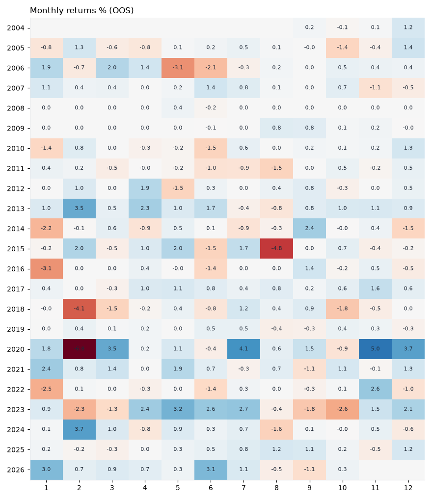
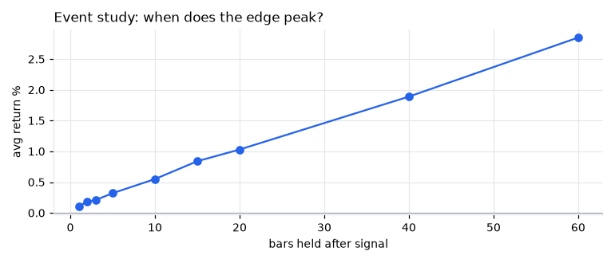
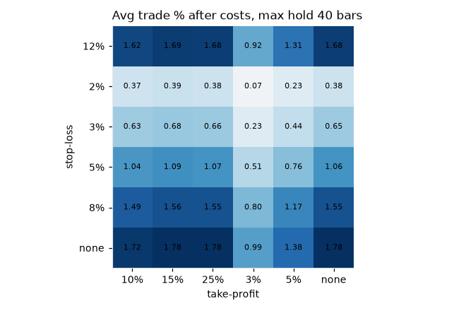

# H065 — ibs_reversion on index_futures [1d]  🟡 WATCH

- Kind: rule · Source: Internal Bar Strength
- For system: `paper_watch`
- Data: 2000-09-18 00:00:00 → 2026-10-21 00:00:00 · 5 assets · 252.7 bars/year · survivorship mask: False
- Costs: {'commission': 0.0001, 'slippage': 0.0003, 'funding_annual': 0.0, 'borrow_annual': 0.0}
- Variants tried (DSR trials): 16 (failed: 0)
- Final variant: `ibs_reversion|lo=0.2,hi=0.7|f=trend_sma200|x=signal_only|size=vol0.1`

## Verdict reasons
- OOS Sharpe (excess of T-bill) 0.202 < 0.5
- with 2x costs it does not beat the equal-weight benchmark
- PBO 0.731 > 0.5 (variant selection is overfit)
- Reality Check p 0.986 > 0.1 (best variant may be data-mined)
- 1-bar delay keeps only 31% of Sharpe (latency-fragile)

## Walk-forward out-of-sample


| Metric | Strategy | Equal-weight benchmark |
|---|---|---|
| years | 22.06 | 22.06 |
| cagr | 0.0271 | 0.0977 |
| vol | 0.0527 | 0.1929 |
| sharpe | 0.533 | 0.58 |
| sharpe_excess_rf | 0.202 | None |
| sortino | 0.285 | 0.816 |
| max_dd | -0.1051 | -0.5558 |
| max_dd_bars | 1301 | 1372 |
| calmar | 0.258 | 0.176 |
| ulcer | 0.0365 | 0.1407 |
| var95 | -0.0039 | -0.0177 |
| cvar95 | -0.0083 | -0.0291 |
| omega | 1.179 | 1.117 |
| tail_ratio | 1.23 | 0.95 |
| skew | -0.87 | -0.081 |
| kurtosis | 31.958 | 13.898 |
| hit_rate | 0.245 | 0.544 |
| turnover_ann | 29.38 | None |

- **Gate Sharpe (excess of T-bill): 0.202**
- Deflated Sharpe: **0.985** · PBO: **0.731** · Reality Check p: **0.986**
- PSR 0.993 · Info ratio -0.477 · Beta 0.123 · Up/Down capture 0.164/0.153
- Sharpe with 2× costs: 0.31 · Walk-forward efficiency: 0.662
- Bootstrap: {'p_sharpe_pos': 0.998, 'cagr_p05': 0.0095, 'maxdd_p05': -0.2138}
- Yearly OOS Sharpe: {'2004': 1.37, '2005': -0.13, '2006': 0.13, '2007': 1.06, '2008': 0.24, '2009': 0.67, '2010': -0.05, '2011': -0.71, '2012': 0.75, '2013': 2.67, '2014': -0.33, '2015': -0.01, '2016': -0.81, '2017': 3.05, '2018': -0.77, '2019': 0.34, '2020': 1.28, '2021': 1.42, '2022': -0.75, '2023': 0.9, '2024': 0.71, '2025': 1.03, '2026': 2.05}



## Regimes (where does it work?)
`{"bull": {"sharpe": 1.12, "ann_ret": 0.0599, "bars": 4357}, "bear": {"sharpe": -1.74, "ann_ret": -0.0856, "bars": 1218}, "calm": {"sharpe": 0.98, "ann_ret": 0.0447, "bars": 2907}, "stressed": {"sharpe": 0.17, "ann_ret": 0.0101, "bars": 2668}, "vix_lt_20": {"sharpe": 1.69, "ann_ret": 0.0742, "bars": 3803}, "vix_20_30": {"sharpe": -0.94, "ann_ret": -0.0594, "bars": 1323}, "vix_ge_30": {"sharpe": -1.33, "ann_ret": -0.1041, "bars": 449}, "curve_inverted": {"sharpe": 0.37, "ann_ret": 0.026, "bars": 813}, "curve_normal": {"sharpe": 0.58, "ann_ret": 0.0285, "bars": 4762}}`

## Calendar profile (weekday / month / hour)
`{"weekday": {"0": 0.00015, "1": 0.00017, "2": 0.00011, "3": 8e-05, "4": 4e-05}, "month": {"1": 7e-05, "2": 2e-05, "3": 0.00012, "4": 0.00018, "5": 0.00018, "6": 4e-05, "7": 0.00026, "8": -0.0001, "9": 0.00012, "10": -1e-05, "11": 0.00025, "12": 0.00023}}`

## Trades (OOS)
`{"n_trades": 1959, "trades_per_year": 88.8, "win_rate": 0.693, "avg_trade": 0.0026, "median_trade": 0.0048, "avg_win": 0.0097, "avg_loss": -0.0136, "profit_factor": 1.616, "payoff": 0.715, "expectancy_r": null, "sqn": null, "kelly_fraction": 0.264, "max_consec_losses": 9, "avg_bars": 2.5, "avg_bars_win": 1.9, "avg_bars_loss": 3.8, "avg_mfe": 0.0099, "avg_mae": -0.0141, "edge_ratio": 0.702, "exit_reasons": {"signal": 1959}, "long_short": {"1": {"count": 1959, "mean": 0.0026}}}`

## Robustness
- **delay**: `{"sharpe": 0.578, "sharpe_delayed_1bar": 0.177, "retained": 0.306}`
- **neighbourhood**: `{"neighbours": 1, "best_sharpe": 0.564, "neighbour_median": 0.567, "share_positive": 1.0, "stability": 1.006}`
- **noise**: `{"noise_bp": 0.002, "sharpe_min": 0.496, "sharpe_median": 0.548}`
- **random_entry**: `{"actual_ret_per_exposure_ann": 0.1734, "random_median_ann": 0.0784, "random_p95_ann": 0.1266, "trades_actual": 2086, "p_value": 0.0}`
- **mc_trade_shuffle**: `{"maxdd_median": -0.0335, "maxdd_p95": -0.0492, "final_p05": 1.0577, "final_median": 1.0577}`

## Timing, take-profit, stop-loss and profit studies (in-sample diagnostics)
- Event study (forward return by bars held): `{"1": {"n": 2856, "mean": 0.0011, "hit": 0.564, "t": 5.6, "per_bar": 0.00112}, "2": {"n": 2856, "mean": 0.0018, "hit": 0.584, "t": 6.24, "per_bar": 0.00088}, "3": {"n": 2856, "mean": 0.0021, "hit": 0.58, "t": 6.13, "per_bar": 0.00071}, "5": {"n": 2853, "mean": 0.0032, "hit": 0.584, "t": 7.07, "per_bar": 0.00063}, "10": {"n": 2846, "mean": 0.0055, "hit": 0.597, "t": 8.76, "per_bar": 0.00055}, "15": {"n": 2844, "mean": 0.0084, "hit": 0.631, "t": 10.91, "per_bar": 0.00056}, "20": {"n": 2841, "mean": 0.0103, "hit": 0.642, "t": 11.85, "per_bar": 0.00051}, "40": {"n": 2816, "mean": 0.0189, "hit": 0.67, "t": 15.73, "per_bar": 0.00047}, "60": {"n": 2791, "mean": 0.0285, "hit": 0.673, "t": 19.35, "per_bar": 0.00048}, "best_holding_bars": 60}`

- Best stop / target / max-hold combinations: `[{"stop": NaN, "target": 0.1, "max_hold": 40, "n": 2856, "mean": 0.0172, "hit": 0.6653, "per_bar": 0.0005, "t": 15.3794}, {"stop": NaN, "target": 0.15, "max_hold": 40, "n": 2856, "mean": 0.0178, "hit": 0.6635, "per_bar": 0.0005, "t": 15.2614}, {"stop": NaN, "target": 0.25, "max_hold": 40, "n": 2856, "mean": 0.0178, "hit": 0.6625, "per_bar": 0.0004, "t": 14.9895}, {"stop": NaN, "target": NaN, "max_hold": 40, "n": 2856, "mean": 0.0178, "hit": 0.6625, "per_bar": 0.0004, "t": 14.983}, {"stop": NaN, "target": 0.05, "max_hold": 40, "n": 2856, "mean": 0.0138, "hit": 0.7041, "per_bar": 0.0005, "t": 14.9599}]`

- Portfolio overlays (vol target, drawdown brake, equity-curve filter): `{"none": {"sharpe": 0.533, "cagr": 0.0271, "max_dd": -0.1051}, "vol_target_0.1": {"sharpe": 0.479, "cagr": 0.0389, "max_dd": -0.1827}, "vol_target_0.15": {"sharpe": 0.519, "cagr": 0.0481, "max_dd": -0.2}, "vol_target_0.2": {"sharpe": 0.531, "cagr": 0.0511, "max_dd": -0.2063}, "dd_brake_0.1": {"sharpe": 0.524, "cagr": 0.0264, "max_dd": -0.104}, "dd_brake_0.2": {"sharpe": 0.533, "cagr": 0.0271, "max_dd": -0.1051}, "equity_ma_42": {"sharpe": 0.312, "cagr": 0.0104, "max_dd": -0.0921}, "equity_ma_126": {"sharpe": 0.411, "cagr": 0.0153, "max_dd": -0.086}, "best_by_calmar": "none"}`
> Studies are in-sample diagnostics. To use a better exit, register it (exits: [...]) and let the gate judge it.

## Kasa koruma (kriz testi, teşhis)

Piyasa: **multi**. Kapsanan krizler: gfc_2008, euro_2011, gold_crash_2013, covid_2020, rates_2022, tariff_apr_2025. Eşikler ve kabul kuralları `config/protection.yaml` içinde, sonuçlardan önce yazıldı. Bu bölüm stratejiyi DEĞİŞTİRMEZ. Bir kuralı kullanmak için hipoteze `overlays:` olarak ekleyin.

Korumasız (tüm geçmiş): CAGR +2.0%, Sharpe 0.578, maks. düşüş -7.2%, MC P(≤−%50) 0.0%

| Kriz | Getiri | Maks. düşüş |
|---|---|---|
| gfc_2008 | +0.0% | 0.0% |
| euro_2011 | -1.2% | -1.1% |
| gold_crash_2013 | +4.1% | -1.2% |
| covid_2020 | -4.5% | -6.2% |
| rates_2022 | -0.6% | -0.7% |
| tariff_apr_2025 | +0.0% | 0.0% |

| Kural | Sonuç (tüm eşikler) | Eşik: krizlerde daha iyi · Sharpe · maks. düşüş |
|---|---|---|
| Kasa düşüş sigortası | ❌ geçmedi | (0.08, 0.16): 0/6 · 0.578 · -7% / (0.1, 0.2): 0/6 · 0.578 · -7% / (0.12, 0.25): 0/6 · 0.578 · -7% |
| Volatilite hedefi | ❌ geçmedi | 0.1: 1/6 · 0.572 · -8% / 0.15: 0/6 · 0.58 · -7% / 0.25: 0/6 · 0.578 · -7% |
| Kasa eğrisi filtresi | ❌ geçmedi | 30: 2/6 · 0.006 · -12% / 60: 3/6 · 0.212 · -8% / 90: 3/6 · 0.218 · -9% |
| Günlük kayıp limiti | ❌ geçmedi | 0.03: 1/6 · 0.553 · -10% / 0.05: 0/6 · 0.578 · -7% / 0.07: 0/6 · 0.578 · -7% |
| Piyasa çöküş bekçisi | ❌ geçmedi | 0.04: 1/6 · 0.524 · -10% / 0.06: 0/6 · 0.564 · -7% / 0.08: 0/6 · 0.573 · -7% |

## Walk-forward windows
- 2021-03-08 00:00:00 → 2021-09-02 00:00:00: IS 1.099 / OOS 1.357 — `ibs_reversion|lo=0.1,hi=0.8|f=trend_sma200|x=signal_only`
- 2021-09-03 00:00:00 → 2022-03-04 00:00:00: IS 1.23 / OOS -0.53 — `ibs_reversion|lo=0.1,hi=0.8|f=trend_sma200|x=signal_only`
- 2022-03-07 00:00:00 → 2022-09-02 00:00:00: IS 1.064 / OOS -1.353 — `ibs_reversion|lo=0.2,hi=0.8|f=trend_sma200|x=signal_only|size=atr_risk0.02`
- 2022-09-06 00:00:00 → 2023-03-07 00:00:00: IS 0.903 / OOS 0.018 — `ibs_reversion|lo=0.2,hi=0.8|f=trend_sma200|x=signal_only|size=atr_risk0.02`
- 2023-03-08 00:00:00 → 2023-09-06 00:00:00: IS 1.001 / OOS 1.983 — `ibs_reversion|lo=0.2,hi=0.8|f=trend_sma200|x=signal_only|size=atr_risk0.02`
- 2023-09-07 00:00:00 → 2024-03-06 00:00:00: IS 1.078 / OOS 0.962 — `ibs_reversion|lo=0.2,hi=0.8|f=trend_sma200|x=signal_only|size=atr_risk0.02`
- 2024-03-07 00:00:00 → 2024-09-05 00:00:00: IS 0.71 / OOS 0.171 — `ibs_reversion|lo=0.1,hi=0.8|f=trend_sma200|x=signal_only`
- 2024-09-06 00:00:00 → 2025-03-07 00:00:00: IS 0.652 / OOS 0.087 — `ibs_reversion|lo=0.1,hi=0.7|f=trend_sma200|x=signal_only`
- 2025-03-10 00:00:00 → 2025-09-05 00:00:00: IS 0.807 / OOS 1.506 — `ibs_reversion|lo=0.2,hi=0.7|f=trend_sma200|x=signal_only|size=atr_risk0.005`
- 2025-09-08 00:00:00 → 2026-03-09 00:00:00: IS 1.033 / OOS 2.458 — `ibs_reversion|lo=0.2,hi=0.7|f=trend_sma200|x=signal_only|size=atr_risk0.005`
- 2026-03-10 00:00:00 → 2026-09-08 00:00:00: IS 1.305 / OOS 1.598 — `ibs_reversion|lo=0.2,hi=0.7|f=trend_sma200|x=signal_only|size=atr_risk0.005`
- 2026-09-09 00:00:00 → 2026-10-21 00:00:00: IS 1.282 / OOS -0.568 — `ibs_reversion|lo=0.2,hi=0.7|f=trend_sma200|x=signal_only|size=vol0.1`

## Best variants (full sample, reference only)
- ibs_reversion|lo=0.2,hi=0.7|f=trend_sma200|x=signal_only|size=atr_risk0.02: Sharpe 0.641
- ibs_reversion|lo=0.2,hi=0.8|f=trend_sma200|x=signal_only|size=atr_risk0.02: Sharpe 0.629
- ibs_reversion|lo=0.2,hi=0.7|f=trend_sma200|x=signal_only: Sharpe 0.626
- ibs_reversion|lo=0.2,hi=0.8|f=trend_sma200|x=signal_only|size=atr_risk0.01: Sharpe 0.616
- ibs_reversion|lo=0.2,hi=0.7|f=trend_sma200|x=signal_only|size=atr_risk0.01: Sharpe 0.616
- ibs_reversion|lo=0.2,hi=0.8|f=trend_sma200|x=signal_only: Sharpe 0.609
- ibs_reversion|lo=0.2,hi=0.7|f=trend_sma200|x=signal_only|size=vol0.2: Sharpe 0.599
- ibs_reversion|lo=0.2,hi=0.8|f=trend_sma200|x=signal_only|size=vol0.2: Sharpe 0.595
- ibs_reversion|lo=0.2,hi=0.8|f=trend_sma200|x=signal_only|size=atr_risk0.005: Sharpe 0.585
- ibs_reversion|lo=0.1,hi=0.8|f=trend_sma200|x=signal_only: Sharpe 0.584

## Current targets / signals
```json
{
 "positions": {
  "NQ=F": 0.1025
 },
 "entry_long_next_open": [],
 "exit_long_next_open": [
  "NQ=F"
 ],
 "entry_short_next_open": []
}
```

> Survivorship bias: unless a membership mask is used, universes are today's members (upper-bound results).