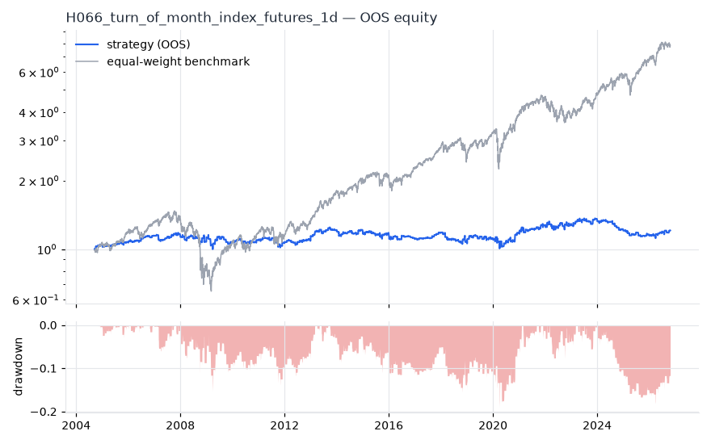
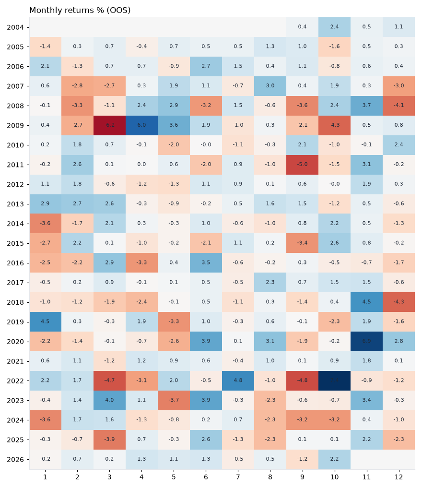
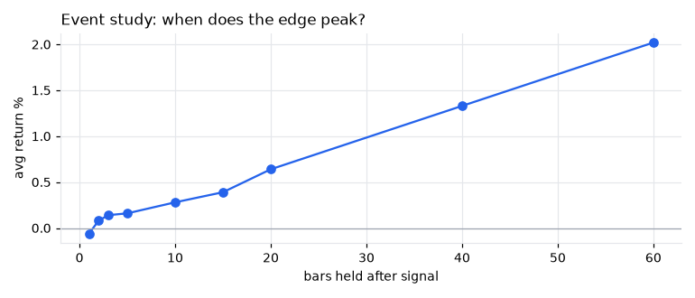
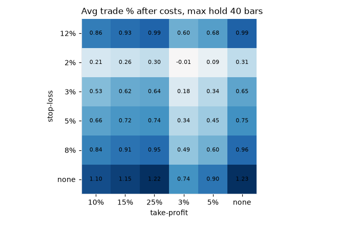

# H066 — turn_of_month on index_futures [1d]  ❌ REJECT

- Kind: rule · Source: Ariel (1987) 'A monthly effect in stock returns'; Lakonishok & Smidt (1988): gains cluster around the turn of the month
- For system: `research_only`
- Data: 2000-09-18 00:00:00 → 2026-10-21 00:00:00 · 5 assets · 252.7 bars/year · survivorship mask: False
- Costs: {'commission': 0.0001, 'slippage': 0.0003, 'funding_annual': 0.0, 'borrow_annual': 0.0}
- Variants tried (DSR trials): 22 (failed: 0)
- Final variant: `turn_of_month|pre=1,post=3|f=none|x=signal_only`

## Verdict reasons
- DSR 0.489 < 0.9 (luck not excluded after 22 trials)
- OOS Sharpe (excess of T-bill) -0.074 < 0.5
- bootstrap P(SR>0) 0.78 < 0.85
- with 2x costs it does not beat the equal-weight benchmark
- PBO 0.582 > 0.5 (variant selection is overfit)
- Reality Check p 1.0 > 0.1 (best variant may be data-mined)
- random entries match it (p=1.0): the edge is in the exits, not the signal

## Walk-forward out-of-sample


| Metric | Strategy | Equal-weight benchmark |
|---|---|---|
| years | 22.06 | 22.06 |
| cagr | 0.0086 | 0.0979 |
| vol | 0.0786 | 0.1929 |
| sharpe | 0.148 | 0.581 |
| sharpe_excess_rf | -0.074 | None |
| sortino | -0.104 | 0.817 |
| max_dd | -0.1921 | -0.5558 |
| max_dd_bars | 1996 | 1372 |
| calmar | 0.045 | 0.176 |
| ulcer | 0.0796 | 0.1407 |
| var95 | -0.0057 | -0.0177 |
| cvar95 | -0.013 | -0.0291 |
| omega | 1.055 | 1.117 |
| tail_ratio | 1.161 | 0.95 |
| skew | -0.489 | -0.081 |
| kurtosis | 33.159 | 13.897 |
| hit_rate | 0.136 | 0.544 |
| turnover_ann | 21.46 | None |

- **Gate Sharpe (excess of T-bill): -0.074**
- Deflated Sharpe: **0.489** · PBO: **0.582** · Reality Check p: **1.0**
- PSR 0.756 · Info ratio -0.584 · Beta 0.186 · Up/Down capture 0.204/0.216
- Sharpe with 2× costs: 0.039 · Walk-forward efficiency: 0.231
- Bootstrap: {'p_sharpe_pos': 0.78, 'cagr_p05': -0.0151, 'maxdd_p05': -0.4279}
- Yearly OOS Sharpe: {'2004': 3.11, '2005': 0.57, '2006': 1.57, '2007': 0.03, '2008': -0.23, '2009': -0.3, '2010': 0.43, '2011': -0.35, '2012': 0.79, '2013': 1.5, '2014': -0.26, '2015': -0.31, '2016': -0.76, '2017': 1.88, '2018': -0.96, '2019': 0.3, '2020': 0.54, '2021': 0.85, '2022': 0.15, '2023': 0.79, '2024': -1.73, '2025': -0.99, '2026': 0.97}



## Regimes (where does it work?)
`{"bull": {"sharpe": 0.49, "ann_ret": 0.0307, "bars": 4357}, "bear": {"sharpe": -0.47, "ann_ret": -0.0565, "bars": 1218}, "calm": {"sharpe": 0.26, "ann_ret": 0.014, "bars": 2907}, "stressed": {"sharpe": 0.09, "ann_ret": 0.0091, "bars": 2668}, "vix_lt_20": {"sharpe": 0.89, "ann_ret": 0.0483, "bars": 3803}, "vix_20_30": {"sharpe": -0.34, "ann_ret": -0.0314, "bars": 1323}, "vix_ge_30": {"sharpe": -1.05, "ann_ret": -0.1722, "bars": 449}, "curve_inverted": {"sharpe": -0.55, "ann_ret": -0.0409, "bars": 813}, "curve_normal": {"sharpe": 0.26, "ann_ret": 0.0206, "bars": 4762}}`

## Calendar profile (weekday / month / hour)
`{"weekday": {"0": 6e-05, "1": -6e-05, "2": 0.00023, "3": 0.00011, "4": -0.00011}, "month": {"1": -8e-05, "2": 3e-05, "3": -0.00013, "4": 6e-05, "5": -4e-05, "6": 0.00039, "7": 8e-05, "8": 7e-05, "9": -0.00039, "10": 0.00013, "11": 0.00074, "12": -0.00031}}`

## Trades (OOS)
`{"n_trades": 1171, "trades_per_year": 53.1, "win_rate": 0.549, "avg_trade": 0.0016, "median_trade": 0.0027, "avg_win": 0.0176, "avg_loss": -0.0179, "profit_factor": 1.196, "payoff": 0.982, "expectancy_r": null, "sqn": null, "kelly_fraction": 0.09, "max_consec_losses": 18, "avg_bars": 4.0, "avg_bars_win": 4.0, "avg_bars_loss": 4.0, "avg_mfe": 0.017, "avg_mae": -0.0186, "edge_ratio": 0.91, "exit_reasons": {"signal": 1171}, "long_short": {"1": {"count": 1171, "mean": 0.0016}}}`

## Robustness
- **delay**: `{"sharpe": 0.14, "sharpe_delayed_1bar": 0.126, "retained": 0.902}`
- **neighbourhood**: `{"neighbours": 5, "best_sharpe": 0.14, "neighbour_median": 0.071, "share_positive": 1.0, "stability": 0.512}`
- **noise**: `{"noise_bp": 0.002, "sharpe_min": 0.135, "sharpe_median": 0.142}`
- **random_entry**: `{"actual_ret_per_exposure_ann": 0.0623, "random_median_ann": 0.0973, "random_p95_ann": 0.1253, "trades_actual": 1305, "p_value": 1.0}`
- **mc_trade_shuffle**: `{"maxdd_median": -0.1048, "maxdd_p95": -0.1589, "final_p05": 0.5488, "final_median": 0.5488}`

## Timing, take-profit, stop-loss and profit studies (in-sample diagnostics)
- Event study (forward return by bars held): `{"1": {"n": 1310, "mean": -0.0006, "hit": 0.456, "t": -1.9, "per_bar": -0.00059}, "2": {"n": 1305, "mean": 0.0008, "hit": 0.55, "t": 1.52, "per_bar": 0.0004}, "3": {"n": 1305, "mean": 0.0014, "hit": 0.556, "t": 2.34, "per_bar": 0.00047}, "5": {"n": 1305, "mean": 0.0016, "hit": 0.575, "t": 2.06, "per_bar": 0.00033}, "10": {"n": 1305, "mean": 0.0028, "hit": 0.573, "t": 2.52, "per_bar": 0.00028}, "15": {"n": 1305, "mean": 0.0039, "hit": 0.608, "t": 2.89, "per_bar": 0.00026}, "20": {"n": 1300, "mean": 0.0064, "hit": 0.61, "t": 4.28, "per_bar": 0.00032}, "40": {"n": 1295, "mean": 0.0133, "hit": 0.626, "t": 6.15, "per_bar": 0.00033}, "60": {"n": 1290, "mean": 0.0202, "hit": 0.645, "t": 8.01, "per_bar": 0.00034}, "best_holding_bars": 60}`

- Best stop / target / max-hold combinations: `[{"stop": NaN, "target": NaN, "max_hold": 40, "n": 1310, "mean": 0.0123, "hit": 0.6229, "per_bar": 0.0003, "t": 5.7546}, {"stop": NaN, "target": 0.25, "max_hold": 40, "n": 1310, "mean": 0.0122, "hit": 0.6229, "per_bar": 0.0003, "t": 5.7472}, {"stop": NaN, "target": 0.03, "max_hold": 40, "n": 1310, "mean": 0.0074, "hit": 0.7725, "per_bar": 0.0004, "t": 5.6249}, {"stop": NaN, "target": 0.1, "max_hold": 40, "n": 1310, "mean": 0.011, "hit": 0.6305, "per_bar": 0.0003, "t": 5.5785}, {"stop": NaN, "target": 0.15, "max_hold": 40, "n": 1310, "mean": 0.0115, "hit": 0.6237, "per_bar": 0.0003, "t": 5.5727}]`

- Portfolio overlays (vol target, drawdown brake, equity-curve filter): `{"none": {"sharpe": 0.148, "cagr": 0.0086, "max_dd": -0.1921}, "vol_target_0.1": {"sharpe": 0.001, "cagr": -0.0056, "max_dd": -0.396}, "vol_target_0.15": {"sharpe": 0.068, "cagr": 0.0003, "max_dd": -0.352}, "vol_target_0.2": {"sharpe": 0.128, "cagr": 0.008, "max_dd": -0.3451}, "dd_brake_0.1": {"sharpe": 0.021, "cagr": -0.0009, "max_dd": -0.2579}, "dd_brake_0.2": {"sharpe": 0.148, "cagr": 0.0086, "max_dd": -0.1921}, "equity_ma_42": {"sharpe": -0.284, "cagr": -0.0161, "max_dd": -0.338}, "equity_ma_126": {"sharpe": -0.14, "cagr": -0.0085, "max_dd": -0.2314}, "best_by_calmar": "none"}`
> Studies are in-sample diagnostics. To use a better exit, register it (exits: [...]) and let the gate judge it.

## Kasa koruma (kriz testi, teşhis)

Piyasa: **multi**. Kapsanan krizler: gfc_2008, euro_2011, gold_crash_2013, covid_2020, rates_2022, tariff_apr_2025. Eşikler ve kabul kuralları `config/protection.yaml` içinde, sonuçlardan önce yazıldı. Bu bölüm stratejiyi DEĞİŞTİRMEZ. Bir kuralı kullanmak için hipoteze `overlays:` olarak ekleyin.

Korumasız (tüm geçmiş): CAGR +0.7%, Sharpe 0.14, maks. düşüş -20.6%, MC P(≤−%50) 0.0%

| Kriz | Getiri | Maks. düşüş |
|---|---|---|
| gfc_2008 | -8.0% | -11.7% |
| euro_2011 | -6.7% | -7.8% |
| gold_crash_2013 | -1.4% | -2.9% |
| covid_2020 | +4.2% | -2.1% |
| rates_2022 | +1.8% | -4.0% |
| tariff_apr_2025 | -4.8% | -5.6% |

| Kural | Sonuç (tüm eşikler) | Eşik: krizlerde daha iyi · Sharpe · maks. düşüş |
|---|---|---|
| Kasa düşüş sigortası | ❌ geçmedi | (0.08, 0.16): 3/6 · -0.165 · -35% / (0.1, 0.2): 3/6 · -0.019 · -25% / (0.12, 0.25): 3/6 · 0.064 · -17% |
| Volatilite hedefi | ❌ geçmedi | 0.1: 3/6 · 0.168 · -19% / 0.15: 3/6 · 0.141 · -19% / 0.25: 0/6 · 0.136 · -21% |
| Kasa eğrisi filtresi | ❌ geçmedi | 30: 4/6 · -0.104 · -30% / 60: 4/6 · -0.061 · -26% / 90: 4/6 · -0.069 · -26% |
| Günlük kayıp limiti | ❌ geçmedi | 0.03: 2/6 · 0.117 · -23% / 0.05: 1/6 · 0.107 · -23% / 0.07: 0/6 · 0.14 · -21% |
| Piyasa çöküş bekçisi | ❌ geçmedi | 0.04: 1/6 · 0.079 · -25% / 0.06: 0/6 · 0.101 · -22% / 0.08: 0/6 · 0.121 · -21% |

## Walk-forward windows
- 2021-03-08 00:00:00 → 2021-09-02 00:00:00: IS 0.948 / OOS 2.064 — `turn_of_month|pre=2,post=4|f=none|x=signal_only`
- 2021-09-03 00:00:00 → 2022-03-04 00:00:00: IS 0.828 / OOS 0.811 — `turn_of_month|pre=2,post=4|f=none|x=signal_only`
- 2022-03-07 00:00:00 → 2022-09-02 00:00:00: IS 0.864 / OOS -0.303 — `turn_of_month|pre=2,post=4|f=none|x=signal_only`
- 2022-09-06 00:00:00 → 2023-03-07 00:00:00: IS 0.807 / OOS 0.87 — `turn_of_month|pre=2,post=3|f=none|x=signal_only|size=atr_risk0.01`
- 2023-03-08 00:00:00 → 2023-09-06 00:00:00: IS 1.089 / OOS 0.004 — `turn_of_month|pre=2,post=3|f=none|x=signal_only|size=atr_risk0.01`
- 2023-09-07 00:00:00 → 2024-03-06 00:00:00: IS 1.217 / OOS 0.359 — `turn_of_month|pre=2,post=2|f=none|x=signal_only`
- 2024-03-07 00:00:00 → 2024-09-05 00:00:00: IS 1.195 / OOS -1.539 — `turn_of_month|pre=3,post=1|f=none|x=signal_only`
- 2024-09-06 00:00:00 → 2025-03-07 00:00:00: IS 0.763 / OOS -2.356 — `turn_of_month|pre=2,post=1|f=none|x=signal_only`
- 2025-03-10 00:00:00 → 2025-09-05 00:00:00: IS 0.436 / OOS -1.221 — `turn_of_month|pre=3,post=1|f=none|x=signal_only`
- 2025-09-08 00:00:00 → 2026-03-09 00:00:00: IS 0.146 / OOS 0.419 — `turn_of_month|pre=3,post=1|f=none|x=signal_only`
- 2026-03-10 00:00:00 → 2026-09-08 00:00:00: IS 0.037 / OOS 0.768 — `turn_of_month|pre=3,post=1|f=none|x=signal_only`
- 2026-09-09 00:00:00 → 2026-10-21 00:00:00: IS 0.24 / OOS 4.854 — `turn_of_month|pre=1,post=3|f=none|x=signal_only`

## Best variants (full sample, reference only)
- turn_of_month|pre=3,post=3|f=none|x=signal_only|size=atr_risk0.01: Sharpe 0.331
- turn_of_month|pre=3,post=3|f=none|x=signal_only|size=vol0.2: Sharpe 0.3
- turn_of_month|pre=3,post=3|f=none|x=signal_only|size=atr_risk0.02: Sharpe 0.291
- turn_of_month|pre=3,post=3|f=none|x=signal_only: Sharpe 0.277
- turn_of_month|pre=3,post=3|f=none|x=signal_only|size=atr_risk0.005: Sharpe 0.266
- turn_of_month|pre=2,post=3|f=none|x=signal_only: Sharpe 0.257
- turn_of_month|pre=2,post=3|f=none|x=signal_only|size=atr_risk0.01: Sharpe 0.257
- turn_of_month|pre=2,post=3|f=none|x=signal_only|size=atr_risk0.02: Sharpe 0.244
- turn_of_month|pre=3,post=3|f=none|x=signal_only|size=vol0.1: Sharpe 0.244
- turn_of_month|pre=2,post=3|f=none|x=signal_only|size=vol0.2: Sharpe 0.231

## Current targets / signals
```json
{
 "positions": {
  "ES=F": 0.2,
  "NQ=F": 0.2,
  "YM=F": 0.2,
  "RTY=F": 0.2,
  "NKD=F": 0.2
 },
 "entry_long_next_open": [],
 "exit_long_next_open": [
  "ES=F",
  "NQ=F",
  "YM=F",
  "RTY=F",
  "NKD=F"
 ],
 "entry_short_next_open": []
}
```

> Survivorship bias: unless a membership mask is used, universes are today's members (upper-bound results).