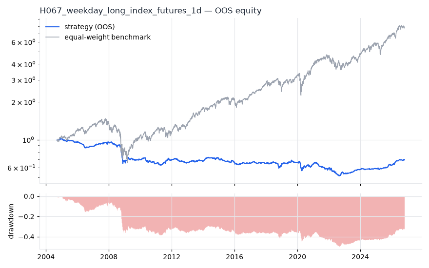
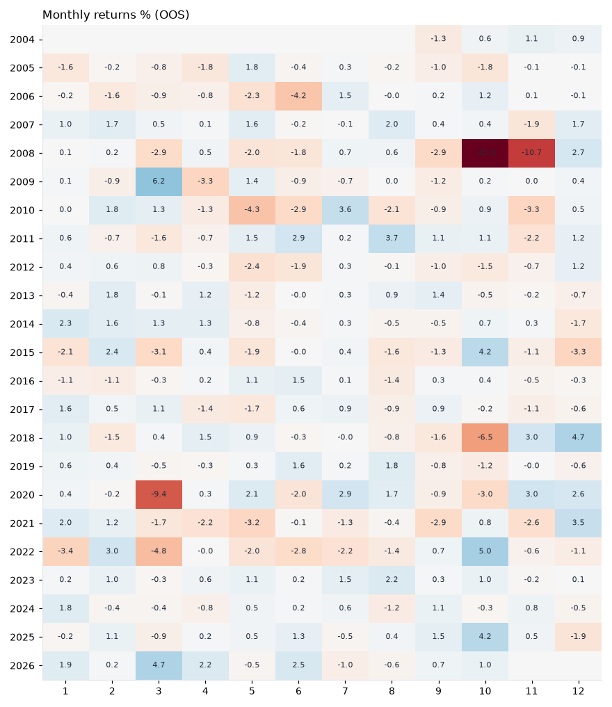
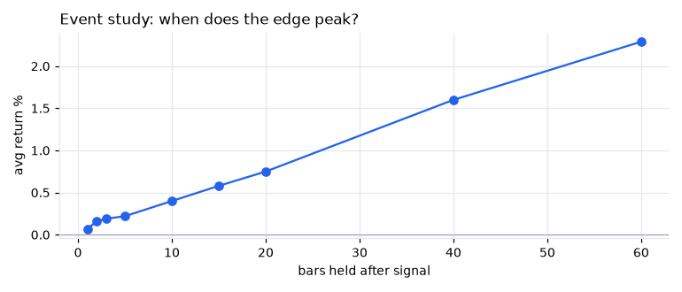
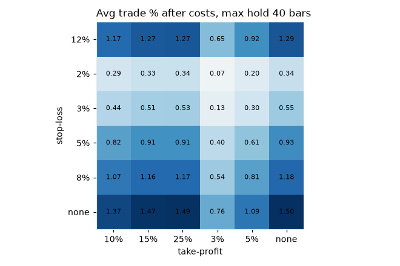

# H067 — weekday_long on index_futures [1d]  ❌ REJECT

- Kind: rule · Source: French (1980) 'Stock returns and the weekend effect'; Gibbons & Hess (1981): returns differ by weekday
- For system: `research_only`
- Data: 2000-09-18 00:00:00 → 2026-10-21 00:00:00 · 5 assets · 252.7 bars/year · survivorship mask: False
- Costs: {'commission': 0.0001, 'slippage': 0.0003, 'funding_annual': 0.0, 'borrow_annual': 0.0}
- Variants tried (DSR trials): 15 (failed: 0)
- Final variant: `weekday_long|day=0|f=none|x=signal_only|size=atr_risk0.01`

## Verdict reasons
- DSR 0.01 < 0.9 (luck not excluded after 15 trials)
- OOS Sharpe (excess of T-bill) -0.471 < 0.5
- OOS MaxDD -0.4946 worse than -0.45 (local or USD)
- bootstrap P(SR>0) 0.195 < 0.85
- only 52% of OOS years positive
- with 2x costs it does not beat the equal-weight benchmark
- PBO 0.786 > 0.5 (variant selection is overfit)
- Reality Check p 1.0 > 0.1 (best variant may be data-mined)
- random entries match it (p=1.0): the edge is in the exits, not the signal

## Walk-forward out-of-sample


| Metric | Strategy | Equal-weight benchmark |
|---|---|---|
| years | 22.06 | 22.06 |
| cagr | -0.0163 | 0.0979 |
| vol | 0.0672 | 0.1929 |
| sharpe | -0.211 | 0.581 |
| sharpe_excess_rf | -0.471 | None |
| sortino | -0.618 | 0.817 |
| max_dd | -0.4946 | -0.5558 |
| max_dd_bars | 5514 | 1372 |
| calmar | -0.033 | 0.176 |
| ulcer | 0.3371 | 0.1407 |
| var95 | -0.0043 | -0.0177 |
| cvar95 | -0.011 | -0.0291 |
| omega | 0.925 | 1.117 |
| tail_ratio | 1.11 | 0.95 |
| skew | -2.207 | -0.081 |
| kurtosis | 58.443 | 13.897 |
| hit_rate | 0.173 | 0.544 |
| turnover_ann | 85.78 | None |

- **Gate Sharpe (excess of T-bill): -0.471**
- Deflated Sharpe: **0.01** · PBO: **0.786** · Reality Check p: **1.0**
- PSR 0.157 · Info ratio -0.719 · Beta 0.147 · Up/Down capture 0.143/0.174
- Sharpe with 2× costs: -0.721 · Walk-forward efficiency: -0.456
- Bootstrap: {'p_sharpe_pos': 0.195, 'cagr_p05': -0.0444, 'maxdd_p05': -0.6738}
- Yearly OOS Sharpe: {'2004': 0.94, '2005': -1.68, '2006': -1.73, '2007': 1.41, '2008': -2.25, '2009': 0.18, '2010': -1.03, '2011': 0.96, '2012': -1.05, '2013': 0.54, '2014': 0.89, '2015': -1.41, '2016': -0.19, '2017': -0.06, '2018': 0.08, '2019': 0.29, '2020': -0.19, '2021': -1.1, '2022': -1.14, '2023': 2.2, '2024': 0.47, '2025': 1.36, '2026': 2.75}



## Regimes (where does it work?)
`{"bull": {"sharpe": 0.34, "ann_ret": 0.0167, "bars": 4357}, "bear": {"sharpe": -1.14, "ann_ret": -0.1246, "bars": 1218}, "calm": {"sharpe": -0.21, "ann_ret": -0.0091, "bars": 2907}, "stressed": {"sharpe": -0.23, "ann_ret": -0.0197, "bars": 2668}, "vix_lt_20": {"sharpe": 0.62, "ann_ret": 0.026, "bars": 3803}, "vix_20_30": {"sharpe": -0.69, "ann_ret": -0.0495, "bars": 1323}, "vix_ge_30": {"sharpe": -1.56, "ann_ret": -0.2505, "bars": 449}, "curve_inverted": {"sharpe": 0.7, "ann_ret": 0.0296, "bars": 813}, "curve_normal": {"sharpe": -0.31, "ann_ret": -0.0217, "bars": 4762}}`

## Calendar profile (weekday / month / hour)
`{"weekday": {"0": 0.00016, "1": -1e-05, "2": -0.00024, "3": -0.00015, "4": -2e-05}, "month": {"1": 0.00012, "2": 0.00025, "3": -0.00025, "4": -9e-05, "5": -0.0002, "6": -0.00015, "7": 0.00018, "8": 5e-05, "9": -0.00017, "10": -0.00019, "11": -0.00037, "12": 0.00019}}`

## Trades (OOS)
`{"n_trades": 4631, "trades_per_year": 209.9, "win_rate": 0.547, "avg_trade": 0.0008, "median_trade": 0.0009, "avg_win": 0.0085, "avg_loss": -0.0084, "profit_factor": 1.222, "payoff": 1.01, "expectancy_r": null, "sqn": null, "kelly_fraction": 0.099, "max_consec_losses": 21, "avg_bars": 1.0, "avg_bars_win": 1.0, "avg_bars_loss": 1.0, "avg_mfe": 0.0081, "avg_mae": -0.0081, "edge_ratio": 1.007, "exit_reasons": {"signal": 4631}, "long_short": {"1": {"count": 4631, "mean": 0.0008}}}`

## Robustness
- **delay**: `{"sharpe": -0.043, "sharpe_delayed_1bar": -0.182, "retained": null}`
- **neighbourhood**: `{"neighbours": 1, "best_sharpe": -0.043, "neighbour_median": -0.28, "share_positive": 0.0, "stability": null}`
- **noise**: `{"noise_bp": 0.002, "sharpe_min": -0.095, "sharpe_median": -0.035}`
- **random_entry**: `{"actual_ret_per_exposure_ann": -0.0159, "random_median_ann": 0.0314, "random_p95_ann": 0.0456, "trades_actual": 5181, "p_value": 1.0}`
- **mc_trade_shuffle**: `{"maxdd_median": -0.0725, "maxdd_p95": -0.1061, "final_p05": 1.2494, "final_median": 1.2494}`

## Timing, take-profit, stop-loss and profit studies (in-sample diagnostics)
- Event study (forward return by bars held): `{"1": {"n": 5194, "mean": 0.0007, "hit": 0.547, "t": 3.52, "per_bar": 0.00066}, "2": {"n": 5194, "mean": 0.0016, "hit": 0.555, "t": 6.46, "per_bar": 0.00078}, "3": {"n": 5194, "mean": 0.0019, "hit": 0.56, "t": 6.16, "per_bar": 0.00062}, "5": {"n": 5189, "mean": 0.0022, "hit": 0.562, "t": 5.64, "per_bar": 0.00044}, "10": {"n": 5184, "mean": 0.004, "hit": 0.587, "t": 7.49, "per_bar": 0.0004}, "15": {"n": 5179, "mean": 0.0058, "hit": 0.606, "t": 8.61, "per_bar": 0.00038}, "20": {"n": 5174, "mean": 0.0075, "hit": 0.621, "t": 9.82, "per_bar": 0.00038}, "40": {"n": 5159, "mean": 0.016, "hit": 0.64, "t": 15.25, "per_bar": 0.0004}, "60": {"n": 5139, "mean": 0.0229, "hit": 0.653, "t": 17.88, "per_bar": 0.00038}, "best_holding_bars": 60}`

- Best stop / target / max-hold combinations: `[{"stop": NaN, "target": 0.15, "max_hold": 40, "n": 5194, "mean": 0.0147, "hit": 0.6367, "per_bar": 0.0004, "t": 14.6569}, {"stop": NaN, "target": NaN, "max_hold": 40, "n": 5194, "mean": 0.015, "hit": 0.635, "per_bar": 0.0004, "t": 14.4536}, {"stop": NaN, "target": 0.25, "max_hold": 40, "n": 5194, "mean": 0.0149, "hit": 0.635, "per_bar": 0.0004, "t": 14.4471}, {"stop": NaN, "target": 0.1, "max_hold": 40, "n": 5194, "mean": 0.0137, "hit": 0.6423, "per_bar": 0.0004, "t": 14.3944}, {"stop": NaN, "target": 0.05, "max_hold": 40, "n": 5194, "mean": 0.0109, "hit": 0.6979, "per_bar": 0.0004, "t": 13.7561}]`

- Portfolio overlays (vol target, drawdown brake, equity-curve filter): `{"none": {"sharpe": -0.211, "cagr": -0.0163, "max_dd": -0.4946}, "vol_target_0.1": {"sharpe": -0.164, "cagr": -0.0206, "max_dd": -0.6536}, "vol_target_0.15": {"sharpe": -0.195, "cagr": -0.0286, "max_dd": -0.722}, "vol_target_0.2": {"sharpe": -0.194, "cagr": -0.031, "max_dd": -0.7358}, "dd_brake_0.1": {"sharpe": -0.265, "cagr": -0.0103, "max_dd": -0.328}, "dd_brake_0.2": {"sharpe": -0.295, "cagr": -0.013, "max_dd": -0.3681}, "equity_ma_42": {"sharpe": -0.016, "cagr": -0.0014, "max_dd": -0.2052}, "equity_ma_126": {"sharpe": 0.108, "cagr": 0.0033, "max_dd": -0.1731}, "best_by_calmar": "equity_ma_126"}`
> Studies are in-sample diagnostics. To use a better exit, register it (exits: [...]) and let the gate judge it.

## Kasa koruma (kriz testi, teşhis)

Piyasa: **multi**. Kapsanan krizler: gfc_2008, euro_2011, gold_crash_2013, covid_2020, rates_2022, tariff_apr_2025. Eşikler ve kabul kuralları `config/protection.yaml` içinde, sonuçlardan önce yazıldı. Bu bölüm stratejiyi DEĞİŞTİRMEZ. Bir kuralı kullanmak için hipoteze `overlays:` olarak ekleyin.

Korumasız (tüm geçmiş): CAGR -0.5%, Sharpe -0.043, maks. düşüş -50.4%, MC P(≤−%50) 0.0%

| Kriz | Getiri | Maks. düşüş |
|---|---|---|
| gfc_2008 | -13.8% | -13.8% |
| euro_2011 | -3.0% | -3.9% |
| gold_crash_2013 | -0.6% | -2.4% |
| covid_2020 | -7.2% | -9.6% |
| rates_2022 | -6.3% | -9.1% |
| tariff_apr_2025 | +2.0% | 0.0% |

| Kural | Sonuç (tüm eşikler) | Eşik: krizlerde daha iyi · Sharpe · maks. düşüş |
|---|---|---|
| Kasa düşüş sigortası | ❌ geçmedi | (0.08, 0.16): 5/6 · -0.277 · -12% / (0.1, 0.2): 5/6 · -0.345 · -18% / (0.12, 0.25): 5/6 · -0.406 · -22% |
| Volatilite hedefi | ❌ geçmedi | 0.1: 2/6 · -0.055 · -50% / 0.15: 1/6 · -0.047 · -50% / 0.25: 1/6 · -0.045 · -50% |
| Kasa eğrisi filtresi | ❌ geçmedi | 30: 4/6 · -0.314 · -45% / 60: 5/6 · -0.083 · -38% / 90: 5/6 · -0.107 · -40% |
| Günlük kayıp limiti | ❌ geçmedi | 0.03: 1/6 · -0.047 · -51% / 0.05: 0/6 · -0.048 · -51% / 0.07: 0/6 · -0.043 · -50% |
| Piyasa çöküş bekçisi | ❌ geçmedi | 0.04: 1/6 · -0.067 · -51% / 0.06: 1/6 · -0.047 · -51% / 0.08: 0/6 · -0.047 · -51% |

## Walk-forward windows
- 2021-03-08 00:00:00 → 2021-09-02 00:00:00: IS 0.597 / OOS -2.729 — `weekday_long|day=1|f=none|x=signal_only`
- 2021-09-03 00:00:00 → 2022-03-04 00:00:00: IS 0.381 / OOS -0.794 — `weekday_long|day=1|f=none|x=signal_only`
- 2022-03-07 00:00:00 → 2022-09-02 00:00:00: IS 0.75 / OOS -2.868 — `weekday_long|day=0|f=none|x=signal_only|size=atr_risk0.01`
- 2022-09-06 00:00:00 → 2023-03-07 00:00:00: IS 0.454 / OOS 1.337 — `weekday_long|day=0|f=none|x=signal_only|size=atr_risk0.01`
- 2023-03-08 00:00:00 → 2023-09-06 00:00:00: IS 0.475 / OOS 3.266 — `weekday_long|day=0|f=none|x=signal_only|size=atr_risk0.01`
- 2023-09-07 00:00:00 → 2024-03-06 00:00:00: IS 0.515 / OOS 1.627 — `weekday_long|day=0|f=none|x=signal_only|size=vol0.1`
- 2024-03-07 00:00:00 → 2024-09-05 00:00:00: IS 0.416 / OOS -0.497 — `weekday_long|day=0|f=none|x=signal_only|size=vol0.1`
- 2024-09-06 00:00:00 → 2025-03-07 00:00:00: IS 0.313 / OOS 0.649 — `weekday_long|day=0|f=none|x=signal_only|size=vol0.1`
- 2025-03-10 00:00:00 → 2025-09-05 00:00:00: IS 0.403 / OOS 1.08 — `weekday_long|day=0|f=none|x=signal_only|size=vol0.1`
- 2025-09-08 00:00:00 → 2026-03-09 00:00:00: IS 1.231 / OOS 2.823 — `weekday_long|day=0|f=none|x=signal_only|size=atr_risk0.01`
- 2026-03-10 00:00:00 → 2026-09-08 00:00:00: IS 1.508 / OOS 2.373 — `weekday_long|day=0|f=none|x=signal_only|size=atr_risk0.005`
- 2026-09-09 00:00:00 → 2026-10-21 00:00:00: IS 1.594 / OOS 2.41 — `weekday_long|day=0|f=none|x=signal_only|size=atr_risk0.01`

## Best variants (full sample, reference only)
- weekday_long|day=0|f=none|x=signal_only: Sharpe -0.025
- weekday_long|day=0|f=none|x=signal_only|size=vol0.2: Sharpe -0.037
- weekday_long|day=0|f=none|x=signal_only|size=atr_risk0.01: Sharpe -0.043
- weekday_long|day=0|f=none|x=signal_only|size=vol0.1: Sharpe -0.046
- weekday_long|day=0|f=none|x=signal_only|size=atr_risk0.005: Sharpe -0.053
- weekday_long|day=0|f=none|x=signal_only|size=atr_risk0.02: Sharpe -0.088
- weekday_long|day=1|f=none|x=signal_only: Sharpe -0.126
- weekday_long|day=2|f=none|x=signal_only: Sharpe -0.169
- weekday_long|day=1|f=none|x=signal_only|size=atr_risk0.02: Sharpe -0.19
- weekday_long|day=1|f=none|x=signal_only|size=vol0.2: Sharpe -0.257

## Current targets / signals
```json
{
 "positions": {},
 "entry_long_next_open": [],
 "exit_long_next_open": [],
 "entry_short_next_open": []
}
```

> Survivorship bias: unless a membership mask is used, universes are today's members (upper-bound results).