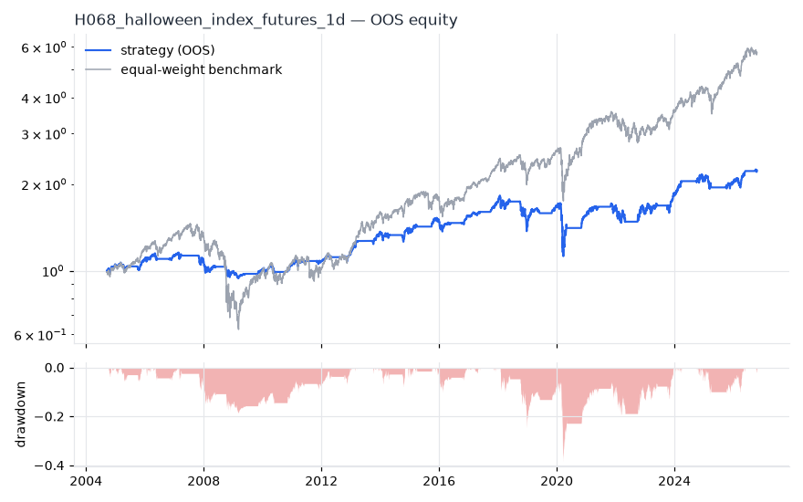
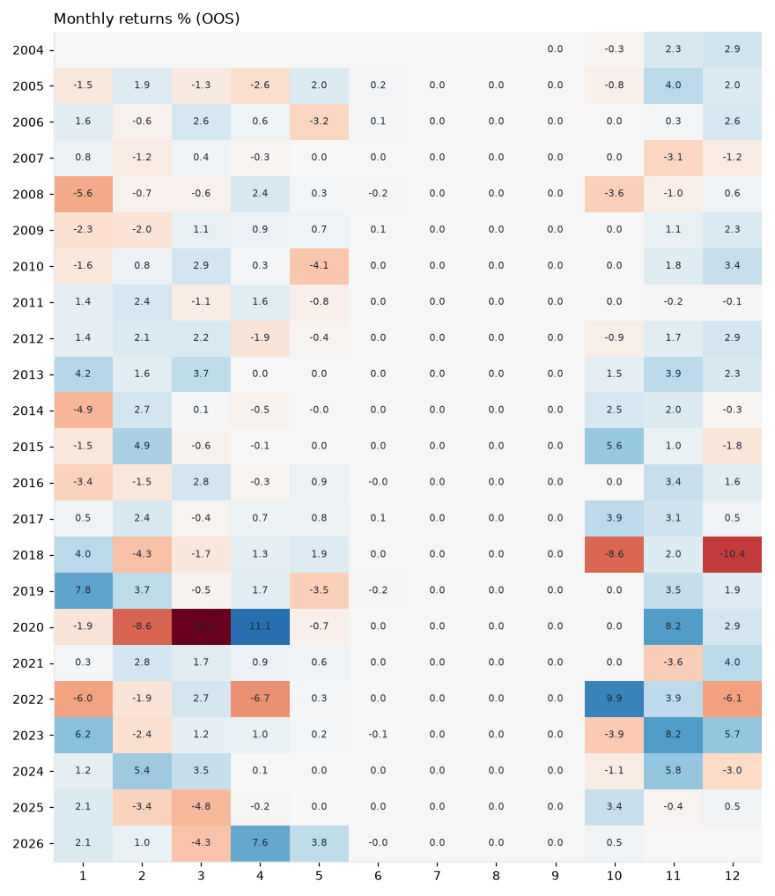
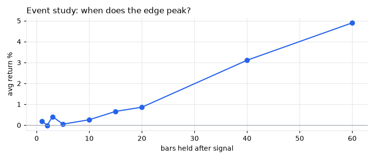
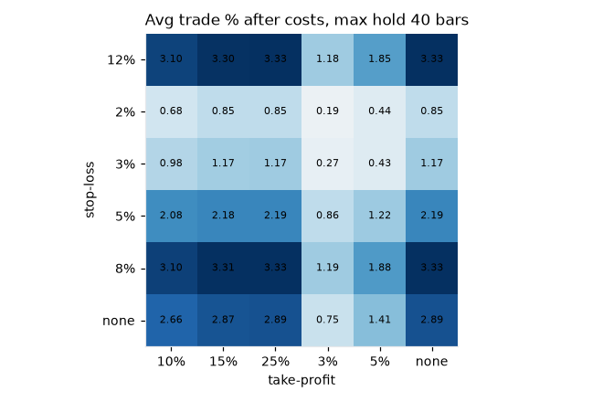

# H068 — halloween on index_futures [1d]  🟡 WATCH

- Kind: rule · Source: Bouman & Jacobsen (2002) 'The Halloween indicator, Sell in May and go away': winter months beat summer
- For system: `research_only`
- Data: 2000-09-18 00:00:00 → 2026-10-21 00:00:00 · 4 assets · 252.7 bars/year · survivorship mask: False
- Costs: {'commission': 0.0001, 'slippage': 0.0003, 'funding_annual': 0.0, 'borrow_annual': 0.0}
- Variants tried (DSR trials): 16 (failed: 0)
- Final variant: `halloween|start=10,end=5|f=none|x=signal_only|size=vol0.1`

## Verdict reasons
- DSR 0.892 < 0.9 (luck not excluded after 16 trials)
- OOS Sharpe (excess of T-bill) 0.228 < 0.5
- with 2x costs it does not beat the equal-weight benchmark
- Reality Check p 0.968 > 0.1 (best variant may be data-mined)

## Walk-forward out-of-sample


| Metric | Strategy | Equal-weight benchmark |
|---|---|---|
| years | 22.06 | 22.06 |
| cagr | 0.037 | 0.0823 |
| vol | 0.1095 | 0.1925 |
| sharpe | 0.387 | 0.507 |
| sharpe_excess_rf | 0.228 | None |
| sortino | 0.315 | 0.712 |
| max_dd | -0.3843 | -0.5708 |
| max_dd_bars | 1483 | 1464 |
| calmar | 0.096 | 0.144 |
| ulcer | 0.0922 | 0.1612 |
| var95 | -0.0095 | -0.0175 |
| cvar95 | -0.0167 | -0.029 |
| omega | 1.107 | 1.102 |
| tail_ratio | 0.989 | 0.964 |
| skew | -0.968 | -0.106 |
| kurtosis | 48.565 | 14.548 |
| hit_rate | 0.312 | 0.539 |
| turnover_ann | 1.49 | None |

- **Gate Sharpe (excess of T-bill): 0.228**
- Deflated Sharpe: **0.892** · PBO: **0.339** · Reality Check p: **0.968**
- PSR 0.963 · Info ratio -0.403 · Beta 0.408 · Up/Down capture 0.413/0.411
- Sharpe with 2× costs: 0.382 · Walk-forward efficiency: 0.459
- Bootstrap: {'p_sharpe_pos': 0.982, 'cagr_p05': 0.0022, 'maxdd_p05': -0.5211}
- Yearly OOS Sharpe: {'2004': 2.44, '2005': 0.58, '2006': 0.62, '2007': -0.51, '2008': -0.71, '2009': 0.41, '2010': 0.53, '2011': 0.6, '2012': 1.11, '2013': 2.61, '2014': 0.21, '2015': 1.05, '2016': 0.51, '2017': 2.43, '2018': -0.93, '2019': 1.84, '2020': -0.06, '2021': 0.76, '2022': -0.25, '2023': 1.43, '2024': 1.21, '2025': -0.28, '2026': 1.48}



## Regimes (where does it work?)
`{"bull": {"sharpe": 1.22, "ann_ret": 0.0974, "bars": 4357}, "bear": {"sharpe": -0.87, "ann_ret": -0.1544, "bars": 1218}, "calm": {"sharpe": 0.9, "ann_ret": 0.0592, "bars": 2907}, "stressed": {"sharpe": 0.17, "ann_ret": 0.0241, "bars": 2668}, "vix_lt_20": {"sharpe": 2.04, "ann_ret": 0.1457, "bars": 3803}, "vix_20_30": {"sharpe": -1.25, "ann_ret": -0.1487, "bars": 1323}, "vix_ge_30": {"sharpe": -1.07, "ann_ret": -0.2696, "bars": 449}, "curve_inverted": {"sharpe": 0.65, "ann_ret": 0.0664, "bars": 813}, "curve_normal": {"sharpe": 0.35, "ann_ret": 0.0383, "bars": 4762}}`

## Calendar profile (weekday / month / hour)
`{"weekday": {"0": 0.00013, "1": 0.00033, "2": 0.00021, "3": 0.0, "4": 0.00016}, "month": {"1": 0.0001, "2": 0.00013, "3": -4e-05, "4": 0.00039, "5": -2e-05, "6": 0.0, "7": 0.0, "8": 0.0, "9": 0.0, "10": 0.00016, "11": 0.00106, "12": 0.00028}}`

## Trades (OOS)
`{"n_trades": 75, "trades_per_year": 3.4, "win_rate": 0.707, "avg_trade": 0.0734, "median_trade": 0.0753, "avg_win": 0.1414, "avg_loss": -0.0903, "profit_factor": 3.77, "payoff": 1.565, "expectancy_r": null, "sqn": null, "kelly_fraction": 0.519, "max_consec_losses": 6, "avg_bars": 167.0, "avg_bars_win": 167.1, "avg_bars_loss": 167.0, "avg_mfe": 0.156, "avg_mae": -0.1028, "edge_ratio": 1.518, "exit_reasons": {"signal": 75}, "long_short": {"1": {"count": 75, "mean": 0.0734}}}`

## Robustness
- **delay**: `{"sharpe": 0.559, "sharpe_delayed_1bar": 0.557, "retained": 0.996}`
- **neighbourhood**: `{"neighbours": 1, "best_sharpe": 0.548, "neighbour_median": 0.523, "share_positive": 1.0, "stability": 0.955}`
- **noise**: `{"noise_bp": 0.002, "sharpe_min": 0.547, "sharpe_median": 0.554}`
- **random_entry**: `{"actual_ret_per_exposure_ann": 0.1267, "random_median_ann": 0.0884, "random_p95_ann": 0.1163, "trades_actual": 80, "p_value": 0.0}`
- **mc_trade_shuffle**: `{"maxdd_median": -0.048, "maxdd_p95": -0.0738, "final_p05": 1.9675, "final_median": 1.9675}`

## Timing, take-profit, stop-loss and profit studies (in-sample diagnostics)
- Event study (forward return by bars held): `{"1": {"n": 85, "mean": 0.002, "hit": 0.588, "t": 1.25, "per_bar": 0.00202}, "2": {"n": 85, "mean": -0.0001, "hit": 0.506, "t": -0.03, "per_bar": -4e-05}, "3": {"n": 85, "mean": 0.0041, "hit": 0.612, "t": 1.55, "per_bar": 0.00136}, "5": {"n": 85, "mean": 0.0005, "hit": 0.576, "t": 0.12, "per_bar": 9e-05}, "10": {"n": 85, "mean": 0.0026, "hit": 0.6, "t": 0.53, "per_bar": 0.00026}, "15": {"n": 85, "mean": 0.0066, "hit": 0.6, "t": 1.1, "per_bar": 0.00044}, "20": {"n": 81, "mean": 0.0086, "hit": 0.593, "t": 1.09, "per_bar": 0.00043}, "40": {"n": 81, "mean": 0.0311, "hit": 0.765, "t": 3.25, "per_bar": 0.00078}, "60": {"n": 81, "mean": 0.049, "hit": 0.815, "t": 4.53, "per_bar": 0.00082}, "best_holding_bars": 60}`

- Best stop / target / max-hold combinations: `[{"stop": 0.08, "target": 0.1, "max_hold": 40, "n": 85, "mean": 0.031, "hit": 0.7412, "per_bar": 0.001, "t": 4.6714}, {"stop": 0.08, "target": 0.15, "max_hold": 40, "n": 85, "mean": 0.0331, "hit": 0.7412, "per_bar": 0.001, "t": 4.6251}, {"stop": 0.08, "target": 0.25, "max_hold": 40, "n": 85, "mean": 0.0333, "hit": 0.7412, "per_bar": 0.0009, "t": 4.5519}, {"stop": 0.08, "target": NaN, "max_hold": 40, "n": 85, "mean": 0.0333, "hit": 0.7412, "per_bar": 0.0009, "t": 4.5519}, {"stop": 0.12, "target": 0.1, "max_hold": 40, "n": 85, "mean": 0.031, "hit": 0.7529, "per_bar": 0.0009, "t": 4.3931}]`

- Portfolio overlays (vol target, drawdown brake, equity-curve filter): `{"none": {"sharpe": 0.387, "cagr": 0.037, "max_dd": -0.3843}, "vol_target_0.1": {"sharpe": 0.539, "cagr": 0.0514, "max_dd": -0.2914}, "vol_target_0.15": {"sharpe": 0.512, "cagr": 0.0613, "max_dd": -0.402}, "vol_target_0.2": {"sharpe": 0.495, "cagr": 0.0671, "max_dd": -0.4722}, "dd_brake_0.1": {"sharpe": 0.374, "cagr": 0.0275, "max_dd": -0.284}, "dd_brake_0.2": {"sharpe": 0.412, "cagr": 0.0356, "max_dd": -0.3202}, "equity_ma_42": {"sharpe": 0.493, "cagr": 0.0287, "max_dd": -0.1205}, "equity_ma_126": {"sharpe": 0.412, "cagr": 0.025, "max_dd": -0.172}, "best_by_calmar": "equity_ma_42"}`
> Studies are in-sample diagnostics. To use a better exit, register it (exits: [...]) and let the gate judge it.

## Kasa koruma (kriz testi, teşhis)

Piyasa: **multi**. Kapsanan krizler: gfc_2008, euro_2011, gold_crash_2013, covid_2020, rates_2022, tariff_apr_2025. Eşikler ve kabul kuralları `config/protection.yaml` içinde, sonuçlardan önce yazıldı. Bu bölüm stratejiyi DEĞİŞTİRMEZ. Bir kuralı kullanmak için hipoteze `overlays:` olarak ekleyin.

Korumasız (tüm geçmiş): CAGR +4.3%, Sharpe 0.559, maks. düşüş -28.5%, MC P(≤−%50) 0.0%

| Kriz | Getiri | Maks. düşüş |
|---|---|---|
| gfc_2008 | -8.5% | -9.8% |
| euro_2011 | -0.2% | -0.7% |
| gold_crash_2013 | +1.8% | -3.0% |
| covid_2020 | -16.5% | -21.7% |
| rates_2022 | +2.6% | -9.1% |
| tariff_apr_2025 | -1.7% | -6.2% |

| Kural | Sonuç (tüm eşikler) | Eşik: krizlerde daha iyi · Sharpe · maks. düşüş |
|---|---|---|
| Kasa düşüş sigortası | ❌ geçmedi | (0.08, 0.16): 4/6 · 0.529 · -23% / (0.1, 0.2): 3/6 · 0.524 · -23% / (0.12, 0.25): 2/6 · 0.566 · -20% |
| Volatilite hedefi | ❌ geçmedi | 0.1: 4/6 · 0.62 · -21% / 0.15: 3/6 · 0.584 · -26% / 0.25: 1/6 · 0.562 · -27% |
| Kasa eğrisi filtresi | ❌ geçmedi | 30: 6/6 · 0.357 · -13% / 60: 5/6 · 0.519 · -12% / 90: 5/6 · 0.385 · -17% |
| Günlük kayıp limiti | ❌ geçmedi | 0.03: 0/6 · 0.472 · -39% / 0.05: 0/6 · 0.511 · -36% / 0.07: 0/6 · 0.559 · -29% |
| Piyasa çöküş bekçisi | ❌ geçmedi | 0.04: 1/6 · 0.493 · -38% / 0.06: 0/6 · 0.483 · -36% / 0.08: 0/6 · 0.491 · -35% |

## Walk-forward windows
- 2021-03-08 00:00:00 → 2021-09-02 00:00:00: IS 0.441 / OOS 1.034 — `halloween|start=11,end=5|f=none|x=signal_only|size=vol0.1`
- 2021-09-03 00:00:00 → 2022-03-04 00:00:00: IS 0.468 / OOS -1.229 — `halloween|start=11,end=4|f=none|x=signal_only`
- 2022-03-07 00:00:00 → 2022-09-02 00:00:00: IS 0.346 / OOS -0.313 — `halloween|start=10,end=4|f=none|x=signal_only`
- 2022-09-06 00:00:00 → 2023-03-07 00:00:00: IS 0.366 / OOS 1.42 — `halloween|start=10,end=5|f=none|x=signal_only`
- 2023-03-08 00:00:00 → 2023-09-06 00:00:00: IS 0.578 / OOS 0.385 — `halloween|start=10,end=5|f=none|x=signal_only`
- 2023-09-07 00:00:00 → 2024-03-06 00:00:00: IS 1.002 / OOS 2.829 — `halloween|start=10,end=3|f=none|x=signal_only`
- 2024-03-07 00:00:00 → 2024-09-05 00:00:00: IS 0.896 / OOS 1.313 — `halloween|start=10,end=3|f=none|x=signal_only`
- 2024-09-06 00:00:00 → 2025-03-07 00:00:00: IS 0.919 / OOS -0.313 — `halloween|start=10,end=3|f=none|x=signal_only`
- 2025-03-10 00:00:00 → 2025-09-05 00:00:00: IS 0.972 / OOS -0.599 — `halloween|start=10,end=3|f=none|x=signal_only`
- 2025-09-08 00:00:00 → 2026-03-09 00:00:00: IS 0.878 / OOS 0.86 — `halloween|start=10,end=5|f=none|x=signal_only|size=vol0.1`
- 2026-03-10 00:00:00 → 2026-09-08 00:00:00: IS 0.749 / OOS 2.171 — `halloween|start=10,end=5|f=none|x=signal_only|size=vol0.1`
- 2026-09-09 00:00:00 → 2026-10-21 00:00:00: IS 1.023 / OOS 0.709 — `halloween|start=10,end=5|f=none|x=signal_only|size=vol0.1`

## Best variants (full sample, reference only)
- halloween|start=10,end=5|f=none|x=signal_only|size=vol0.1: Sharpe 0.548
- halloween|start=11,end=5|f=none|x=signal_only|size=vol0.1: Sharpe 0.523
- halloween|start=10,end=5|f=none|x=signal_only|size=vol0.2: Sharpe 0.5
- halloween|start=10,end=5|f=none|x=signal_only|size=atr_risk0.005: Sharpe 0.499
- halloween|start=10,end=5|f=none|x=signal_only|size=atr_risk0.01: Sharpe 0.497
- halloween|start=10,end=5|f=none|x=signal_only|size=atr_risk0.02: Sharpe 0.459
- halloween|start=11,end=5|f=none|x=signal_only|size=vol0.2: Sharpe 0.449
- halloween|start=10,end=5|f=none|x=signal_only: Sharpe 0.448
- halloween|start=11,end=5|f=none|x=signal_only|size=atr_risk0.01: Sharpe 0.443
- halloween|start=11,end=5|f=none|x=signal_only|size=atr_risk0.02: Sharpe 0.438

## Current targets / signals
```json
{
 "positions": {
  "ES=F": 0.2164,
  "YM=F": 0.2079,
  "RTY=F": 0.1898,
  "NKD=F": 0.0992
 },
 "entry_long_next_open": [],
 "exit_long_next_open": [
  "ES=F",
  "YM=F",
  "RTY=F",
  "NKD=F"
 ],
 "entry_short_next_open": []
}
```

> Survivorship bias: unless a membership mask is used, universes are today's members (upper-bound results).