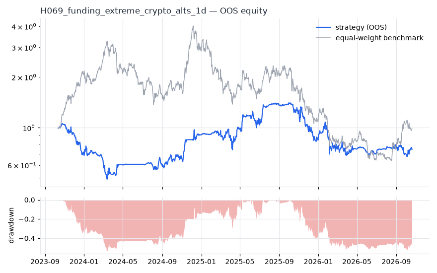
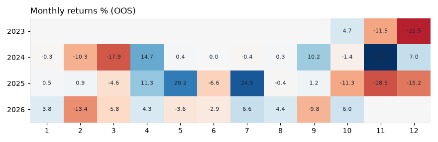
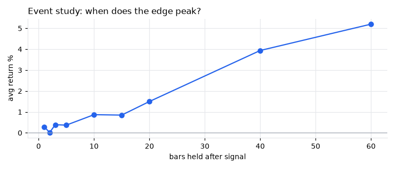
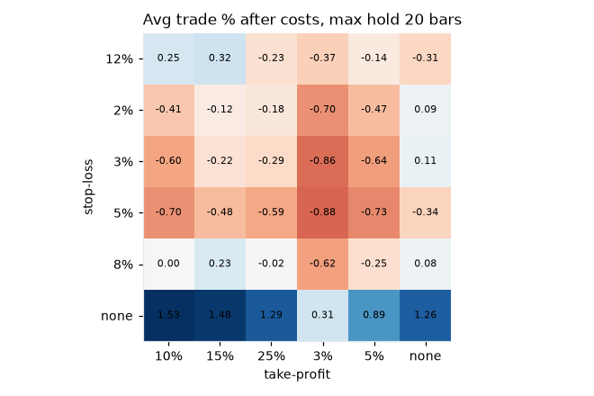

# H069 — funding_extreme on crypto_alts [1d]  ❌ REJECT

- Kind: rule · Source: Contrarian crowding logic (Briese 2008) applied to perp funding: extreme positive funding = crowded longs. Funding history: Binance public files (free)
- For system: `research_only`
- Data: 2019-10-01 00:00:00 → 2026-10-20 00:00:00 · 35 assets · 365.4 bars/year · survivorship mask: False
- Costs: {'commission': 0.0006, 'slippage': 0.0005, 'funding_annual': 0.08, 'borrow_annual': 0.0}
- Variants tried (DSR trials): 16 (failed: 0)
- Final variant: `funding_extreme|n=365,th=1.5|f=none|x=signal_only|size=atr_risk0.01`

## Verdict reasons
- DSR 0.336 < 0.9 (luck not excluded after 16 trials)
- OOS Sharpe (excess of T-bill) -0.088 < 0.5
- OOS MaxDD -0.5325 worse than -0.45 (local or USD)
- bootstrap P(SR>0) 0.499 < 0.85
- only 50% of OOS years positive
- with 2x costs it does not beat the equal-weight benchmark
- Reality Check p 0.956 > 0.1 (best variant may be data-mined)
- random entries match it (p=0.44): the edge is in the exits, not the signal

## Walk-forward out-of-sample


| Metric | Strategy | Equal-weight benchmark |
|---|---|---|
| years | 3.02 | 3.02 |
| cagr | -0.0932 | -0.0034 |
| vol | 0.45 | 0.7063 |
| sharpe | 0.007 | 0.351 |
| sharpe_excess_rf | -0.088 | None |
| sortino | -0.128 | 0.496 |
| max_dd | -0.5325 | -0.8414 |
| max_dd_bars | 560 | 683 |
| calmar | -0.175 | -0.004 |
| ulcer | 0.3395 | 0.5472 |
| var95 | -0.0349 | -0.0551 |
| cvar95 | -0.0539 | -0.0837 |
| omega | 1.001 | 1.051 |
| tail_ratio | 1.032 | 1.039 |
| skew | 0.387 | -0.233 |
| kurtosis | 9.006 | 2.907 |
| hit_rate | 0.452 | 0.51 |
| turnover_ann | 12.47 | None |

- **Gate Sharpe (excess of T-bill): -0.088**
- Deflated Sharpe: **0.336** · PBO: **0.461** · Reality Check p: **0.956**
- PSR 0.505 · Info ratio -0.34 · Beta 0.183 · Up/Down capture 0.177/0.185
- Sharpe with 2× costs: -0.024 · Walk-forward efficiency: None
- Bootstrap: {'p_sharpe_pos': 0.499, 'cagr_p05': -0.4139, 'maxdd_p05': -0.8607}
- Yearly OOS Sharpe: {'2023': -3.57, '2024': 0.79, '2025': 0.11, '2026': -0.13}



## Regimes (where does it work?)
`{"bull": {"sharpe": 0.51, "ann_ret": 0.2159, "bars": 807}, "bear": {"sharpe": -1.1, "ann_ret": -0.5732, "bars": 298}, "calm": {"sharpe": 1.35, "ann_ret": 0.4492, "bars": 506}, "stressed": {"sharpe": -0.71, "ann_ret": -0.3738, "bars": 599}, "vix_lt_20": {"sharpe": 0.28, "ann_ret": 0.1158, "bars": 904}, "vix_20_30": {"sharpe": -1.19, "ann_ret": -0.6694, "bars": 180}}`

## Calendar profile (weekday / month / hour)
`{"weekday": {"0": 0.00169, "1": 0.00226, "2": -0.00083, "3": -0.00228, "4": 0.00207, "5": 0.00124, "6": -0.00408}, "month": {"1": 0.00071, "2": -0.00243, "3": -0.00283, "4": 0.00362, "5": 0.00176, "6": -0.00093, "7": 0.00313, "8": 0.00057, "9": 0.00018, "10": -0.00012, "11": -0.00026, "12": -0.0034}}`

## Trades (OOS)
`{"n_trades": 229, "trades_per_year": 75.7, "win_rate": 0.607, "avg_trade": 0.0004, "median_trade": 0.0319, "avg_win": 0.1636, "avg_loss": -0.2517, "profit_factor": 1.004, "payoff": 0.65, "expectancy_r": null, "sqn": null, "kelly_fraction": 0.002, "max_consec_losses": 9, "avg_bars": 37.0, "avg_bars_win": 29.0, "avg_bars_loss": 49.4, "avg_mfe": 0.2041, "avg_mae": -0.2271, "edge_ratio": 0.899, "exit_reasons": {"signal": 229}, "long_short": {"-1": {"count": 61, "mean": -0.0962}, "1": {"count": 168, "mean": 0.0355}}}`

## Robustness
- **delay**: `{"sharpe": -0.172, "sharpe_delayed_1bar": -0.11, "retained": null}`
- **neighbourhood**: `{"neighbours": 1, "best_sharpe": -0.162, "neighbour_median": -0.479, "share_positive": 0.0, "stability": null}`
- **noise**: `{"noise_bp": 0.002, "sharpe_min": -0.175, "sharpe_median": -0.173}`
- **random_entry**: `{"actual_ret_per_exposure_ann": -0.1449, "random_median_ann": -0.1768, "random_p95_ann": 0.1021, "trades_actual": 365, "p_value": 0.44}`
- **mc_trade_shuffle**: `{"maxdd_median": -0.4003, "maxdd_p95": -0.5158, "final_p05": -0.1873, "final_median": -0.1873}`

## Timing, take-profit, stop-loss and profit studies (in-sample diagnostics)
- Event study (forward return by bars held): `{"1": {"n": 464, "mean": 0.0029, "hit": 0.526, "t": 1.26, "per_bar": 0.00294}, "2": {"n": 464, "mean": 0.0002, "hit": 0.461, "t": 0.06, "per_bar": 0.00011}, "3": {"n": 464, "mean": 0.0039, "hit": 0.476, "t": 0.75, "per_bar": 0.0013}, "5": {"n": 464, "mean": 0.0037, "hit": 0.472, "t": 0.66, "per_bar": 0.00074}, "10": {"n": 464, "mean": 0.0087, "hit": 0.487, "t": 1.33, "per_bar": 0.00087}, "15": {"n": 464, "mean": 0.0085, "hit": 0.489, "t": 1.09, "per_bar": 0.00057}, "20": {"n": 462, "mean": 0.015, "hit": 0.452, "t": 1.53, "per_bar": 0.00075}, "40": {"n": 461, "mean": 0.0394, "hit": 0.453, "t": 2.56, "per_bar": 0.00099}, "60": {"n": 459, "mean": 0.052, "hit": 0.486, "t": 2.84, "per_bar": 0.00087}, "best_holding_bars": 60}`

- Event study short: `{"1": {"n": 322, "mean": 0.0013, "hit": 0.55, "t": 0.37, "per_bar": 0.00134}, "2": {"n": 322, "mean": 0.0009, "hit": 0.537, "t": 0.19, "per_bar": 0.00047}, "3": {"n": 322, "mean": -0.0029, "hit": 0.556, "t": -0.54, "per_bar": -0.00098}, "5": {"n": 322, "mean": -0.0161, "hit": 0.559, "t": -2.24, "per_bar": -0.00323}, "10": {"n": 322, "mean": -0.0332, "hit": 0.494, "t": -2.88, "per_bar": -0.00332}, "15": {"n": 322, "mean": -0.0311, "hit": 0.516, "t": -2.26, "per_bar": -0.00208}, "20": {"n": 321, "mean": -0.0549, "hit": 0.517, "t": -3.28, "per_bar": -0.00275}, "40": {"n": 302, "mean": -0.0958, "hit": 0.513, "t": -3.89, "per_bar": -0.0024}, "60": {"n": 277, "mean": -0.0568, "hit": 0.585, "t": -1.98, "per_bar": -0.00095}, "best_holding_bars": 1}`
- Best stop / target / max-hold combinations: `[{"stop": NaN, "target": 0.1, "max_hold": 20, "n": 464, "mean": 0.0153, "hit": 0.6444, "per_bar": 0.0012, "t": 2.7261}, {"stop": NaN, "target": NaN, "max_hold": 40, "n": 464, "mean": 0.0367, "hit": 0.4461, "per_bar": 0.0009, "t": 2.3931}, {"stop": NaN, "target": 0.15, "max_hold": 40, "n": 464, "mean": 0.0188, "hit": 0.6272, "per_bar": 0.0007, "t": 2.3157}, {"stop": NaN, "target": 0.15, "max_hold": 20, "n": 464, "mean": 0.0148, "hit": 0.5431, "per_bar": 0.001, "t": 2.2515}, {"stop": NaN, "target": 0.05, "max_hold": 20, "n": 464, "mean": 0.0089, "hit": 0.7953, "per_bar": 0.0011, "t": 2.0953}]`

- Portfolio overlays (vol target, drawdown brake, equity-curve filter): `{"none": {"sharpe": 0.007, "cagr": -0.0932, "max_dd": -0.5325}, "vol_target_0.1": {"sharpe": -0.351, "cagr": -0.0604, "max_dd": -0.3069}, "vol_target_0.15": {"sharpe": -0.272, "cagr": -0.0716, "max_dd": -0.3617}, "vol_target_0.2": {"sharpe": -0.182, "cagr": -0.0752, "max_dd": -0.3906}, "dd_brake_0.1": {"sharpe": -0.271, "cagr": -0.1075, "max_dd": -0.4214}, "dd_brake_0.2": {"sharpe": -0.158, "cagr": -0.0999, "max_dd": -0.3848}, "equity_ma_60": {"sharpe": 0.062, "cagr": -0.0142, "max_dd": -0.3362}, "equity_ma_182": {"sharpe": 0.372, "cagr": 0.0678, "max_dd": -0.3689}, "best_by_calmar": "equity_ma_182"}`
> Studies are in-sample diagnostics. To use a better exit, register it (exits: [...]) and let the gate judge it.

## Kasa koruma (kriz testi, teşhis)

Piyasa: **crypto**. Kapsanan krizler: may_2021, luna_2022, ftx_2022, aug_2024, oct_2025. Eşikler ve kabul kuralları `config/protection.yaml` içinde, sonuçlardan önce yazıldı. Bu bölüm stratejiyi DEĞİŞTİRMEZ. Bir kuralı kullanmak için hipoteze `overlays:` olarak ekleyin.

Korumasız (tüm geçmiş): CAGR -11.5%, Sharpe -0.172, maks. düşüş -72.7%, MC P(≤−%50) 9.0%

| Kriz | Getiri | Maks. düşüş |
|---|---|---|
| may_2021 | +0.1% | -3.4% |
| luna_2022 | -17.9% | -24.2% |
| ftx_2022 | -8.8% | -8.5% |
| aug_2024 | -5.5% | -5.8% |
| oct_2025 | -7.1% | -9.2% |

| Kural | Sonuç (tüm eşikler) | Eşik: krizlerde daha iyi · Sharpe · maks. düşüş |
|---|---|---|
| Kasa düşüş sigortası | ❌ geçmedi | (0.08, 0.16): 5/5 · -0.536 · -20% / (0.1, 0.2): 5/5 · -0.483 · -21% / (0.12, 0.25): 5/5 · -0.581 · -26% |
| Volatilite hedefi | ❌ geçmedi | 0.25: 1/5 · -0.328 · -58% / 0.35: 1/5 · -0.268 · -66% / 0.5: 1/5 · -0.196 · -72% |
| Kasa eğrisi filtresi | ❌ geçmedi | 30: 4/5 · -0.632 · -60% / 60: 5/5 · -0.167 · -34% / 90: 4/5 · 0.242 · -31% |
| Günlük kayıp limiti | ❌ geçmedi | 0.04: 0/5 · -0.362 · -80% / 0.05: 0/5 · -0.243 · -74% / 0.07: 0/5 · -0.253 · -75% |
| Piyasa çöküş bekçisi | ❌ geçmedi | 0.08: 1/5 · -0.184 · -73% / 0.1: 1/5 · -0.21 · -72% / 0.15: 0/5 · -0.178 · -73% |

## Walk-forward windows
- 2023-10-12 00:00:00 → 2024-04-10 00:00:00: IS -0.118 / OOS -2.743 — `funding_extreme|n=180,th=1.5|f=none|x=signal_only`
- 2024-04-11 00:00:00 → 2024-10-09 00:00:00: IS -0.537 / OOS 1.532 — `funding_extreme|n=365,th=1.5|f=none|x=signal_only|size=atr_risk0.02`
- 2024-10-10 00:00:00 → 2025-04-09 00:00:00: IS -0.486 / OOS 1.337 — `funding_extreme|n=365,th=1.5|f=none|x=signal_only|size=atr_risk0.02`
- 2025-04-10 00:00:00 → 2025-10-08 00:00:00: IS -0.218 / OOS 2.569 — `funding_extreme|n=365,th=1.5|f=none|x=signal_only|size=atr_risk0.02`
- 2025-10-09 00:00:00 → 2026-04-08 00:00:00: IS 0.263 / OOS -1.662 — `funding_extreme|n=365,th=1.5|f=none|x=signal_only|size=atr_risk0.02`
- 2026-04-09 00:00:00 → 2026-10-07 00:00:00: IS 0.1 / OOS -0.102 — `funding_extreme|n=365,th=1.5|f=none|x=signal_only|size=atr_risk0.01`
- 2026-10-08 00:00:00 → 2026-10-20 00:00:00: IS -0.075 / OOS 3.676 — `funding_extreme|n=365,th=1.5|f=none|x=signal_only|size=atr_risk0.01`

## Best variants (full sample, reference only)
- funding_extreme|n=365,th=1.5|f=none|x=signal_only|size=atr_risk0.01: Sharpe -0.162
- funding_extreme|n=365,th=1.5|f=none|x=signal_only|size=atr_risk0.02: Sharpe -0.258
- funding_extreme|n=365,th=1.5|f=none|x=signal_only: Sharpe -0.316
- funding_extreme|n=365,th=2.0|f=none|x=signal_only|size=atr_risk0.02: Sharpe -0.331
- funding_extreme|n=365,th=1.5|f=none|x=signal_only|size=atr_risk0.005: Sharpe -0.38
- funding_extreme|n=365,th=2.0|f=none|x=signal_only: Sharpe -0.393
- funding_extreme|n=365,th=1.5|f=none|x=signal_only|size=vol0.1: Sharpe -0.401
- funding_extreme|n=365,th=1.5|f=none|x=signal_only|size=vol0.2: Sharpe -0.401
- funding_extreme|n=365,th=2.0|f=none|x=signal_only|size=atr_risk0.005: Sharpe -0.436
- funding_extreme|n=365,th=2.0|f=none|x=signal_only|size=vol0.1: Sharpe -0.445

## Current targets / signals
```json
{
 "positions": {
  "XRP/USDT": -0.0221,
  "ADA/USDT": -0.0304,
  "DOGE/USDT": -0.0989,
  "AVAX/USDT": -0.0736,
  "LINK/USDT": -0.0886,
  "LTC/USDT": -0.0323,
  "BCH/USDT": -0.0453,
  "TRX/USDT": 0.1131,
  "NEAR/USDT": -0.0632,
  "UNI/USDT": -0.0207,
  "AAVE/USDT": -0.081,
  "ETC/USDT": -0.0282,
  "XLM/USDT": -0.0408,
  "ALGO/USDT": -0.0287,
  "MANA/USDT": -0.1092,
  "ARB/USDT": 0.0458,
  "SUI/USDT": -0.0781
 },
 "entry_long_next_open": [],
 "exit_long_next_open": [],
 "entry_short_next_open": []
}
```

> Survivorship bias: unless a membership mask is used, universes are today's members (upper-bound results).