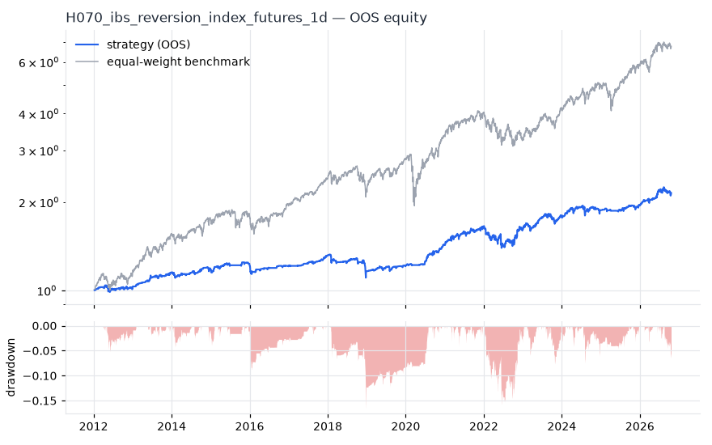
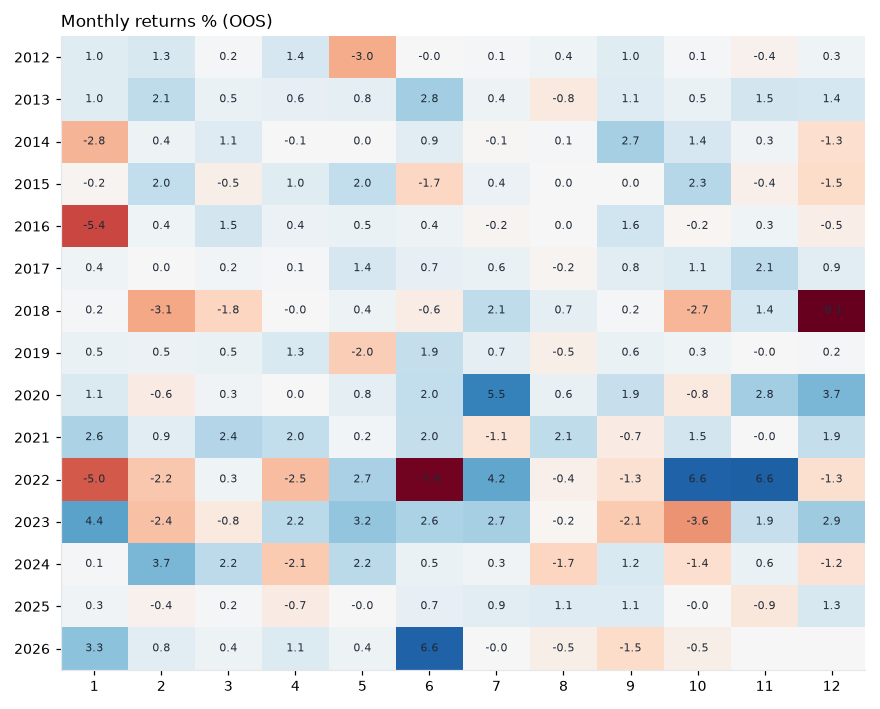
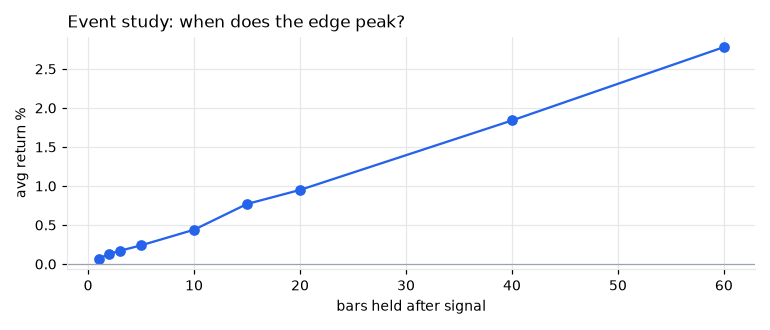
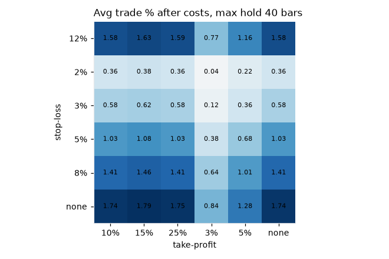

# H070 — ibs_reversion on index_futures [1d]  🟡 WATCH

- Kind: rule · Source: Internal Bar Strength
- For system: `research_only`
- Data: 2008-01-02 00:00:00 → 2026-10-21 00:00:00 · 5 assets · 251.7 bars/year · survivorship mask: False
- Costs: {'commission': 0.0001, 'slippage': 0.0003, 'funding_annual': 0.0, 'borrow_annual': 0.0}
- Variants tried (DSR trials): 16 (failed: 0)
- Final variant: `ibs_reversion|lo=0.3,hi=0.8|f=vix_term_contango|x=signal_only|size=atr_risk0.02`

## Verdict reasons
- OOS Sharpe (excess of T-bill) 0.484 < 0.5
- with 2x costs it does not beat the equal-weight benchmark
- Reality Check p 1.0 > 0.1 (best variant may be data-mined)

## Walk-forward out-of-sample


| Metric | Strategy | Equal-weight benchmark |
|---|---|---|
| years | 14.77 | 14.77 |
| cagr | 0.053 | 0.1383 |
| vol | 0.0792 | 0.1746 |
| sharpe | 0.692 | 0.83 |
| sharpe_excess_rf | 0.484 | None |
| sortino | 0.716 | 1.166 |
| max_dd | -0.1667 | -0.3329 |
| max_dd_bars | 644 | 530 |
| calmar | 0.318 | 0.415 |
| ulcer | 0.0455 | 0.0697 |
| var95 | -0.007 | -0.0164 |
| cvar95 | -0.0124 | -0.026 |
| omega | 1.198 | 1.165 |
| tail_ratio | 1.11 | 0.986 |
| skew | 0.298 | -0.485 |
| kurtosis | 16.113 | 12.124 |
| hit_rate | 0.338 | 0.544 |
| turnover_ann | 45.95 | None |

- **Gate Sharpe (excess of T-bill): 0.484**
- Deflated Sharpe: **0.987** · PBO: **0.288** · Reality Check p: **1.0**
- PSR 0.996 · Info ratio -0.627 · Beta 0.265 · Up/Down capture 0.309/0.298
- Sharpe with 2× costs: 0.46 · Walk-forward efficiency: 0.994
- Bootstrap: {'p_sharpe_pos': 0.997, 'cagr_p05': 0.0215, 'maxdd_p05': -0.26}
- Yearly OOS Sharpe: {'2012': 0.43, '2013': 2.36, '2014': 0.45, '2015': 0.65, '2016': -0.2, '2017': 2.43, '2018': -1.1, '2019': 0.86, '2020': 2.72, '2021': 1.55, '2022': 0.0, '2023': 1.23, '2024': 0.5, '2025': 0.71, '2026': 1.29}



## Regimes (where does it work?)
`{"bull": {"sharpe": 1.26, "ann_ret": 0.085, "bars": 3151}, "bear": {"sharpe": -0.9, "ann_ret": -0.1129, "bars": 567}, "calm": {"sharpe": 1.11, "ann_ret": 0.0674, "bars": 2023}, "stressed": {"sharpe": 0.41, "ann_ret": 0.0398, "bars": 1695}, "vix_lt_20": {"sharpe": 2.04, "ann_ret": 0.1163, "bars": 2800}, "vix_20_30": {"sharpe": -0.93, "ann_ret": -0.1047, "bars": 760}, "vix_ge_30": {"sharpe": -1.61, "ann_ret": -0.2682, "bars": 158}, "curve_inverted": {"sharpe": 0.92, "ann_ret": 0.0854, "bars": 615}, "curve_normal": {"sharpe": 0.64, "ann_ret": 0.0487, "bars": 3103}}`

## Calendar profile (weekday / month / hour)
`{"weekday": {"0": 0.00035, "1": 0.00039, "2": 7e-05, "3": 0.00021, "4": 8e-05}, "month": {"1": 4e-05, "2": 0.00012, "3": 0.00022, "4": 0.00016, "5": 0.00031, "6": 0.00034, "7": 0.00051, "8": 3e-05, "9": 0.00022, "10": 0.00014, "11": 0.00056, "12": -4e-05}}`

## Trades (OOS)
`{"n_trades": 2197, "trades_per_year": 148.7, "win_rate": 0.687, "avg_trade": 0.0028, "median_trade": 0.005, "avg_win": 0.0116, "avg_loss": -0.0165, "profit_factor": 1.542, "payoff": 0.703, "expectancy_r": null, "sqn": null, "kelly_fraction": 0.241, "max_consec_losses": 11, "avg_bars": 3.3, "avg_bars_win": 2.5, "avg_bars_loss": 5.0, "avg_mfe": 0.0115, "avg_mae": -0.0174, "edge_ratio": 0.66, "exit_reasons": {"signal": 2197}, "long_short": {"1": {"count": 2197, "mean": 0.0028}}}`

## Robustness
- **delay**: `{"sharpe": 0.619, "sharpe_delayed_1bar": 0.266, "retained": 0.43}`
- **neighbourhood**: `{"neighbours": 1, "best_sharpe": 0.617, "neighbour_median": 0.666, "share_positive": 1.0, "stability": 1.08}`
- **noise**: `{"noise_bp": 0.002, "sharpe_min": 0.605, "sharpe_median": 0.618}`
- **random_entry**: `{"actual_ret_per_exposure_ann": 0.1557, "random_median_ann": 0.1256, "random_p95_ann": 0.1596, "trades_actual": 2607, "p_value": 0.08}`
- **mc_trade_shuffle**: `{"maxdd_median": -0.0807, "maxdd_p95": -0.1157, "final_p05": 4.3313, "final_median": 4.3313}`

## Timing, take-profit, stop-loss and profit studies (in-sample diagnostics)
- Event study (forward return by bars held): `{"1": {"n": 4603, "mean": 0.0007, "hit": 0.538, "t": 4.46, "per_bar": 0.00074}, "2": {"n": 4603, "mean": 0.0013, "hit": 0.559, "t": 5.29, "per_bar": 0.00065}, "3": {"n": 4603, "mean": 0.0017, "hit": 0.56, "t": 5.63, "per_bar": 0.00057}, "5": {"n": 4598, "mean": 0.0024, "hit": 0.569, "t": 6.33, "per_bar": 0.00048}, "10": {"n": 4587, "mean": 0.0044, "hit": 0.581, "t": 8.48, "per_bar": 0.00044}, "15": {"n": 4585, "mean": 0.0077, "hit": 0.613, "t": 12.21, "per_bar": 0.00052}, "20": {"n": 4580, "mean": 0.0095, "hit": 0.629, "t": 12.92, "per_bar": 0.00047}, "40": {"n": 4546, "mean": 0.0184, "hit": 0.676, "t": 17.52, "per_bar": 0.00046}, "60": {"n": 4511, "mean": 0.0278, "hit": 0.675, "t": 21.93, "per_bar": 0.00046}, "best_holding_bars": 60}`

- Best stop / target / max-hold combinations: `[{"stop": NaN, "target": 0.1, "max_hold": 40, "n": 4603, "mean": 0.0174, "hit": 0.6746, "per_bar": 0.0005, "t": 17.4547}, {"stop": NaN, "target": 0.15, "max_hold": 40, "n": 4603, "mean": 0.0179, "hit": 0.6715, "per_bar": 0.0005, "t": 17.2364}, {"stop": NaN, "target": 0.25, "max_hold": 40, "n": 4603, "mean": 0.0175, "hit": 0.6709, "per_bar": 0.0004, "t": 16.7865}, {"stop": NaN, "target": NaN, "max_hold": 40, "n": 4603, "mean": 0.0174, "hit": 0.6709, "per_bar": 0.0004, "t": 16.767}, {"stop": 0.12, "target": 0.1, "max_hold": 40, "n": 4603, "mean": 0.0158, "hit": 0.6661, "per_bar": 0.0004, "t": 16.3878}]`

- Portfolio overlays (vol target, drawdown brake, equity-curve filter): `{"none": {"sharpe": 0.692, "cagr": 0.053, "max_dd": -0.1667}, "vol_target_0.1": {"sharpe": 0.706, "cagr": 0.0688, "max_dd": -0.2283}, "vol_target_0.15": {"sharpe": 0.696, "cagr": 0.0852, "max_dd": -0.2855}, "vol_target_0.2": {"sharpe": 0.678, "cagr": 0.0915, "max_dd": -0.3103}, "dd_brake_0.1": {"sharpe": 0.69, "cagr": 0.0488, "max_dd": -0.157}, "dd_brake_0.2": {"sharpe": 0.692, "cagr": 0.053, "max_dd": -0.1667}, "equity_ma_41": {"sharpe": 0.4, "cagr": 0.0199, "max_dd": -0.1598}, "equity_ma_125": {"sharpe": 0.6, "cagr": 0.0347, "max_dd": -0.1132}, "best_by_calmar": "none"}`
> Studies are in-sample diagnostics. To use a better exit, register it (exits: [...]) and let the gate judge it.

## Kasa koruma (kriz testi, teşhis)

Piyasa: **multi**. Kapsanan krizler: gfc_2008, euro_2011, gold_crash_2013, covid_2020, rates_2022, tariff_apr_2025. Eşikler ve kabul kuralları `config/protection.yaml` içinde, sonuçlardan önce yazıldı. Bu bölüm stratejiyi DEĞİŞTİRMEZ. Bir kuralı kullanmak için hipoteze `overlays:` olarak ekleyin.

Korumasız (tüm geçmiş): CAGR +6.3%, Sharpe 0.619, maks. düşüş -22.4%, MC P(≤−%50) 0.0%

| Kriz | Getiri | Maks. düşüş |
|---|---|---|
| gfc_2008 | -4.1% | -8.6% |
| euro_2011 | -6.6% | -6.6% |
| gold_crash_2013 | +2.4% | -4.3% |
| covid_2020 | -6.6% | -10.7% |
| rates_2022 | -1.6% | -11.8% |
| tariff_apr_2025 | -1.4% | -5.0% |

| Kural | Sonuç (tüm eşikler) | Eşik: krizlerde daha iyi · Sharpe · maks. düşüş |
|---|---|---|
| Kasa düşüş sigortası | ❌ geçmedi | (0.08, 0.16): 4/6 · 0.483 · -18% / (0.1, 0.2): 4/6 · 0.532 · -20% / (0.12, 0.25): 3/6 · 0.556 · -19% |
| Volatilite hedefi | ❌ geçmedi | 0.1: 4/6 · 0.508 · -20% / 0.15: 3/6 · 0.558 · -22% / 0.25: 1/6 · 0.618 · -22% |
| Kasa eğrisi filtresi | ❌ geçmedi | 30: 5/6 · 0.1 · -24% / 60: 5/6 · 0.281 · -15% / 90: 5/6 · 0.395 · -15% |
| Günlük kayıp limiti | ❌ geçmedi | 0.03: 1/6 · 0.593 · -25% / 0.05: 0/6 · 0.61 · -22% / 0.07: 0/6 · 0.619 · -22% |
| Piyasa çöküş bekçisi | ❌ geçmedi | 0.04: 2/6 · 0.56 · -25% / 0.06: 0/6 · 0.61 · -22% / 0.08: 0/6 · 0.617 · -22% |

## Walk-forward windows
- 2020-12-21 00:00:00 → 2021-06-21 00:00:00: IS 0.517 / OOS 2.238 — `ibs_reversion|lo=0.2,hi=0.8|f=vix_term_contango|x=signal_only|size=atr_risk0.02`
- 2021-06-22 00:00:00 → 2021-12-16 00:00:00: IS 1.082 / OOS 1.088 — `ibs_reversion|lo=0.2,hi=0.8|f=vix_term_contango|x=signal_only|size=atr_risk0.02`
- 2021-12-17 00:00:00 → 2022-06-16 00:00:00: IS 1.405 / OOS -2.005 — `ibs_reversion|lo=0.2,hi=0.8|f=vix_term_contango|x=signal_only|size=atr_risk0.02`
- 2022-06-17 00:00:00 → 2022-12-14 00:00:00: IS 0.706 / OOS 2.208 — `ibs_reversion|lo=0.2,hi=0.8|f=vix_term_contango|x=signal_only|size=atr_risk0.02`
- 2022-12-15 00:00:00 → 2023-06-15 00:00:00: IS 0.966 / OOS 1.528 — `ibs_reversion|lo=0.2,hi=0.8|f=vix_term_contango|x=signal_only|size=atr_risk0.02`
- 2023-06-16 00:00:00 → 2023-12-12 00:00:00: IS 1.094 / OOS 0.231 — `ibs_reversion|lo=0.2,hi=0.8|f=vix_term_contango|x=signal_only|size=atr_risk0.02`
- 2023-12-13 00:00:00 → 2024-06-12 00:00:00: IS 0.723 / OOS 2.238 — `ibs_reversion|lo=0.2,hi=0.8|f=vix_term_contango|x=signal_only|size=atr_risk0.01`
- 2024-06-13 00:00:00 → 2024-12-10 00:00:00: IS 0.692 / OOS -0.399 — `ibs_reversion|lo=0.2,hi=0.8|f=vix_term_contango|x=signal_only|size=vol0.2`
- 2024-12-11 00:00:00 → 2025-06-11 00:00:00: IS 0.632 / OOS -0.307 — `ibs_reversion|lo=0.1,hi=0.7|f=vix_term_contango|x=signal_only`
- 2025-06-12 00:00:00 → 2025-12-08 00:00:00: IS 0.758 / OOS 1.111 — `ibs_reversion|lo=0.2,hi=0.7|f=vix_term_contango|x=signal_only`
- 2025-12-09 00:00:00 → 2026-06-09 00:00:00: IS 0.868 / OOS 2.38 — `ibs_reversion|lo=0.2,hi=0.7|f=vix_term_contango|x=signal_only`
- 2026-06-10 00:00:00 → 2026-10-21 00:00:00: IS 1.016 / OOS 0.525 — `ibs_reversion|lo=0.3,hi=0.8|f=vix_term_contango|x=signal_only|size=atr_risk0.02`

## Best variants (full sample, reference only)
- ibs_reversion|lo=0.2,hi=0.8|f=vix_term_contango|x=signal_only|size=atr_risk0.02: Sharpe 0.666
- ibs_reversion|lo=0.2,hi=0.8|f=vix_term_contango|x=signal_only|size=atr_risk0.01: Sharpe 0.631
- ibs_reversion|lo=0.2,hi=0.8|f=vix_term_contango|x=signal_only: Sharpe 0.624
- ibs_reversion|lo=0.3,hi=0.8|f=vix_term_contango|x=signal_only|size=atr_risk0.02: Sharpe 0.617
- ibs_reversion|lo=0.2,hi=0.8|f=vix_term_contango|x=signal_only|size=atr_risk0.005: Sharpe 0.579
- ibs_reversion|lo=0.3,hi=0.8|f=vix_term_contango|x=signal_only|size=atr_risk0.01: Sharpe 0.573
- ibs_reversion|lo=0.3,hi=0.8|f=vix_term_contango|x=signal_only: Sharpe 0.572
- ibs_reversion|lo=0.2,hi=0.8|f=vix_term_contango|x=signal_only|size=vol0.2: Sharpe 0.569
- ibs_reversion|lo=0.2,hi=0.7|f=vix_term_contango|x=signal_only: Sharpe 0.551
- ibs_reversion|lo=0.2,hi=0.8|f=vix_term_contango|x=signal_only|size=vol0.1: Sharpe 0.534

## Current targets / signals
```json
{
 "positions": {
  "ES=F": 0.1875,
  "NQ=F": 0.1875,
  "YM=F": 0.1875,
  "NKD=F": 0.25
 },
 "entry_long_next_open": [],
 "exit_long_next_open": [
  "ES=F",
  "NQ=F",
  "YM=F",
  "RTY=F"
 ],
 "entry_short_next_open": []
}
```

> Survivorship bias: unless a membership mask is used, universes are today's members (upper-bound results).