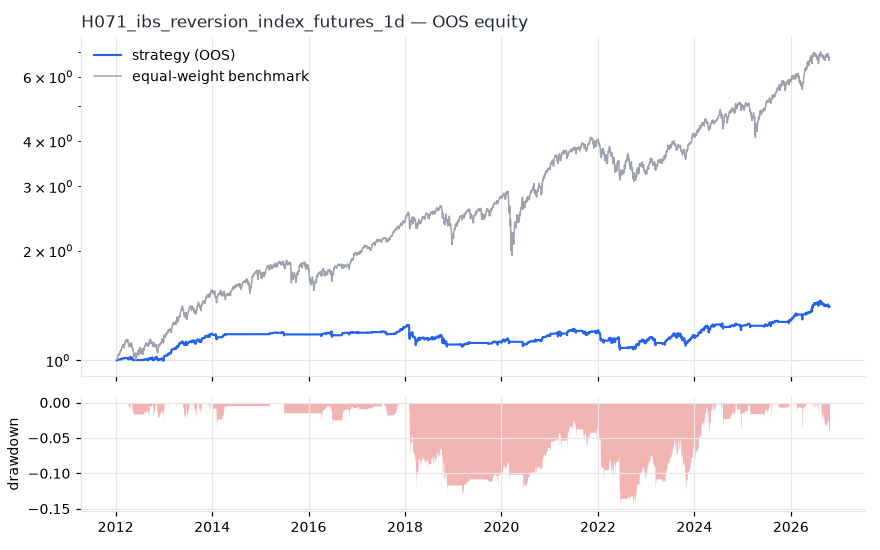
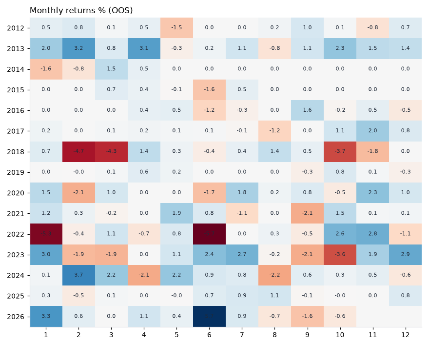
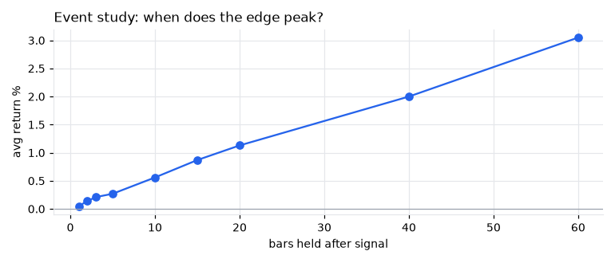
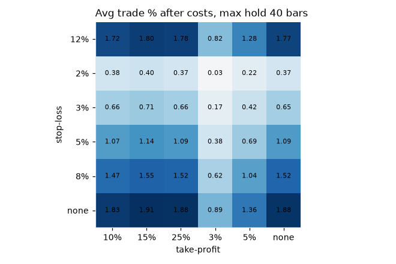

# H071 — ibs_reversion on index_futures [1d]  🟡 WATCH

- Kind: rule · Source: Internal Bar Strength
- For system: `research_only`
- Data: 2008-01-02 00:00:00 → 2026-10-21 00:00:00 · 5 assets · 251.7 bars/year · survivorship mask: False
- Costs: {'commission': 0.0001, 'slippage': 0.0003, 'funding_annual': 0.0, 'borrow_annual': 0.0}
- Variants tried (DSR trials): 16 (failed: 0)
- Final variant: `ibs_reversion|lo=0.2,hi=0.7|f=credit_calm|x=signal_only`

## Verdict reasons
- OOS Sharpe (excess of T-bill) 0.139 < 0.5
- with 2x costs it does not beat the equal-weight benchmark
- PBO 0.784 > 0.5 (variant selection is overfit)
- Reality Check p 0.998 > 0.1 (best variant may be data-mined)

## Walk-forward out-of-sample


| Metric | Strategy | Equal-weight benchmark |
|---|---|---|
| years | 14.77 | 14.77 |
| cagr | 0.0233 | 0.1383 |
| vol | 0.0607 | 0.1746 |
| sharpe | 0.41 | 0.83 |
| sharpe_excess_rf | 0.139 | None |
| sortino | 0.195 | 1.166 |
| max_dd | -0.1454 | -0.3329 |
| max_dd_bars | 1593 | 530 |
| calmar | 0.16 | 0.415 |
| ulcer | 0.0592 | 0.0697 |
| var95 | -0.0046 | -0.0164 |
| cvar95 | -0.0099 | -0.026 |
| omega | 1.132 | 1.165 |
| tail_ratio | 1.201 | 0.986 |
| skew | -0.641 | -0.485 |
| kurtosis | 27.6 | 12.124 |
| hit_rate | 0.247 | 0.544 |
| turnover_ann | 31.93 | None |

- **Gate Sharpe (excess of T-bill): 0.139**
- Deflated Sharpe: **0.904** · PBO: **0.784** · Reality Check p: **0.998**
- PSR 0.94 · Info ratio -0.782 · Beta 0.174 · Up/Down capture 0.198/0.203
- Sharpe with 2× costs: 0.199 · Walk-forward efficiency: 0.518
- Bootstrap: {'p_sharpe_pos': 0.97, 'cagr_p05': 0.0009, 'maxdd_p05': -0.2422}
- Yearly OOS Sharpe: {'2012': 0.39, '2013': 2.61, '2014': -0.13, '2015': -0.05, '2016': 0.23, '2017': 1.38, '2018': -0.91, '2019': 0.46, '2020': 0.96, '2021': 0.45, '2022': -0.67, '2023': 0.55, '2024': 0.89, '2025': 0.77, '2026': 1.33}



## Regimes (where does it work?)
`{"bull": {"sharpe": 0.86, "ann_ret": 0.0495, "bars": 3151}, "bear": {"sharpe": -1.5, "ann_ret": -0.1121, "bars": 567}, "calm": {"sharpe": 0.68, "ann_ret": 0.0334, "bars": 2023}, "stressed": {"sharpe": 0.2, "ann_ret": 0.0147, "bars": 1695}, "vix_lt_20": {"sharpe": 1.58, "ann_ret": 0.0776, "bars": 2800}, "vix_20_30": {"sharpe": -1.31, "ann_ret": -0.1066, "bars": 760}, "vix_ge_30": {"sharpe": -2.58, "ann_ret": -0.2775, "bars": 158}, "curve_inverted": {"sharpe": 0.68, "ann_ret": 0.046, "bars": 615}, "curve_normal": {"sharpe": 0.35, "ann_ret": 0.0207, "bars": 3103}}`

## Calendar profile (weekday / month / hour)
`{"weekday": {"0": 0.0001, "1": 0.00033, "2": -0.00012, "3": 0.00012, "4": 6e-05}, "month": {"1": 0.0002, "2": -5e-05, "3": 4e-05, "4": 0.00018, "5": 0.00018, "6": 1e-05, "7": 0.00024, "8": -5e-05, "9": -4e-05, "10": 0.0, "11": 0.00032, "12": 0.00018}}`

## Trades (OOS)
`{"n_trades": 1379, "trades_per_year": 93.4, "win_rate": 0.682, "avg_trade": 0.0027, "median_trade": 0.0045, "avg_win": 0.0104, "avg_loss": -0.0136, "profit_factor": 1.635, "payoff": 0.761, "expectancy_r": null, "sqn": null, "kelly_fraction": 0.265, "max_consec_losses": 9, "avg_bars": 2.5, "avg_bars_win": 1.9, "avg_bars_loss": 3.8, "avg_mfe": 0.0104, "avg_mae": -0.015, "edge_ratio": 0.69, "exit_reasons": {"signal": 1379}, "long_short": {"1": {"count": 1379, "mean": 0.0027}}}`

## Robustness
- **delay**: `{"sharpe": 0.562, "sharpe_delayed_1bar": 0.351, "retained": 0.624}`
- **neighbourhood**: `{"neighbours": 3, "best_sharpe": 0.558, "neighbour_median": 0.536, "share_positive": 1.0, "stability": 0.96}`
- **noise**: `{"noise_bp": 0.002, "sharpe_min": 0.5, "sharpe_median": 0.541}`
- **random_entry**: `{"actual_ret_per_exposure_ann": 0.2023, "random_median_ann": 0.1302, "random_p95_ann": 0.2042, "trades_actual": 1576, "p_value": 0.08}`
- **mc_trade_shuffle**: `{"maxdd_median": -0.0499, "maxdd_p95": -0.0736, "final_p05": 1.3731, "final_median": 1.3731}`

## Timing, take-profit, stop-loss and profit studies (in-sample diagnostics)
- Event study (forward return by bars held): `{"1": {"n": 2164, "mean": 0.0005, "hit": 0.537, "t": 2.04, "per_bar": 0.00051}, "2": {"n": 2164, "mean": 0.0014, "hit": 0.57, "t": 4.08, "per_bar": 0.00072}, "3": {"n": 2164, "mean": 0.0021, "hit": 0.567, "t": 5.0, "per_bar": 0.00071}, "5": {"n": 2164, "mean": 0.0027, "hit": 0.576, "t": 4.94, "per_bar": 0.00053}, "10": {"n": 2156, "mean": 0.0056, "hit": 0.592, "t": 7.37, "per_bar": 0.00056}, "15": {"n": 2154, "mean": 0.0087, "hit": 0.618, "t": 9.41, "per_bar": 0.00058}, "20": {"n": 2151, "mean": 0.0113, "hit": 0.629, "t": 10.85, "per_bar": 0.00057}, "40": {"n": 2126, "mean": 0.02, "hit": 0.671, "t": 13.68, "per_bar": 0.0005}, "60": {"n": 2101, "mean": 0.0305, "hit": 0.674, "t": 16.88, "per_bar": 0.00051}, "best_holding_bars": 60}`

- Best stop / target / max-hold combinations: `[{"stop": NaN, "target": 0.1, "max_hold": 40, "n": 2164, "mean": 0.0183, "hit": 0.665, "per_bar": 0.0005, "t": 13.5652}, {"stop": NaN, "target": 0.15, "max_hold": 40, "n": 2164, "mean": 0.0191, "hit": 0.664, "per_bar": 0.0005, "t": 13.4267}, {"stop": NaN, "target": 0.25, "max_hold": 40, "n": 2164, "mean": 0.0188, "hit": 0.6631, "per_bar": 0.0005, "t": 13.0854}, {"stop": NaN, "target": NaN, "max_hold": 40, "n": 2164, "mean": 0.0188, "hit": 0.6631, "per_bar": 0.0005, "t": 13.0787}, {"stop": 0.12, "target": 0.1, "max_hold": 40, "n": 2164, "mean": 0.0172, "hit": 0.6617, "per_bar": 0.0005, "t": 12.8417}]`

- Portfolio overlays (vol target, drawdown brake, equity-curve filter): `{"none": {"sharpe": 0.41, "cagr": 0.0233, "max_dd": -0.1454}, "vol_target_0.1": {"sharpe": 0.433, "cagr": 0.0366, "max_dd": -0.2195}, "vol_target_0.15": {"sharpe": 0.439, "cagr": 0.0436, "max_dd": -0.2505}, "vol_target_0.2": {"sharpe": 0.42, "cagr": 0.0434, "max_dd": -0.2745}, "dd_brake_0.1": {"sharpe": 0.312, "cagr": 0.0161, "max_dd": -0.1964}, "dd_brake_0.2": {"sharpe": 0.41, "cagr": 0.0233, "max_dd": -0.1454}, "equity_ma_41": {"sharpe": 0.142, "cagr": 0.0047, "max_dd": -0.1675}, "equity_ma_125": {"sharpe": 0.128, "cagr": 0.0048, "max_dd": -0.1238}, "best_by_calmar": "vol_target_0.15"}`
> Studies are in-sample diagnostics. To use a better exit, register it (exits: [...]) and let the gate judge it.

## Kasa koruma (kriz testi, teşhis)

Piyasa: **multi**. Kapsanan krizler: gfc_2008, euro_2011, gold_crash_2013, covid_2020, rates_2022, tariff_apr_2025. Eşikler ve kabul kuralları `config/protection.yaml` içinde, sonuçlardan önce yazıldı. Bu bölüm stratejiyi DEĞİŞTİRMEZ. Bir kuralı kullanmak için hipoteze `overlays:` olarak ekleyin.

Korumasız (tüm geçmiş): CAGR +3.3%, Sharpe 0.562, maks. düşüş -15.3%, MC P(≤−%50) 0.0%

| Kriz | Getiri | Maks. düşüş |
|---|---|---|
| gfc_2008 | -5.0% | -6.4% |
| euro_2011 | +0.0% | 0.0% |
| gold_crash_2013 | +4.3% | -1.4% |
| covid_2020 | +0.0% | 0.0% |
| rates_2022 | -5.4% | -10.2% |
| tariff_apr_2025 | +0.0% | 0.0% |

| Kural | Sonuç (tüm eşikler) | Eşik: krizlerde daha iyi · Sharpe · maks. düşüş |
|---|---|---|
| Kasa düşüş sigortası | ❌ geçmedi | (0.08, 0.16): 1/6 · 0.542 · -12% / (0.1, 0.2): 1/6 · 0.544 · -13% / (0.12, 0.25): 1/6 · 0.541 · -15% |
| Volatilite hedefi | ❌ geçmedi | 0.1: 2/6 · 0.545 · -14% / 0.15: 0/6 · 0.556 · -15% / 0.25: 0/6 · 0.562 · -15% |
| Kasa eğrisi filtresi | ❌ geçmedi | 30: 1/6 · 0.179 · -19% / 60: 2/6 · 0.366 · -14% / 90: 2/6 · 0.366 · -15% |
| Günlük kayıp limiti | ❌ geçmedi | 0.03: 1/6 · 0.528 · -15% / 0.05: 0/6 · 0.534 · -15% / 0.07: 0/6 · 0.562 · -15% |
| Piyasa çöküş bekçisi | ❌ geçmedi | 0.04: 0/6 · 0.509 · -15% / 0.06: 0/6 · 0.555 · -15% / 0.08: 0/6 · 0.558 · -15% |

## Walk-forward windows
- 2020-12-21 00:00:00 → 2021-06-21 00:00:00: IS 0.353 / OOS 1.093 — `ibs_reversion|lo=0.1,hi=0.8|f=credit_calm|x=signal_only`
- 2021-06-22 00:00:00 → 2021-12-16 00:00:00: IS 1.161 / OOS -0.148 — `ibs_reversion|lo=0.2,hi=0.8|f=credit_calm|x=signal_only|size=atr_risk0.02`
- 2021-12-17 00:00:00 → 2022-06-16 00:00:00: IS 1.377 / OOS -2.034 — `ibs_reversion|lo=0.2,hi=0.8|f=credit_calm|x=signal_only|size=vol0.2`
- 2022-06-17 00:00:00 → 2022-12-14 00:00:00: IS 0.421 / OOS 2.417 — `ibs_reversion|lo=0.2,hi=0.8|f=credit_calm|x=signal_only|size=vol0.1`
- 2022-12-15 00:00:00 → 2023-06-15 00:00:00: IS 0.843 / OOS 0.205 — `ibs_reversion|lo=0.2,hi=0.8|f=credit_calm|x=signal_only|size=vol0.2`
- 2023-06-16 00:00:00 → 2023-12-12 00:00:00: IS 0.865 / OOS 0.231 — `ibs_reversion|lo=0.2,hi=0.8|f=credit_calm|x=signal_only|size=atr_risk0.02`
- 2023-12-13 00:00:00 → 2024-06-12 00:00:00: IS 0.468 / OOS 2.249 — `ibs_reversion|lo=0.2,hi=0.8|f=credit_calm|x=signal_only|size=atr_risk0.02`
- 2024-06-13 00:00:00 → 2024-12-10 00:00:00: IS 0.513 / OOS -0.119 — `ibs_reversion|lo=0.1,hi=0.8|f=credit_calm|x=signal_only`
- 2024-12-11 00:00:00 → 2025-06-11 00:00:00: IS 0.522 / OOS -0.152 — `ibs_reversion|lo=0.1,hi=0.7|f=credit_calm|x=signal_only`
- 2025-06-12 00:00:00 → 2025-12-08 00:00:00: IS 0.702 / OOS 1.059 — `ibs_reversion|lo=0.2,hi=0.7|f=credit_calm|x=signal_only`
- 2025-12-09 00:00:00 → 2026-06-09 00:00:00: IS 0.869 / OOS 2.174 — `ibs_reversion|lo=0.2,hi=0.7|f=credit_calm|x=signal_only`
- 2026-06-10 00:00:00 → 2026-10-21 00:00:00: IS 1.113 / OOS 0.532 — `ibs_reversion|lo=0.2,hi=0.7|f=credit_calm|x=signal_only`

## Best variants (full sample, reference only)
- ibs_reversion|lo=0.2,hi=0.8|f=credit_calm|x=signal_only|size=atr_risk0.01: Sharpe 0.629
- ibs_reversion|lo=0.3,hi=0.8|f=credit_calm|x=signal_only|size=atr_risk0.01: Sharpe 0.623
- ibs_reversion|lo=0.2,hi=0.8|f=credit_calm|x=signal_only|size=vol0.2: Sharpe 0.617
- ibs_reversion|lo=0.3,hi=0.8|f=credit_calm|x=signal_only|size=atr_risk0.02: Sharpe 0.616
- ibs_reversion|lo=0.2,hi=0.8|f=credit_calm|x=signal_only|size=atr_risk0.02: Sharpe 0.611
- ibs_reversion|lo=0.3,hi=0.8|f=credit_calm|x=signal_only|size=vol0.2: Sharpe 0.598
- ibs_reversion|lo=0.3,hi=0.8|f=credit_calm|x=signal_only: Sharpe 0.598
- ibs_reversion|lo=0.2,hi=0.8|f=credit_calm|x=signal_only: Sharpe 0.592
- ibs_reversion|lo=0.2,hi=0.8|f=credit_calm|x=signal_only|size=atr_risk0.005: Sharpe 0.588
- ibs_reversion|lo=0.3,hi=0.8|f=credit_calm|x=signal_only|size=atr_risk0.005: Sharpe 0.571

## Current targets / signals
```json
{
 "positions": {},
 "entry_long_next_open": [],
 "exit_long_next_open": [
  "ES=F",
  "NQ=F",
  "YM=F",
  "RTY=F"
 ],
 "entry_short_next_open": []
}
```

> Survivorship bias: unless a membership mask is used, universes are today's members (upper-bound results).