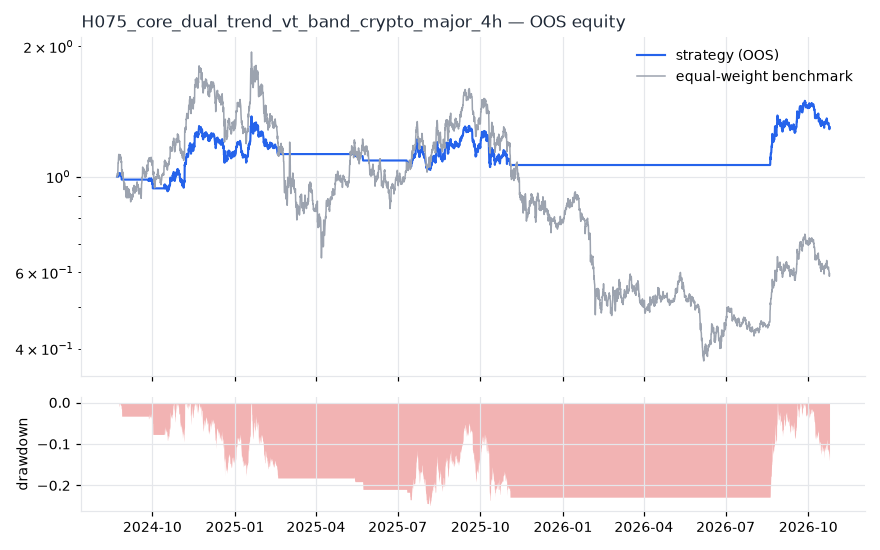
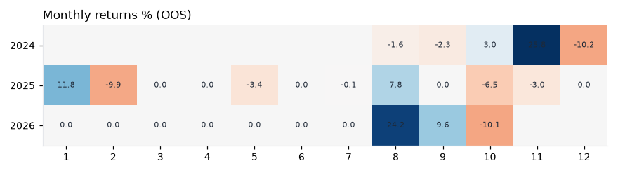

# H075 — core_dual_trend_vt_band on crypto_major [4h]  🟡 WATCH

- Kind: strategy · Source: H052 + 10% no-trade band (pre-registered variant V_band, config/core.yaml)
- For system: `research_only`
- Data: 2020-08-11 04:00:00 → 2026-10-24 16:00:00 · 1 assets · 2191.7 bars/year · survivorship mask: False
- Costs: {'commission': 0.0006, 'slippage': 0.0005, 'funding_annual': 0.08, 'borrow_annual': 0.0}
- Variants tried (DSR trials): 1 (failed: 0)
- Final variant: `core_dual_trend_vt_band|`

## Verdict reasons
- OOS too short (2.17y < 3.0y)
- DSR 0.802 < 0.9 (luck not excluded after 1 trials)
- OOS Sharpe (excess of T-bill) 0.433 < 0.5

## Walk-forward out-of-sample


| Metric | Strategy | Equal-weight benchmark |
|---|---|---|
| years | 2.17 | 2.17 |
| cagr | 0.1287 | -0.212 |
| vol | 0.2788 | 0.7392 |
| sharpe | 0.573 | 0.047 |
| sharpe_excess_rf | 0.433 | None |
| sortino | 0.65 | 0.067 |
| max_dd | -0.2484 | -0.8071 |
| max_dd_bars | 3511 | 3860 |
| calmar | 0.518 | -0.263 |
| ulcer | 0.1786 | 0.5319 |
| var95 | -0.0087 | -0.0244 |
| cvar95 | -0.0147 | -0.0367 |
| omega | 1.057 | 1.003 |
| tail_ratio | 1.028 | 1.009 |
| skew | 1.013 | 0.097 |
| kurtosis | 19.977 | 5.008 |
| hit_rate | 0.195 | 0.498 |
| turnover_ann | 9.63 | None |

- **Gate Sharpe (excess of T-bill): 0.433**
- Deflated Sharpe: **0.802** · PBO: **None** · Reality Check p: **None**
- PSR 0.802 · Info ratio 0.207 · Beta 0.238 · Up/Down capture 0.246/0.233
- Sharpe with 2× costs: 0.535 · Walk-forward efficiency: 0.632
- Bootstrap: {'p_sharpe_pos': 0.855, 'cagr_p05': -0.1242, 'maxdd_p05': -0.4399}
- Yearly OOS Sharpe: {'2024': 1.03, '2025': -0.03, '2026': 1.31}



## Regimes (where does it work?)
`{"bull": {"sharpe": 0.55, "ann_ret": 0.1935, "bars": 2972}, "bear": {"sharpe": 1.95, "ann_ret": 0.1037, "bars": 1787}, "calm": {"sharpe": 0.49, "ann_ret": 0.1587, "bars": 2418}, "stressed": {"sharpe": 0.71, "ann_ret": 0.1609, "bars": 2341}, "vix_lt_20": {"sharpe": 0.45, "ann_ret": 0.1309, "bars": 3679}, "vix_20_30": {"sharpe": 1.23, "ann_ret": 0.2904, "bars": 960}, "vix_ge_30": {"sharpe": 0.0, "ann_ret": 0.0, "bars": 120}}`

## Calendar profile (weekday / month / hour)
`{"weekday": {"0": -0.00024, "1": -0.00017, "2": 0.00041, "3": -6e-05, "4": 0.00018, "5": 7e-05, "6": 0.00033}, "month": {"1": 0.00033, "2": -0.0003, "3": 0.0, "4": 0.0, "5": -9e-05, "6": 0.0, "7": 1e-05, "8": 0.00068, "9": 0.00015, "10": -0.00024, "11": 0.00059, "12": -0.00027}, "hour": {"0": 0.00039, "4": 2e-05, "8": 0.0001, "12": -0.00012, "16": -6e-05, "20": 0.00011}}`

## Robustness
- **delay**: `{"sharpe": 1.103, "sharpe_delayed_1bar": 1.139, "retained": 1.033}`
- **neighbourhood**: `{"neighbours": 0}`
- **noise**: `{"noise_bp": 0.002, "sharpe_min": 1.03, "sharpe_median": 1.068}`

## Timing, take-profit, stop-loss and profit studies (in-sample diagnostics)
- Portfolio overlays (vol target, drawdown brake, equity-curve filter): `{"none": {"sharpe": 0.573, "cagr": 0.1287, "max_dd": -0.2484}, "vol_target_0.1": {"sharpe": 0.907, "cagr": 0.1184, "max_dd": -0.1577}, "vol_target_0.15": {"sharpe": 1.062, "cagr": 0.193, "max_dd": -0.1776}, "vol_target_0.2": {"sharpe": 1.114, "cagr": 0.2568, "max_dd": -0.1947}, "dd_brake_0.1": {"sharpe": 0.498, "cagr": 0.0894, "max_dd": -0.1978}, "dd_brake_0.2": {"sharpe": 0.367, "cagr": 0.0646, "max_dd": -0.2995}, "equity_ma_365": {"sharpe": 0.236, "cagr": 0.0284, "max_dd": -0.2889}, "equity_ma_1095": {"sharpe": -0.374, "cagr": -0.1046, "max_dd": -0.3961}, "best_by_calmar": "vol_target_0.2"}`
> Studies are in-sample diagnostics. To use a better exit, register it (exits: [...]) and let the gate judge it.

## Kasa koruma (kriz testi, teşhis)

Piyasa: **crypto**. Kapsanan krizler: may_2021, luna_2022, ftx_2022, aug_2024, oct_2025. Eşikler ve kabul kuralları `config/protection.yaml` içinde, sonuçlardan önce yazıldı. Bu bölüm stratejiyi DEĞİŞTİRMEZ. Bir kuralı kullanmak için hipoteze `overlays:` olarak ekleyin.

Korumasız (tüm geçmiş): CAGR +33.1%, Sharpe 1.103, maks. düşüş -44.2%, MC P(≤−%50) 0.5%

| Kriz | Getiri | Maks. düşüş |
|---|---|---|
| may_2021 | -3.8% | -13.9% |
| luna_2022 | +0.0% | 0.0% |
| ftx_2022 | +0.0% | 0.0% |
| aug_2024 | -17.5% | -19.2% |
| oct_2025 | -12.5% | -17.3% |

| Kural | Sonuç (tüm eşikler) | Eşik: krizlerde daha iyi · Sharpe · maks. düşüş |
|---|---|---|
| Kasa düşüş sigortası | ❌ geçmedi | (0.08, 0.16): 2/5 · 0.889 · -40% / (0.1, 0.2): 2/5 · 0.751 · -44% / (0.12, 0.25): 2/5 · 0.953 · -35% |
| Volatilite hedefi | ❌ geçmedi | 0.25: 3/5 · 0.961 · -38% / 0.35: 2/5 · 0.966 · -44% / 0.5: 1/5 · 1.081 · -44% |
| Kasa eğrisi filtresi | ❌ geçmedi | 30: 2/5 · 1.279 · -33% / 60: 2/5 · 1.071 · -37% / 90: 2/5 · 1.134 · -29% |
| Günlük kayıp limiti | ❌ geçmedi | 0.04: 2/5 · 1.008 · -45% / 0.05: 1/5 · 1.052 · -45% / 0.07: 0/5 · 1.103 · -44% |
| Piyasa çöküş bekçisi | ❌ geçmedi | 0.08: 1/5 · 0.794 · -46% / 0.1: 0/5 · 0.91 · -44% / 0.15: 0/5 · 1.096 · -45% |

## Walk-forward windows
- 2024-08-22 16:00:00 → 2025-02-21 00:00:00: IS 0.937 / OOS 0.812 — `core_dual_trend_vt_band|`
- 2025-02-21 04:00:00 → 2025-08-22 12:00:00: IS 0.835 / OOS 0.288 — `core_dual_trend_vt_band|`
- 2025-08-22 16:00:00 → 2026-02-21 00:00:00: IS 0.833 / OOS -0.445 — `core_dual_trend_vt_band|`
- 2026-02-21 04:00:00 → 2026-08-22 12:00:00: IS 0.755 / OOS 2.531 — `core_dual_trend_vt_band|`
- 2026-08-22 16:00:00 → 2026-10-24 16:00:00: IS 1.171 / OOS 1.239 — `core_dual_trend_vt_band|`

## Best variants (full sample, reference only)
- core_dual_trend_vt_band|: Sharpe 1.053

## Current targets / signals
```json
{
 "SOL/USDT": 0.7865
}
```

> Survivorship bias: unless a membership mask is used, universes are today's members (upper-bound results).